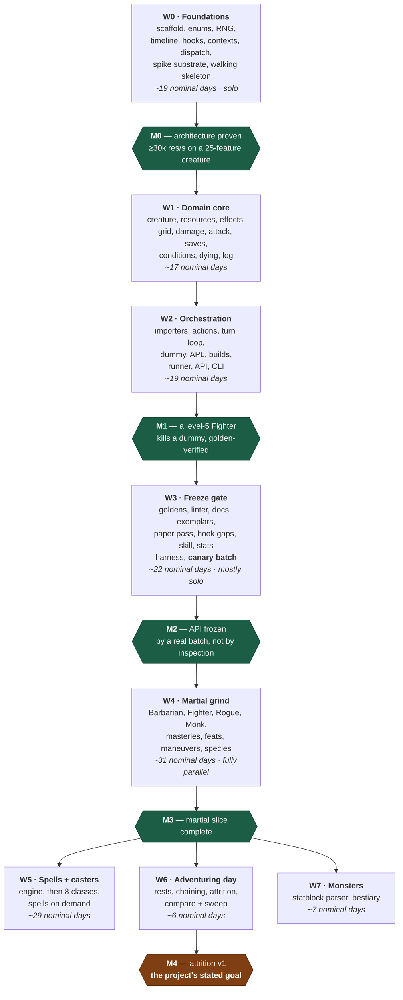

# Roadmap & Delegation Plan

Companion to [DESIGN.md](DESIGN.md). This document sequences the build so that
**decisions with the widest blast radius are made first**, and every interface a
later agent depends on exists — in code, not prose — before that agent starts.

60 tasks across 8 waves, `W0`–`W7`. DESIGN.md § Build order is the one-table
summary; this is the operational detail.

## Sequencing principles

1. **Vocabulary before everything.** `rules/enums.py` and the hook registry are
   imported by all ~630 content implementations. A rename after the grind begins
   is a mass edit; a rename in W0 is free.
2. **Interfaces are code, not documents.** A wave is only "done" when its public
   types exist and are importable, so the next wave's agents can write against a
   real signature instead of a description of one.
3. **Prove the expensive constraint against a hostile case.** The performance
   budget is validated in W0 on a creature with ~25 attached features, an
   8-condition APL and real movement — never on a stub. A stub clears the budget
   trivially and proves only that the harness runs, which spends the one
   milestone whose whole purpose is to make revision cheap. That is why `w0g2`
   pulls a first cut of the creature, the damage pipeline and the grid into W0:
   a spike cannot be hostile against machinery that does not exist yet.
4. **The paper pass gates the grind.** All ~400 combat-relevant features are
   classified to a hook *before* any batch authoring starts. This is what
   prevents hook drift, and it is cheap only if it happens before the API is
   frozen.
5. **Nothing is frozen until an outsider has used it.** M2 is not reached by
   inspecting three hand-built exemplars; it is reached when a canary batch —
   one small, semi-disposable slice authored by an agent that has never seen the
   API — comes back needing no correction. A wrong API found in the sixth
   parallel batch costs six times a wrong API found in the first.
6. **Serialise the risky, parallelise the repetitive.** W0 and W3 are
   single-owner; W1–W2 are delegable but tightly sequenced. W4 onward fans out to
   many agents with near-zero coordination cost, because by then the contract is
   fixed and the work is mechanical.
7. **The reviewer is the bottleneck, not the agents.** Roughly 150 nominal
   agent-days funnel through one person, so every deliverable is designed to be
   *reviewable in minutes* — disposition tables, quoted citations, arithmetic
   written out in goldens, a hard file-size cap. Batches are sized for a review
   sitting (15–25 features), not for agent capacity. A batch nobody has the
   attention left to check is worth less than half the batch, checked.

## Delegation modes

| Mode | Meaning |
|---|---|
| 🔒 **Solo** | One owner, serial. High blast radius or cross-cutting; splitting it costs more than it saves. |
| 👥 **Delegable** | One agent, self-contained, clear inputs and outputs. Safe to hand off with a task packet. |
| 🚀 **Batch** | Many agents in parallel on disjoint files, following the authoring skill. Coordination cost ≈ 0. |

---

## Wave dependencies

The per-wave tables below carry the complete edge list in their **Depends**
columns; this is the shape those edges make. There are deliberately no dates:
effort is quoted in **nominal days** — one focused agent-session's worth of work
— and a nominal day is not a calendar day, so a chart with an axis of calendar
dates reads as wrong within a week and gets discounted along with everything
else on it.



**Nothing in W4 or later may start before M2**, and that is the single most
important scheduling constraint in the project. Once M3 lands, three branches run
independently: **W6 depends only on W4, not on W5**, so attrition against target
dummies — the v1 goal — is reachable with martials alone and does not wait for
casters. W7 likewise forks from W4. Given enough agents, W5, W6 and W7 proceed
concurrently.

### The critical path

`enums → hook registry → contexts → dispatch → spike substrate → walking
skeleton → perf spike → damage → attack → turn loop → APL → exemplars → paper
pass → hook gaps → authoring skill → canary batch → the grind → spell engine`

Everything on it is a decision that is expensive to revisit later; everything off
it can slip without blocking anyone. Three entries were added to the chain
after review. Two are the points at which a milestone stops being
self-certified; the third is what makes the first of them measurable at all:

- **The walking skeleton** (inside `w0h`) puts a featureless creature through the
  real dispatch path and real damage pipeline before resources, effects or
  conditions exist. Without it, 25 tasks complete before anything runs end to
  end, and integration bugs surface at the most expensive possible moment.
- **The canary batch** (`w3j`) is the outsider that turns M2 from an assertion
  into a measurement.
- **The spike substrate** (`w0g2`) is the price of the first: a walking skeleton
  needs a creature and a damage pipeline, and a hostile spike needs a grid. First
  cuts of `creatures/`, `engine/damage.py` and `core/geometry.py` therefore move
  into W0, and `w1a` / `w1d` / `w1e` complete those files rather than creating
  them. The alternative — writing the damage order twice — breaks the one rule
  the design leans on hardest.
- **The movement observer** (`w0g3`) is the same argument one step further on.
  A grid the spike walks but that fires no triggers is a stub of the most
  flattering kind — the distance queries are paid for and the provocation they
  exist to produce costs nothing — so the audience half of `engine/triggers.py`
  moves into W0 alongside the substrate it measures against, and `w2c` completes
  it. What did **not** move is the opportunity attack itself: it is a Command
  and Commands are `w2b`'s, which is the same boundary DESIGN.md § Module layout
  draws between `actions/` and `engine/triggers.py`.

---

## W0 — Foundations 🔒

One owner throughout. This wave decides the shape of every line of code written
afterwards.

| ID | Task | Mode | Depends | Produces (the interface) | Done when |
|---|---|---|---|---|---|
| w0a | Repo scaffold: `pyproject.toml`, ruff, mypy, pytest layout, `.gitignore` (`data/`), GitHub Actions | 🔒 | — | package importable, CI green | `uv sync` + `uv run pytest` pass on an empty suite |
| w0b | **Rules vocabulary**: `Ability`, `DamageType`, `Condition`, `Mastery`, `WeaponProperty`, `Size`, `School`, `Outcome`, PB table, slot table | 🔒 | w0a | `rules/enums.py`, `rules/constants.py` | every 2024 damage type, condition and mastery present; no string literals anywhere downstream |
| w0c | RNG protocol + `PcgRng` + `ScriptedRng`; dice tokeniser; **per-iteration seeding** `mix(master_seed, iteration_index)` | 🔒 | w0a | `core/rng.py`, `core/dice.py` | same seed ⇒ identical stream; `ScriptedRng` raises on over-draw; **a run reproduces byte-for-byte across different `--jobs` values** |
| w0d | Timeline: `TimeKey`, `TurnPhase`, `InitiativeKey` + the tie-break rule, `Duration` + named constructors, `ResetManager`, `Reset` scopes | 🔒 | w0b | `core/timeline.py` | `TURN` vs `OWN_TURN` semantics covered by tests; `through_phase` proven in both directions; **a creature entering or leaving the order moves nobody else and invalidates no resolved `Expiry`** — initiative is a key, never a seat index |
| w0e | **Hook registry**: `Scope`, `Phase`, `HookSpec`, `define_hook`, and the 39 `define_hook()` calls — including `on_heal`, `on_temp_hp_gained`, `on_death_save`, `on_stabilize`, `on_initiative_roll` | 🔒 | w0b | `hooks/registry.py`, `hooks/definitions.py` | unknown hook name raises; the registry is closed and complete for W1–W3, and the CI **freeze** guard is enabled by `w3f` after the paper pass, not here; the healing and initiative hooks exist **before** W6 and W4 need them |
| w0f | **Contexts**: every `*Context` Parameter Object, attribute-locked, mutator methods only | 🔒 | w0e | `hooks/contexts.py` | direct field assignment raises `AttributeError`; wrong-phase mutation raises `PhaseError` |
| w0g | `@hook` decorator, `HookResult`, `HookSource.__init_subclass__` validation, `Dispatcher` | 🔒 | w0f | `hooks/decorator.py`, `source.py`, `dispatch.py`, `core/errors.py` | bad signature is an `ImportError`; `once_per`/`costs` consumed only on `APPLIED` |
| w0g2 | **Spike substrate**: minimal `Creature` / `StatBlock` and one weapon, first cut of `engine/damage.py` (the full resolution order, no effects yet) and of `core/geometry.py` (5 ft distance, reach, shortest-legal-route) | 🔒 | w0g | `creatures/creature.py`, `stats.py`, `engine/damage.py`, `core/geometry.py` | `w0h` and `w0i` run against real damage and real distance queries rather than stubs. `w1a` / `w1d` / `w1e` **complete** these files; the damage order is never written twice |
| w0h | **Walking skeleton**: a featureless creature attacking another through the *real* dispatch path and *real* damage pipeline, printing a result | 🔒 | w0g2 | `tests/bench/`, `tools/skeleton.py` | one command runs a fight end to end, before resources, effects or conditions exist |
| w0i | **Pessimistic performance spike**: synthetic creature with ~25 attached `HookSource`s (≥15 on `on_hit`), an 8-condition APL with `target:` and `move:` **hand-compiled to callables over the namespace-proxy shape `w2e` will emit**, real grid movement; worker-startup cost measured separately | 🔒 | w0g2, w0h | `tests/bench/` | **≥30k attack resolutions/sec/core on that configuration** — revised down from 50k by the spike itself at M0 (`docs/decisions.md` § w0i), which is what a stop-and-revise gate looks like when it fires. `w2e` re-runs this benchmark when the real compiler lands and must come in at or under the same number |
| w0g3 | **Movement observer**: first cut of `engine/triggers.py` — the audience for a move, the per-five-foot-step `on_leave_reach` offer, initiative ordering, and `Dispatcher.responsive()`; the opportunity-attack trigger without the opportunity attack | 🔒 | w0g2, w0i | `engine/triggers.py`, `hooks/dispatch.py` | a move is walked square by square and the offer is made **from the square being left**, with the mover still standing on it; the audience is filtered only by things that cannot change the answer, so a room of twenty combatants none of whom own a movement reaction costs twenty dict lookups and no dispatches — counted by `tests/contract/test_triggers.py`, never timed. `w2c` **completes** this file with the turn loop, the `opportunity_attack` Command and the effect drain |

> **M0 — Architecture proven.** If w0i misses the budget, stop and revise before
> W1. This is the cheapest moment in the project to change the dispatch design.
>
> **This fired.** The spike came in at 17k against the 50k the design had
> assumed; a revision pass across the hot path took it to ~31.5k, a floor
> calculation showed 50k was unreachable without giving up the authoring
> guarantees, and the budget was revised to 30k with the reasoning recorded in
> `docs/decisions.md` § w0i. Two levers were taken there that later waves
> inherit: `reopen()` is compiled per context class, and the production
> generator is now `MersenneRng` rather than `PcgRng`.
>
> The spike is deliberately hostile. A stub creature clears any budget trivially
> and proves only that the benchmark harness runs — which would spend the one
> milestone whose entire purpose is to make revision cheap. Measure `spawn`
> worker startup too: on Windows every worker re-imports the package and rebuilds
> every character, a cost `compare --sweep dummy.ac=10:22` pays thirteen times
> and an inner-loop benchmark never sees.
>
> It is only hostile if the machinery it stresses is real, which is what `w0g2`
> buys. The one stand-in left is the APL compiler: the eight conditions, the
> `target:` selector and the `move:` clause are hand-written callables over the
> same proxy shape `w2e` will compile to, and `w2e` re-runs `dndsim bench` to
> prove the real compiler is no slower. A stand-in that a later task has to beat
> is a budget; a stand-in nobody re-measures is a stub.

## W1 — Domain core 👥

Interfaces from W0 are fixed, so these run largely in parallel. `w1e`/`w1f` stay
with the architect — they encode the two resolution orders everything else
trusts. `w1a`, `w1d` and `w1e` **complete** files `w0g2` already created; none of
the three is greenfield, and none of them may restate the damage order.

| ID | Task | Mode | Depends | Produces | Done when |
|---|---|---|---|---|---|
| w1a | `Creature` and `StatBlock` completed from `w0g2`, derived stats, **AC derivation** over an `Armour` value object (armour + DEX cap + shield + the Unarmored Defense variants), `ActionEconomy` (action/bonus/reaction/movement, grants) | 👥 | w0g2 | `creatures/creature.py`, `stats.py`, `economy.py` | Action Surge's "grant another action" works via the economy alone; AC is **derived from equipment**, never a literal in the build YAML |
| w1b | `ResourceSpec`, `Recovery`, `ResourcePool`, `SpellSlots` facade, `transaction()` unit of work | 👥 | w0g | `creatures/resources.py` | all 7 resource shapes in DESIGN.md expressible; rollback proven |
| w1c | `Effect`, `EffectStore`, `Stacking`, charge consumption, refresh/expire | 👥 | w0d | `creatures/effects.py` | Rage extend, Vex charge+time, Reckless hard stop all pass |
| w1d | Grid geometry completed from `w0g2`: LoS, cone/sphere/line templates, and the full **shortest-legal-route resolution** for a movement destination | 👥 | w0g2 | `core/geometry.py` | Fireball's 20 ft sphere selects the correct cells; a `move:` destination resolves to a route that provokes correctly on the way out of reach |
| w1e | **Damage resolution order** completed from `w0g2` — immunity → vulnerability → resistance → flat → halvings → temp HP → HP, with the ruling for each non-quoted step cited inline | 🔒 | w0g2 | `engine/damage.py` | Rage + Uncanny Dodge + vulnerability produces the hand-computed number |
| w1f | **Attack pipeline** — declare → roll → adv/disadv resolution → hit/crit/miss → damage → resolved | 🔒 | w1e | `engine/attack.py` | crit doubles `dice` and never `flat`; advantage is idempotent |
| w1g | Saving throws, DC calculation, save-for-half | 👥 | w1f | `engine/saves.py` | legendary resistance expressible |
| w1h | The 15 combat-relevant conditions as `Effect` subclasses | 👥 | w1c | `conditions/` | no `if creature.is_prone` anywhere in the engine |
| w1i | Structured event log (tuples; formatting deferred to the reporter) | 👥 | w0d | `core/log.py` | `--log-level=summary` skips per-roll records |
| w1j | **Dying**: 0 HP, death saves, stabilise, healing application and temp HP, firing `on_death_save` / `on_stabilize` / `on_heal` / `on_temp_hp_gained` | 👥 | w1e | `engine/dying.py`, `engine/healing.py` | a downed PC rolls death saves; a heal at 0 HP restores consciousness; Relentless Endurance is expressible with no engine change |

## W2 — Orchestration 👥

| ID | Task | Mode | Depends | Produces | Done when |
|---|---|---|---|---|---|
| w2a | **Content ACL**: fetch script **pinning the upstream 5etools commit as the content version**, 5etools loader, `refSubclassFeature`/`refOptionalfeature` resolution, `classTableGroups` → `table_value()`, weapon + **armour** + mastery + **species** import | 👥 | w0b | `content/` | 38 XPHB weapons, every armour and shield entry, `species.json`, and every class table import; `content fetch` records the commit SHA that every `SimResult` cites; no 5etools vocabulary escapes this package |
| w2b | `Action` Command base (`is_legal`/`execute`), Attack, Dash, Dodge, Disengage | 👥 | w1f | `actions/` | legality query provably cannot spend a resource |
| w2c | Initiative, turn loop, round loop, trigger audience, **reaction regained at the start of each of your turns**, opportunity attacks, movement offers, `on_initiative_roll` | 🔒 | w2b | `engine/turn.py`, `encounter.py`, `triggers.py`, `world.py`, `query.py`, `actions/opportunity_attack.py` | **completes `w0g3`'s `engine/triggers.py`** rather than rewriting it: the movement audience, the per-step offer and the initiative ordering are already there, and what this task owes them is the `opportunity_attack` Command, the `ctx.pending_effects` drain the first cut raises on, the Disengage / forced-movement / teleport valve wired to the Commands and conditions that set it, and a stop on a speed reduced to zero. Re-runs `w0i`'s benchmark on a configuration where the offers actually fire and must come in at or under its number. turn loop re-polls after every action; a creature may react before its turn and again after it in the same round — the invariant is on the **turn** boundary, never the round. Owns the roster and the `InitiativeKey` for each combatant: `tiebreak` is **one independent uniform draw per creature**, `(rng.roll(2**32) - 1) / 2**32` (never a shuffle of the entrants — it has no honest place for a latecomer), a joiner mid-encounter draws its own without touching anyone else's, and a creature leaving is dropped from the roster with its key left alone |
| w2d | `TargetDummy` with every knob from DESIGN.md, including `movement_profile` (`static` / `closes_to_melee` / `kites_at`) | 👥 | w1a | `creatures/dummy.py` | AC sweep 10–22 configurable from YAML; a dummy that closes to melee provokes and is provoked, so the grid is exercised rather than decorative |
| w2e | **APL**: AST whitelist compiler, `NamespaceSchema`, proxies, `Apl.allows()`, default policy, and **all three clauses** — `if:`, `target:` (selector expressions), `move:` (positioning) | 🔒 | w2b, w2c | `apl/` | `self.ragging` fails at load with a suggestion; unmentioned riders and reactions default OFF, **movement being the one exception** — a build with no `move:` clause closes to its nearest enemy; `target: "lowest_hp of enemies.in_reach"` and `move: "toward nearest of enemies until in_reach"` compile through the same whitelist. **Reactions are entries like any other** — one flat list, not a second one: `{ action: opportunity_attack, if: "..." }` is answered through `Apl.allows()` at the moment `engine/triggers.py` makes the offer, the `trigger.*` root carries the mover and the square being left, and an entry nobody wrote is OFF, so a build that never swings at runners is a build that said so. **All three clauses ship together** — adding a clause after builds exist is a schema migration across every YAML file in git. `dndsim bench` on `w0i`'s configuration comes in at or under `w0i`'s number |
| w2f | Build YAML pydantic schema — class + level, **species, background, ASI/feat choices, fighting style, equipment (weapons, armour, shield)**, `apl:`, and party `retreat_when` — plus the `Character` Builder | 👥 | w2a, w2e | `builds/`, `creatures/character.py` | unknown feature id fails with difflib suggestions; every choice a single-classed level 1–12 character makes is expressible, and AC falls out of the equipment |
| w2g | Monte Carlo runner, multiprocessing, stats, CIs; **`SimResult` + its JSON schema**; text/json renderers; the public API | 👥 | w2c, w2d, w2f | `sim/`, `reporting/`, `api.py` | identical seed ⇒ byte-identical event log **at any `--jobs`**, because worker records are merged in **iteration order, never completion order**; text output derived from the JSON, not parallel to it |
| w2h | Typer CLI as a **thin adapter** over `api.py`: `sim`, `day`, `compare`, `inspect`, `validate`, `trace`, `check`, `content fetch`, `bench` | 👥 | w2g, w2a, w2f | `cli.py` | every command in DESIGN.md § Verification runs; no simulation logic lives in `cli.py` |

> **M1 — A level-5 Fighter with a greatsword kills a dummy**, and every number is
> reproduced by a hand-computed golden test.

## W3 — Freeze gate 🔒

The highest-leverage wave in the project. Skipping or rushing it is how the grind
produces 400 subtly wrong features.

One task changed shape after review and two are new. **`w3e` is batched rather
than solo**: 400
prose features classified by hand, alone, is the most tedious task in the plan
sitting directly on the crux, and it degrades quietly because nothing downstream
detects a sloppy classification until features are written against it. Batching
the rows and triaging only the low-confidence and gap buckets costs a fraction of
the attention and spends it where it decides something. **`w3j` and `w3l` are
new**: `w3j` because M2 has to be measured rather than asserted (see M2), and
`w3l` because the statistical harness — the only oracle in the project an author
cannot fake — had no task producing it.

| ID | Task | Mode | Depends | Produces | Done when |
|---|---|---|---|---|---|
| w3a | Golden harness, `scripted_rng` fixture, `parts_by_source` assertions | 👥 | w2c | `tests/golden/conftest.py` | exact-integer assertions, no distributions |
| w3b | Feature linter + no-op detector + golden-coverage collection test, wired to `dndsim check` and to **every batch PR** | 👥 | w3a | `tools/check_features.py`, `noop_report.py` | catches missing `# PHASE:`, private access, stray `import random`, `try`/`except` or `hasattr` in `features/`, a feature file over 60 lines, a `source_ref` without a quoted rules sentence, a `dndsim` import inside an analytic expectation, and any write outside a packet's file allowlist |
| w3c | Generate `docs/hooks.md` and `docs/apl.md` from the registries | 👥 | w0e, w2e | `tools/gen_docs.py` | CI fails if generated docs are stale |
| w3d | **Reference exemplars**: Rage, Sneak Attack, Uncanny Dodge, hand-built | 🔒 | w2e | `features/base.py`, `params.py`, `TEMPLATE.py`, the three exemplars | all three pass goldens; they become the skill's examples |
| w3e | **Paper pass**: classify all ~400 combat-relevant features to a hook. **Batched against a fixed row schema**, then human-triaged | 🚀 → 🔒 | w3d | `docs/feature-hook-map.md` | every feature has a row: `feature_id \| hook \| scope \| phase \| resource \| once_per \| confidence \| gap_kind`. Gaps are classified **additive** (a new hook) or **structural** (a missing context field, or a hook firing at the wrong pipeline point) |
| w3f | **Hook gap resolution**: add the hooks the paper pass proved missing; fix the structural ones | 🔒 | w3e | `hooks/definitions.py` (final) | registry frozen; CI guard enabled. **Budget against the structural count, not the total** — additive gaps are an append, structural gaps touch `hooks/contexts.py` and `engine/` |
| w3g | `.claude/skills/feature-authoring/SKILL.md` (≤3 pages) | 🔒 | w3f | the skill | a fresh agent implements a held-out feature correctly from it alone |
| w3h | Interaction matrix v1 (~50 hand-computed combos) | 🔒 | w3d | `tests/interaction/` | crit+rider, resistance+halving, chained attacks covered |
| w3i | CI benchmark gate: median-of-N with warmup, against a same-run microbenchmark baseline | 👥 | w0i, w2h | CI config | a deliberate slowdown fails CI **and a rerun on unchanged code does not**. Tracked-but-non-blocking until its variance is known |
| w3j | **The canary batch**: Rogue core + Thief only, authored by one agent from the skill alone, treated as semi-disposable | 🚀 | w3g | `features/classes/rogue/`, an API-friction report | the batch lands needing no correction — or the API is revised and the batch is rewritten |
| w3k | **Reviewer-pass harness**: a read-only review prompt that sees the quoted rules text and the code but not the author's reasoning, and that **re-derives each golden's expected number from the rules text alone** before comparing it with the author's | 👥 | w3d | `.claude/skills/feature-review/` | run against w3j; it finds at least one real discrepancy or is judged useless and cut |
| w3l | **Statistical harness**: the `expectation` declaration on features, 200k-attack comparison, Wilson intervals for rates and Student-t for means, wired to **every batch PR**; plus the invariant property tests (damage never negative, HP conservation, one reaction per turn, effect count back to baseline after an encounter) | 👥 | w3a, w3b | `tests/statistical/` | a feature whose implementation is 10% off its declared expectation fails the batch; an `expectation` that imports `dndsim` is a linter error, not a review comment |

> **M2 — API frozen.** W4 may not begin before this milestone.
>
> The freeze is **measured by w3j, not asserted by w3d**. Three hand-built
> exemplars prove the exemplars compile; they prove nothing about an author who
> has never seen the API. The canary is one small self-contained slice — the
> smallest in the project — written by an outsider against the frozen contract,
> and its job is to be wrong cheaply. Every friction it reports is a friction six
> parallel batches would otherwise have hit simultaneously, at six times the
> rework.
>
> Arcane Trickster sits inside this slice, which makes w3j the natural place to
> settle the Eldritch Knight / Arcane Trickster spellcasting question below rather
> than discovering it when W4 starts.

## W4 — The martial grind 🚀

Fully parallel, and only now — the canary batch `w3j` has already run one slice
through the frozen API and the frictions it found are fixed. Each batch touches
disjoint files; the only shared surface is the frozen API. Every row is sized for
one review sitting (15–25 features); split further by subclass if you want more
agents, never merge rows to get fewer.

| ID | Task | Mode | Depends | Scope |
|---|---|---|---|---|
| w4a | Weapon masteries | 🚀 | w3j | Cleave, Graze, Nick, Push, Sap, Slow, Topple, Vex |
| w4b | Fighting styles + martial feats | 🚀 | w3j | Archery, Defense, Dueling, GWF, + GWM, Sharpshooter, Crossbow Expert, Dual Wielder, Charger, Grappler… |
| w4b2 | **General combat feats** | 🚀 | w3j | the combat-relevant remainder of the 77 XPHB feats that is not martial-weapon-shaped — Alert, Lucky, Tough, Savage Attacker, Resilient, Sentinel, Polearm Master, Shield Master, Defensive Duelist, Mage Slayer, War Caster, Heavy Armor Master, Inspiring Leader, Healer, Skulker, Elemental Adept, Fey-Touched, Telekinetic… Origin feats need `w2f`'s `background` field, and Alert needs `on_initiative_roll` |
| w4c | Barbarian 1–12 | 🚀 | w3j | core + Berserker, Wild Heart, World Tree, Zealot |
| w4d | Fighter 1–12 | 🚀 | w3j | core + Champion, Eldritch Knight, Psi Warrior. **Battle Master is not in this row at all** — subclass features included, see `w4d2` |
| w4d2 | **Battle Master** | 🚀 | w3j | the whole subclass — Combat Superiority, Student of War, Know Your Enemy, Improved Combat Superiority, Relentless — **and** its 20 maneuvers. Split out of `w4d` because it is a sub-project, not a subclass: one resource, one rider shape, its own save DC — which also makes it an unusually clean batch on its own. Splitting the maneuvers from the features that grant and refresh them is how a subclass ends up owned by nobody |
| w4e | Rogue 1–12 — *remainder after the canary* | 🚀 | w3j | Arcane Trickster, Assassin, Soulknife (core + Thief already landed in `w3j`) |
| w4f | Monk 1–12 | 🚀 | w3j | core + Mercy, Shadow, Elements, Open Hand |
| w4h | **Species traits** | 🚀 | w3j | the ~18 combat-relevant 2024 traits — Relentless Endurance, Breath Weapon, Savage Attacks, Large Form… — landing in `features/species/`, off `w2a`'s `species.json` import |
| w4g | Slice integration, `NEEDS_HOOK` / `APPROXIMATED` triage, no-op sweep, **API freeze review** | 🔒 | w4a–w4f, w4b2, w4d2, w4h | every disposition row is resolved: implemented, hook queued, or approximation accepted in writing |

Eldritch Knight and Arcane Trickster need minimal spellcasting: either stub their
spell list behind `NEEDS_HOOK` or pull `w5a` forward for those two. **This is
settled during `w3j`**, not when W4 starts — Arcane Trickster sits inside the
canary slice, so the canary learns which option is cheaper at the moment that
information is still free.

## W5 — Spell engine + casters 🚀

| ID | Task | Mode | Depends | Scope |
|---|---|---|---|---|
| w5a | **Spell engine**: `Spell(Action)`, concentration + checks, slots/upcasting, AoE templates, save-for-half | 🔒 | w4g | the last high-blast-radius design decision |
| w5b | Paladin + Ranger | 🚀 | w5a | half-casters, martial-adjacent — the cheapest validation of w5a |
| w5c | Cleric + Druid | 🚀 | w5b | |
| w5d | Bard + Sorcerer | 🚀 | w5b | + 10 metamagic |
| w5e | Warlock + Wizard | 🚀 | w5b | + 28 invocations |
| w5f | Spell implementations, on demand | 🚀 | w5a | 212 combat spells, levels 0–6, pulled as the classes above need them |

## W6 — Adventuring day 👥

Depends on W4 only — reachable with martials and target dummies, before any
caster exists.

| ID | Task | Mode | Depends | Scope |
|---|---|---|---|---|
| w6a | Short/long rests, hit dice, encounter chaining, the **stop condition** (TPK or `party.retreat_when`), attrition metrics | 👥 | w4g, w1j | `engine/adventuring_day.py` — the v1 headline output |
| w6b | `compare` harness, `--sweep`, adaptive stopping on CI width | 👥 | w6a | `sim/compare.py`, `sweep.py` — what makes it a sim rather than a calculator |

> **M4 — Attrition v1.** `dndsim day` reports how far a party gets before
> resources run dry, with confidence intervals. This is the project's stated
> goal; W5 and W7 are content expansion beyond it.
>
> Note the dependency on `w1j`. The headline number is decided as much by the
> dying rules and the retreat threshold as by any damage calculation — see
> DESIGN.md § Context for the settled stop condition. `retreat_when` is a party
> YAML knob precisely so that `--sweep` over it is an experiment rather than an
> assumption buried in the engine.

## W7 — Monsters 👥

| ID | Task | Mode | Depends | Scope |
|---|---|---|---|---|
| w7a | Statblock parser (Visitor) over the closed tag vocabulary + `.claude/skills/statblock-import/` | 👥 | w4g | `{@atkr}`, `{@hit}`, `{@h}`, `{@damage}`, `{@actSave}`, `{@dc}`, `{@recharge}` |
| w7b | Bestiary import, Multiattack handling, unparsed-content report | 🚀 | w7a | 503 XMM stat blocks; unparseable content is flagged, never approximated |

---

## Task packet template

What a delegated agent receives. Anything missing here is a coordination cost
paid at review time instead.

```markdown
## Task <id>: <title>
**Wave:** W<n>   **Mode:** 🚀 Batch   **Blocked by:** <ids, all merged>

### Read first
- .claude/skills/feature-authoring/SKILL.md
- docs/hooks.md and docs/apl.md (generated — the authoritative surface)
- Exemplars: features/classes/barbarian/rage.py, .../rogue/sneak_attack.py
- Seed feature from THIS batch, already implemented: <path>

NOT DESIGN.md. It is a document for the architect; prose-heavy architecture in a
batch context window produces features consistent with the vibe and wrong about
the rule.

### Scope
Implement exactly: <explicit list of 15-25 feature ids>
Source data: data/class/class-<x>.json, entries with source == "XPHB"
Hook assignment: see docs/feature-hook-map.md rows <n–m>
Files you may write: <explicit allowlist> — CI rejects anything else

### Out of scope
Anything under hooks/, engine/, core/, or outside the allowlist above.
Multiclassing and magic items are out of v1 scope entirely.

### When a feature does not fit
Two markers, both of which are successes:
- NEEDS_HOOK = "on_X: <description>"    cannot be expressed at all
- APPROXIMATED = "<what is lost, why>"  expressible only approximately

In a batch of 20, expect 2-5 of these. **A batch reporting zero will be
spot-audited**, because the failure mode this project is most exposed to is a
feature that is expressible-but-lossy landing silently as "implemented".

### Definition of done
- [ ] every feature registered with a `source_ref` carrying the QUOTED rules
      sentence, not just a page citation
- [ ] scaling numbers read via `table_value()`, never hardcoded
- [ ] one golden test per feature, with the expected number written out as
      arithmetic in a comment, derived from the rules text and not from your
      implementation. You write it; the reviewer pass re-derives the number from
      your quoted `source_ref` alone, so a figure back-read from your own code is
      caught there
- [ ] an `expectation` declared per feature as a literal or a closed-form
      expression of declared inputs (AC, ability modifier, proficiency bonus,
      level) — importing `dndsim` inside one is a linter error
- [ ] every feature file under 60 lines
- [ ] `dndsim check` clean
- [ ] no feature reported by the no-op detector
- [ ] `pytest` green

### Report back
- [ ] **Disposition table**: one row per feature id —
      implemented | needs_hook | approximated — with the reason for the last two
- [ ] `dndsim bench` delta
- [ ] no-op report output
```

The disposition table is the artefact that actually gets reviewed. Everything
else in the checklist is enforced by CI; the table is where a human decides
whether the batch is honest.

## Standing rules for every agent

1. **Never touch `hooks/`, `engine/` or `core/`** in a content batch, or any file
   outside your packet's allowlist. CI enforces it. A needed change there goes
   back to the architect.
2. **Both escape valves are successes.** `NEEDS_HOOK` when a feature cannot be
   expressed; `APPROXIMATED` when it can be expressed only lossily.
   Blocked-and-visible beats improvised-and-wrong, and lossy-and-declared beats
   lossy-and-silent. A batch that flags six features is more useful than one that
   silently approximates them — and a batch that flags none is the one that gets
   audited.
3. **Never hardcode a scaling number.** It comes from `table_value()`.
4. **Never skip a golden test, and write the arithmetic out.** The collection
   test fails the build anyway; the comment is what makes the number reviewable
   without re-deriving it. You write the golden and a separate read-only agent
   re-derives its number from your quoted `source_ref` (`w3k`) — which only works
   if the arithmetic is there to disagree with.
5. **`source_ref` quotes the rules sentence.** A page citation alone is a linter
   error. It is what lets a reviewer check the feature without opening the book.
6. **`dice` doubles on crits, `flat` does not.** `Reset.TURN` is any turn
   boundary; `Reset.OWN_TURN` is yours. These two are the likeliest subtle bugs in
   the entire project.
7. **No `try`/`except`, no `hasattr`/`getattr`, no `isinstance` chain on a domain
   object, no file over 60 lines.** Defensive blocks swallow the fail-loud design,
   attribute probing and type-switching route around the typed contract, and a
   feature needing more than 60 lines is a design smell that goes back to the
   architect rather than getting written. (`isinstance` in a mypy narrowing
   position is fine; branching on what kind of creature or effect something is
   is not.)
8. **Never add a dependency, and never write test harness code.** Test cases
   against the existing fixture only — otherwise there are six competing
   `conftest.py` helpers by the end of W4.
9. **Declare an `expectation`, and never compute it from the engine.** A literal
   or a closed-form expression of AC, ability modifier, proficiency bonus and
   level. An expectation that calls `dndsim` agrees with the implementation by
   construction and tests nothing — it is the one check in the project an author
   cannot fake, and that property only survives if the linter defends it.
