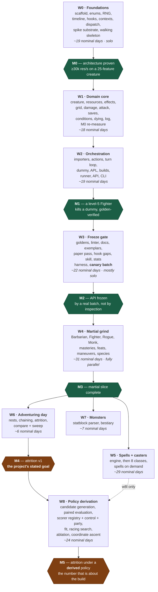

# Roadmap & Delegation Plan

Companion to [DESIGN.md](DESIGN.md). This document sequences the build so that
**decisions with the widest blast radius are made first**, and every interface a
later agent depends on exists — in code, not prose — before that agent starts.

77 tasks across 9 waves, `W0`–`W8`. DESIGN.md § Build order is the one-table
summary; this is the operational detail.

## Sequencing principles

1. **Vocabulary before everything.** `rules/enums.py` and the hook registry are
   imported by all ~630 content implementations. A rename after the grind begins
   is a mass edit; a rename in W0 is free.
2. **Interfaces are code, not documents.** A wave is only "done" when its public
   types exist and are importable, so the next wave's agents can write against a
   real signature instead of a description of one.
3. **Prove the expensive constraint against a hostile case.** The performance
   budget is validated in W0 on a creature with ~25 attached features, an
   8-condition APL and real movement — never on a stub. A stub clears the budget
   trivially and proves only that the harness runs, which spends the one
   milestone whose whole purpose is to make revision cheap. That is why `w0g2`
   pulls a first cut of the creature, the damage pipeline and the grid into W0:
   a spike cannot be hostile against machinery that does not exist yet.
4. **The paper pass gates the grind.** All ~400 combat-relevant features are
   classified to a hook *before* any batch authoring starts. This is what
   prevents hook drift, and it is cheap only if it happens before the API is
   frozen.
5. **Nothing is frozen until an outsider has used it.** M2 is not reached by
   inspecting three hand-built exemplars; it is reached when a canary batch —
   one small, semi-disposable slice authored by an agent that has never seen the
   API — comes back needing no correction. A wrong API found in the sixth
   parallel batch costs six times a wrong API found in the first.
6. **Serialise the risky, parallelise the repetitive.** W0 and W3 are
   single-owner; W1–W2 are delegable but tightly sequenced. W4 onward fans out to
   many agents with near-zero coordination cost, because by then the contract is
   fixed and the work is mechanical.
7. **A stand-in is a budget only if a named task re-measures it.** `w0i` stated
   this of the APL compiler — "a stand-in that a later task has to beat is a
   budget; a stand-in nobody re-measures is a stub" — and W0 then produced sixteen
   more of them, among them a literal `armour_class`, a hand-sequenced attack, a
   hardcoded greatsword, two protocols too narrow for real features, a
   `refuse_pending()` that raises where `w1c` will apply, and derived stats
   recomputed per attack.
   None of those were wrong to write; all of them are invisible once the file
   around them grows. Every one is now in § The W0 debt register with the task
   that retires it, and a first cut written from here on gets a row there in the
   same commit.
8. **A seam for a later wave is cut in the wave that owns the file.** W8 derives
   the APL by search, and needs three things from W2 — an `Apl` that can be built
   programmatically and serialised back, the reserved `best_scored` action id,
   and an API that takes an explicit seed list and returns per-seed results — all
   near-free in `w2e`/`w2g`, and the reserved id a schema migration across every
   file in `builds/` once builds exist in git (the other two are signatures every
   later caller is built against, which is its own reason to cut them early).
   **One seam lands in W3 instead, and it is the expensive one to miss**: the
   closed `Perturbation` vocabulary the scorer reads off a buff or debuff
   feature (`w3f`, `w3g`, `w3b`, `w3l`). It is authoring surface rather than a
   signature, so declaring it after the grind is a retrofit across
   every buff in `features/` — written by whichever agents happen to be free,
   months after the authors who understood the features moved on. The rule
   generalises: when a later wave's requirement is *known* and costs a signature
   rather than a design, it goes in now — but only the signature. Speculative
   generality is still the enemy; a known consumer is not speculation.
9. **The reviewer is the bottleneck, not the agents.** Roughly 175 nominal
   agent-days funnel through one person, so every deliverable is designed to be
   *reviewable in minutes* — disposition tables, quoted citations, arithmetic
   written out in goldens, a hard file-size cap. Batches are sized for a review
   sitting (15–25 features), not for agent capacity. A batch nobody has the
   attention left to check is worth less than half the batch, checked.
10. **A cost is actionable only if the task that added it attributes it.**
   Principle 7 makes a stand-in a budget by naming who re-measures it; this is
   the same move in the other direction. `w1f` priced the completed attack
   pipeline at 5.5% of the rate and named which 1.8% of that was `_seal()`, so
   the one piece worth inlining if the budget gets tight is identified and the
   rest is known to be the pipeline being complete (`docs/decisions.md` § w1f).
   M0's whole headroom was 5%. Had five W1 tasks each spent 2% and only `w1k`
   measured, the gate would report a shortfall with five candidate causes and no
   way to choose between them — and the cheapest thing to do with an
   unattributed shortfall is lower the budget, which DESIGN.md § Biggest risks
   names as the failure mode to watch for. So a task that touches the hot path
   runs the spike paired on its own container and records what it cost, the way
   `w1f` did.
   **And it records a deterministic witness beside the rate, because on three
   tasks out of three the rate alone could not carry the claim.** `w1b` measured
   −0.2% against pair-to-pair ratios spanning −6.2% to +5.8%, `w1c` −0.3% against
   −2.5% to +1.2%, and `w1d` +0.6% against −15.1% to +17.4% on a container whose
   baseline wandered between 21.5k and 26.7k within one session. Eight to
   fourteen paired runs per task bought "not distinguishable from zero" three
   times, which is the right conclusion and not an attribution. What did the
   attributing was deterministic: `w1d`'s first cut cost 3.5% of the rate and the
   profile said why without the noise — `distance_ft` from 21 ms to 74 ms
   cumulative, 133k Python calls added — and the fix is quoted to `w1k` as 1.678M
   calls to 1.632M rather than as a percentage, because that number means the
   same thing on another machine. So the record carries **the Python call count
   over a fixed spike run and the cProfile cumulative time of the functions the
   diff touched, both before and after**, and the paired rate stays as the check
   that the deterministic story is not missing something the interpreter does
   off-path. Where the two disagree the deterministic one is the finding and the
   rate is the noise — unless the diff changed no call count at all, which is
   itself the answer (`docs/decisions.md` § w1b, § w1c, § w1d).

## Delegation modes

| Mode | Meaning |
|---|---|
| 🔒 **Solo** | One owner, serial. High blast radius or cross-cutting; splitting it costs more than it saves. |
| 👥 **Delegable** | One agent, self-contained, clear inputs and outputs. Safe to hand off with a task packet. |
| 🚀 **Batch** | Many agents in parallel on disjoint files, following the authoring skill. Coordination cost ≈ 0. |

---

## Wave dependencies

The per-wave tables below carry the complete edge list in their **Depends**
columns; this is the shape those edges make. There are deliberately no dates:
effort is quoted in **nominal days** — one focused agent-session's worth of work
— and a nominal day is not a calendar day, so a chart with an axis of calendar
dates reads as wrong within a week and gets discounted along with everything
else on it.



**Nothing in W4 or later may start before M2**, and that is the single most
important scheduling constraint in the project. Once M3 lands, three branches run
independently: **W6 depends only on W4, not on W5**, so attrition against target
dummies — the v1 goal — is reachable with martials alone and does not wait for
casters. W7 likewise forks from W4. Given enough agents, W5, W6 and W7 proceed
concurrently. **W8 joins after M4**, because it needs W6's objective function to
search against and W4's features to search over (its one dashed edge from W5 is
`w8l`, AoE placement, which is off the critical path to M5) — it is the one wave whose
position in the order is the inverse of its importance, and the compensation for
that is `w2e`/`w2g`'s seams rather than an earlier start.

### The critical path

`enums → hook registry → contexts → dispatch → spike substrate → walking
skeleton → perf spike → damage → attack → turn loop → APL → exemplars → paper
pass → hook gaps → authoring skill → canary batch → the grind → spell engine`

Everything on it is a decision that is expensive to revisit later; everything off
it can slip without blocking anyone. Three entries were added to the chain
after review. Two are the points at which a milestone stops being
self-certified; the third is what makes the first of them measurable at all:

- **The walking skeleton** (inside `w0h`) puts a featureless creature through the
  real dispatch path and real damage pipeline before resources, effects or
  conditions exist. Without it, 25 tasks complete before anything runs end to
  end, and integration bugs surface at the most expensive possible moment.
- **The canary batch** (`w3j`) is the outsider that turns M2 from an assertion
  into a measurement.
- **The spike substrate** (`w0g2`) is the price of the first: a walking skeleton
  needs a creature and a damage pipeline, and a hostile spike needs a grid. First
  cuts of `creatures/`, `engine/damage.py` and `core/geometry.py` therefore move
  into W0, and `w1a` / `w1d` / `w1e` complete those files rather than creating
  them. The alternative — writing the damage order twice — breaks the one rule
  the design leans on hardest.
- **The movement observer** (`w0g3`) is the same argument one step further on.
  A grid the spike walks but that fires no triggers is a stub of the most
  flattering kind — the distance queries are paid for and the provocation they
  exist to produce costs nothing — so the audience half of `engine/triggers.py`
  moves into W0 alongside the substrate it measures against, and `w2c` completes
  it. What did **not** move is the opportunity attack itself: it is a Command
  and Commands are `w2b`'s, which is the same boundary DESIGN.md § Module layout
  draws between `actions/` and `engine/triggers.py`.

---

## W0 — Foundations 🔒

One owner throughout. This wave decides the shape of every line of code written
afterwards.

| ID | Task | Mode | Depends | Produces (the interface) | Done when |
|---|---|---|---|---|---|
| w0a | Repo scaffold: `pyproject.toml`, ruff, mypy, pytest layout, `.gitignore` (`data/`), GitHub Actions | 🔒 | — | package importable, CI green | `uv sync` + `uv run pytest` pass on an empty suite |
| w0b | **Rules vocabulary**: `Ability`, `DamageType`, `Condition`, `Mastery`, `WeaponProperty`, `Size`, `School`, `Outcome`, PB table, slot table | 🔒 | w0a | `rules/enums.py`, `rules/constants.py` | every 2024 damage type, condition and mastery present; no string literals anywhere downstream |
| w0c | RNG protocol + `MersenneRng` (`PcgRng` as built, replaced by `w0i`) + `ScriptedRng`; dice tokeniser; **per-iteration seeding** `mix(master_seed, iteration_index)` | 🔒 | w0a | `core/rng.py`, `core/dice.py` | same seed ⇒ identical stream; `ScriptedRng` raises on over-draw; **a run reproduces byte-for-byte across different `--jobs` values** |
| w0d | Timeline: `TimeKey`, `TurnPhase`, `InitiativeKey` + the tie-break rule, `Duration` + named constructors, `ResetManager`, `Reset` scopes | 🔒 | w0b | `core/timeline.py` | `TURN` vs `OWN_TURN` semantics covered by tests; `through_phase` proven in both directions; **a creature entering or leaving the order moves nobody else and invalidates no resolved `Expiry`** — initiative is a key, never a seat index |
| w0e | **Hook registry**: `Scope`, `Phase`, `HookSpec`, `define_hook`, and the 39 `define_hook()` calls — including `on_heal`, `on_temp_hp_gained`, `on_death_save`, `on_stabilize`, `on_initiative_roll` | 🔒 | w0b | `hooks/registry.py`, `hooks/definitions.py` | unknown hook name raises; the registry is closed and complete for W1–W3, and the CI **freeze** guard is enabled by `w3f` after the paper pass, not here; the healing and initiative hooks exist **before** W6 and W4 need them |
| w0f | **Contexts**: every `*Context` Parameter Object, attribute-locked, mutator methods only | 🔒 | w0e | `hooks/contexts.py` | direct field assignment raises `AttributeError`; wrong-phase mutation raises `PhaseError` |
| w0g | `@hook` decorator, `HookResult`, `HookSource.__init_subclass__` validation, `Dispatcher` | 🔒 | w0f | `hooks/decorator.py`, `source.py`, `dispatch.py`, `core/errors.py` | bad signature is an `ImportError`; `once_per`/`costs` consumed only on `APPLIED` |
| w0g2 | **Spike substrate**: minimal `Creature` / `StatBlock` and one weapon, first cut of `engine/damage.py` (the full resolution order, no effects yet) and of `core/geometry.py` (5 ft distance, reach, shortest-legal-route) | 🔒 | w0g | `creatures/creature.py`, `stats.py`, `engine/damage.py`, `core/geometry.py` | `w0h` and `w0i` run against real damage and real distance queries rather than stubs. `w1a` / `w1d` / `w1e` **complete** these files; the damage order is never written twice |
| w0h | **Walking skeleton**: a featureless creature attacking another through the *real* dispatch path and *real* damage pipeline, printing a result | 🔒 | w0g2 | `tests/bench/`, `tools/skeleton.py` | one command runs a fight end to end, before resources, effects or conditions exist |
| w0i | **Pessimistic performance spike**: synthetic creature with ~25 attached `HookSource`s (≥15 on `on_hit`), an 8-condition APL with `target:` and `move:` **hand-compiled to callables over the namespace-proxy shape `w2e` will emit**, real grid movement; worker-startup cost measured separately | 🔒 | w0g2, w0h | `tests/bench/` | **≥30k attack resolutions/sec/core on that configuration** — revised down from 50k by the spike itself at M0 (`docs/decisions.md` § w0i), which is what a stop-and-revise gate looks like when it fires. `w2e` re-runs this benchmark when the real compiler lands and must come in at or under the same number |
| w0g3 | **Movement observer**: first cut of `engine/triggers.py` — the audience for a move, the per-five-foot-step `on_leave_reach` offer, initiative ordering, and `Dispatcher.responsive()`; the opportunity-attack trigger without the opportunity attack | 🔒 | w0g2, w0i | `engine/triggers.py`, `hooks/dispatch.py` | a move is walked square by square and the offer is made **from the square being left**, with the mover still standing on it; the audience is filtered only by things that cannot change the answer, so a room of twenty combatants none of whom own a movement reaction costs twenty dict lookups and no dispatches — counted by `tests/contract/test_triggers.py`, never timed. `w2c` **completes** this file with the turn loop, the `opportunity_attack` Command and the effect drain |

> **M0 — Architecture proven.** If w0i misses the budget, stop and revise before
> W1. This is the cheapest moment in the project to change the dispatch design.
>
> **This fired.** The spike came in at 17k against the 50k the design had
> assumed; a revision pass across the hot path took it to ~31.5k, a floor
> calculation showed 50k was unreachable without giving up the authoring
> guarantees, and the budget was revised to 30k with the reasoning recorded in
> `docs/decisions.md` § w0i. Two levers were taken there that later waves
> inherit: `reopen()` is compiled per context class, and the production
> generator is now `MersenneRng` rather than `PcgRng`.
>
> The spike is deliberately hostile. A stub creature clears any budget trivially
> and proves only that the benchmark harness runs — which would spend the one
> milestone whose entire purpose is to make revision cheap. Measure `spawn`
> worker startup too: on Windows every worker re-imports the package and rebuilds
> every character, a cost `compare --sweep dummy.ac=10:22` pays thirteen times
> and an inner-loop benchmark never sees.
>
> It is only hostile if the machinery it stresses is real, which is what `w0g2`
> buys. The one stand-in left is the APL compiler: the eight conditions, the
> `target:` selector and the `move:` clause are hand-written callables over the
> same proxy shape `w2e` will compile to, and `w2e` re-runs `dndsim bench` to
> prove the real compiler is no slower. A stand-in that a later task has to beat
> is a budget; a stand-in nobody re-measures is a stub.

## The W0 debt register

W0 is complete and M0 was met on measurement, so this plan has been re-read
against what the wave actually taught rather than against what it assumed. (The
margin behind that measurement is since spent, and the budget is now projected
to be missed — § What the W1 critical-path gate changed.) Most of what it taught
is already in `docs/decisions.md`; what follows is the part that changes *the
plan*.

The wave produced twenty-two deliberate stand-ins and deferred obligations —
seventeen from `w0a`-`w0i` and five more from `w0g3`; fifteen of those are
still open, `w1e` and `w1f` added three rows of their own, and the W1
critical-path gate found three more that the completed tasks had named in
`docs/decisions.md` and nowhere the plan would show them. `w1c` has since
retired one and opened three of its own, `w1b` has opened a fourth and `w1d`
has retired one and opened two; the mid-wave gate then found a seventh
obligation with no owner anywhere (#35), `w1g` has opened two more while
discharging the declared half of that one, and `w1h` has opened ten — the
clauses of the fifteen conditions that cannot be written with the API that
exists — so the table stands at thirty-eight.
Every one of them was the right thing to write — a hostile spike needs real
machinery now, not finished machinery later — and every one of them is invisible
six months from now, when the file around it has grown and the paragraph
explaining it reads as description rather than as a debt. Sequencing principle 7 is the
general rule; this is the ledger it refers to.

**Each row is now also in the retiring task's *Done when* cell**, which is where
an agent will actually look. This table is the index, not the specification.

**A row leaves the table when its task lands**, and the numbers of the rows left
do not move — they are cited from code and from `docs/decisions.md`, and a
register that renumbered itself would make every citation say something else.
Retired so far: **#1, #2, #4 and #10 by `w1a`**, **#7 by `w1e`**, **#3 and
#6 by `w1f`**, **#5 by `w1c`** and **#9 by `w1d`** (`docs/decisions.md` § w1a,
§ w1e, § w1f, § w1c, § w1d).

| # | The stand-in or debt | Where | Retired by | What it costs if nobody does |
|---|---|---|---|---|
| 8 | `on_reduced_to_zero` never fires; hit points clamp at 0 | `engine/damage.py` | `w1j` | nothing is ever dying, and Relentless Endurance has no moment to attach to |
| 11 | The `Gate` protocol has no contract test | `hooks/dispatch.py` | `w2e` | as above, for every gated handler |
| 12 | `Dispatcher.bind()` is never called | `hooks/dispatch.py` | `w2f` | every gated handler raises `EngineAssemblyError` at the first gate |
| 13 | `GREATSWORD` is hardcoded | `creatures/stats.py` | `w2a` | a second weapon definition beside the imported 38 |
| 14 | The APL is hand-compiled callables | `tools/spike_apl.py` | `w2e` | the budget is defended by a compiler that does not exist yet (already in `w2e`'s row — `w0i` set this precedent) |
| 15 | Effects and resources are fixture stand-ins in the spike | `tools/spike_apl.py` | **`w1k`** | the budget never sees the per-round cost `w0i` says it understates |
| 16 | No multi-round `Duration` anchor | `core/timeline.py` | `w5a` | nothing lasting a minute is expressible — a `core/` change made after the registry freeze, which is why it is named now |
| 17 | No healer-side heal hook | `hooks/definitions.py` | `w3f`, via `w3e` | `on_heal` is `TARGET` by design, so Disciple of Life and every heal-boosting feature has nowhere to attach |
| 18 | `_offer()` raises on a queued effect | `engine/triggers.py` | `w2c` | every effect a reaction applies is refused — 2024 Sentinel's speed-to-zero above all; the raise is the reminder, and it is the same debt as #5 one hook along |
| 19 | Nothing stops a mover whose speed a reaction set to 0 | `engine/triggers.py` | `w2c`, needs `w1a` + `w1c` | Sentinel lets the runner keep running; the walk stops on hit points because those exist, and on nothing else |
| 20 | `provokes=False` has no caller | `engine/triggers.py` | `w2b`, `w2c` | Disengage, forced movement and teleportation all provoke — the valve is there and nothing sets it |
| 21 | No visibility gate on the offer | `engine/triggers.py` | `w2c`, **and #39 before it** | the rule is "a creature **you can see** leaves your reach"; a Blinded or Invisible-adjacent creature takes opportunity attacks it cannot legally take. **It is no longer latent**: `w1h` has landed `Blinded` and `Invisible`, so "exact while nothing is blind" has stopped being true, and the gate cannot be written until #39 gives it something to ask |
| 22 | No hook for *entering* reach | `hooks/definitions.py` | `w3f`, via `w3e` | 2024 Polearm Master is unwritable — the registry is closed at 39 and this was not the task to open it (same shape as #17) |
| 23 | A reduction carries no damage type, so it is spent over every type that survived immunity | `hooks/contexts.py`, spent in `engine/damage.py` | `w3f`, via `w3e` | 2024 Heavy Armor Master reduces Bludgeoning, Piercing and Slashing only, and this one eats the fire half of a flame tongue's hit as readily as the slashing half. Exact while a hit carries one type, wrong the first time one carries two — and `w1e`'s reorder is what makes the spend decide *which* types shrink |
| 24 | No ranged attack: `Weapon` carries no range, so every attack resolves at the weapon's reach with Strength | `hooks/contexts.py`, `engine/attack.py` | `w2a` | exact while the only weapons are melee, and silently wrong the first time the importer lands a longbow — a 600-foot shot refused as out of reach, or made with the wrong ability |
| 25 | The proficiency bonus is added to every attack | `engine/attack.py` | `w2f` | exact for a character swinging their own weapon and for a monster, whose attack bonus is printed; a build holding something it is not proficient with attacks at +prof anyway, and `builds/schema.py` is the first thing that can know |
| 26 | One `PooledContexts` serves one attack at a time; `declared()` refuses re-entry | `engine/attack.py` | `w2c` | a reaction attack made from inside another attack — Sentinel, the 2024 Riposte, any `on_hit` counterattack — raises `EngineAssemblyError` instead of resolving. The refusal is the right first cut and its message names the fix (a second pool, never a deeper one); what it costs is that the wave which first produces a nested attack has not been told it owes one |
| 27 | `Armour` carries no Strength requirement, so heavy armour never costs its 10 feet of speed | `creatures/stats.py`, imported by `content/` in `w2a` | `w2f` | `StatBlock.speed_ft` is what the build says and nothing reads the armour; a Strength-13 character in plate moves 30 feet forever, which is a positioning advantage in every melee build that did not pay for it. `w2a` lands the field, `w2f` is where equipment is assembled into a creature and is the first place that can apply it (§ w1a left this to "the first feature that needs them", and wearing armour is not a feature). **The stealth penalty is deliberately not in this row**: § w1a names it beside the Strength requirement, but a combat simulator rolls no stealth check, so it is out of scope rather than owed — and a debt row nobody can retire is worse than no row |
| 28 | Movement is never charged against the economy | `tools/spike.py`, `engine/turn.py` when it exists | `w2c` | `turn_started()` hands out a speed the benchmark's `_step` walks without ever drawing on, so a creature can move any distance and the budget has never seen the per-step economy call. Exact for the spike, which does not test legality; the cost is that `w1k`'s number still excludes it and `w2c`'s re-run is the first that will not (§ w1a) |
| 29 | Nothing advances an `EffectStore`'s clock, so every duration resolves against `TimeKey(1, UNSEATED, START)` | `creatures/effects.py`, `creatures/creature.py` | `w2c` | a `Duration` is relative and the store resolves it against the clock it was last told; `expire_before()` and `expire_after()` are what tell it and only the turn loop calls them. **`UNSEATED` is a seat, not a position ahead of the order**: it is `initiative=0`, so an anchor at initiative 0 or above already sorts at or before it and `Duration.resolve()` reads its turn as begun, ending the effect in round 2, while an anchor below it ends in round 1. So the default is not "round 1 for everyone" — it is one arbitrary point in an order nobody has rolled. Exact while nothing crosses a turn boundary — the spike does not — and wrong for every effect applied from round 2 onwards the moment something does |
| 30 | A queued effect can only land on the event's own participants | `creatures/effects.py`'s `apply_pending()`, called from `engine/damage.py` and `engine/attack.py` | `w2c` | complete for an attack and an instance of damage, whose handlers are all owned by the attacker or the defender (`docs/decisions.md` § w1c). A handler naming a third creature — an aura, an ally buffed from an observer hook — raises rather than being dropped, and the roster is what answers it. Same shape as #18, which is why both wait on the same task |
| 31 | `on_effect_applied` is handed the application, not the incumbent a re-application refreshes | `creatures/effects.py` | **the M0 / W1 milestone review** | raised by `w1c`'s fourth review round and left contested rather than patched (`docs/workflow.md` § The review loop). The hook fires *before* the state change so that a veto can refuse an effect, and `w1c`'s third round established that the incumbent cannot be known before the dispatch, because the dispatch can dispel or create one. The two together mean a `REFRESH` re-application hands the handler the incoming object, which is attached to nothing and discarded — so a handler calling `ctx.effect.refresh()` or `.consume()` raises `EngineAssemblyError` inside the hook whose registry summary is "Rage extending rather than stacking". Resolving it is a design choice, not a patch: fire after the change and lose the veto, or unwind a vetoed application. Nothing in W1 declares a handler on this hook, so it costs nothing until W3 authoring does |
| 32 | A resource recharging on a Short Rest never recharges on a Long Rest | `creatures/resources.py` | `w6a` | `recover()` applies the `Recovery` entries whose trigger it was given and nothing more, which is DESIGN.md § Resources' table read exactly: Rage writes `(SHORT_REST, 1), (LONG_REST, ALL)` out rather than relying on an implication, but Ki writes only `(SHORT_REST, ALL)` and a day loop that fires `LONG_REST` alone hands a monk nothing back overnight. Firing both on a long rest is the rest rules' job and `w6a` owns them; deciding it inside the pool would be a rule invented from a sentence nobody has quoted. Exact while nothing rests — W1 has no day loop — and wrong for every short-rest resource the first time something does |
| 33 | Nothing supplies `opaque`, so line of sight never blocks | `core/geometry.py`, read by `sphere()`, `cone()` and `line()` | **the M0 / W1 milestone review** | the XPHB rule that an area reaches only what an unblocked straight line reaches is implemented and inert: every fight is an open field, so no template has ever been clipped. The plan has no terrain anywhere — not in the scenario spec (DESIGN.md § Scenario dependence), not in W5's spells, not in W7 — so this is a decision rather than a task: put cover in the scenario spec and name who fills it, or cut the parameter and the rule with it. Filed against the review rather than a wave because a debt row nobody can retire is worse than no row (#27), and every candidate owner here would be inventing the requirement rather than meeting one |
| 34 | The APL's `toward … until in_reach` destination is computed from anchors, not footprints | `tools/spike_apl.py` | `w2e` | `core/geometry.py` measures reach between footprints from `w1d`, and the destination grammar still picks the square to stand in by arithmetic on two positions. Exact while both creatures are one square; for a Large mover or target it stops one square short or overshoots, which reads as a movement bug in the engine rather than as an APL one. The file is the hand-compiled stand-in `w2e` replaces wholesale (#14), so this is a note on what the replacement owes rather than a patch to a file that is going away |
| 35 | Nothing rolls a save-ends effect's repeat save | `engine/turn.py` (`w2c` rolls); declared in `rules/enums.py` | `w2c`, declared by `w1g`; first consumer `w5a` | DESIGN.md § Buffs and debuffs gives the two geometric series — one for a save at the **end** of each of the target's turns, one for a save at the **start** — and says the vocabulary carries the timing rather than assuming one. The formulas, and what getting them the wrong way round costs on every control spell, are there and are deliberately not copied here. `w3f`'s `Perturbation` declares it, as `repeat=`, for the **scorer** — and both DESIGN.md § Buffs and debuffs and `w3f`'s own row now say that field takes this enum rather than a string literal of their own, which is the half of this debt that is already discharged. Nothing resolves it: `w1c`'s `Effect` carries `duration`, `charges` and `caster` and no repeat save, `w1c`'s `expire_before()`/`expire_after()` are the two turn-boundary sweeps and both only read deadlines, and no row in W1, W2 or W5 asks for the roll. So the repeat save is the third missing piece, not a replacement for a working one: no duration can last a minute yet (debt #16), and nothing calls the sweeps that would end one (debt #29). **The cheap half is a signature and belongs in `w1g`**, which is already adding the save result type: one enum in `rules/enums.py` for the timing, so that the engine that rolls the repeat save and `w3f`'s profile key read the same member rather than two string literals that can disagree — and a disagreement there is the estimator-vs-resolver divergence DESIGN.md says may never happen, one level up, absorbed into a fitted coefficient where nothing goes red. `w2c` owns the roll because it owns the turn boundaries that call the sweeps; `w5a` is the first task that produces an effect needing one. Declared after W3 it is a retrofit across every control spell in `spells/`, which is sequencing principle 8's case exactly. **The declared half has landed**: the enum is `rules/enums.py`'s `SaveRepeat`, whose two members are `TURN_END` and `TURN_START` (`docs/decisions.md` § w1g), so what is left of this row is the roll at a boundary `w2c` already sweeps |
| 36 | A saving throw adds the bare ability modifier: nothing can say a creature is proficient in a save | `creatures/stats.py` (the field), spent in `engine/saves.py`'s `save_bonus()` | `w2f` | XPHB adds the Proficiency Bonus to a save the creature is proficient in, and `StatBlock` has no field saying which saves those are — a character's come from its class (W4), a monster's bonus is printed (`w7a`), and the dummy's per-ability knob is `w2d`'s (DESIGN.md § The target dummy). So every save the engine rolls is low by the proficiency bonus for what ought to be a proficient one: exact while no creature can claim one, and wrong for the first that does. `w2f` is where a build is assembled into a creature and the first place that can know. The engine side needs no second change — the bonus is computed in one function and `w8a`'s estimator reads that same function, so the two cannot come to different answers about it (DESIGN.md § The estimator and the resolver may never diverge) |
| 37 | A save cannot be made to fail automatically: `SaveResolvedContext` has `succeed()` and no counterpart | `hooks/contexts.py` | `w3f`, via `w3e` | **Four** of the fifteen conditions fail Strength and Dexterity saving throws automatically, not three: Paralyzed, Petrified, Stunned and Unconscious all carry the sentence (XPHB, Rules Glossary), and this row and `w1h`'s named three until `w1h` read the Petrified entry (`docs/decisions.md` § w1h). **`w1h` has landed and all four declare the gap** rather than approximating it, which is what this row asked of it. Adding a `fail()` is not the whole of the fix and is why this is not `w1g`'s: it also has to rule on what a forced success and a forced failure meeting on one save mean, and no quoted sentence settles that — Legendary Resistance's "succeed instead of failing" reads as beating an auto-fail, but reading it is not the rules saying so (`docs/decisions.md` § w1g). Same shape as #17 and #22: a structural gap in the closed package, found before the pass that batches them |
| 38 | A check cannot be made to fail, and no check says which sense it needs | `hooks/contexts.py` | `w3f`, via `w3e` | `AbilityCheckContext` has no counterpart to a forced failure and carries no "requires sight" or "requires hearing", so Blinded's "You can't see and automatically fail any ability check that requires sight" and Deafened's hearing twin are both unwritable — and Deafened's is the *whole* of that condition, which therefore ships with no handler at all. Same shape as #37 one context along, and the same ruling is owed: what a forced success and a forced failure meeting on one check mean (`docs/decisions.md` § w1g, § w1h) |
| 39 | Nothing can be asked what it can see | `hooks/contexts.py` (the `Combatant` view), spent in `engine/triggers.py` and in `conditions/` | `w3f`, via `w3e` | three clauses of the fifteen conditions need it and none can have it: Invisible's "You aren't affected by any effect that requires its target to be seen unless the effect's creator can somehow see you", its "If a creature can somehow see you, you don't gain this benefit against that creature" — approximated, so an Invisible creature keeps its Advantage against something with Blindsight — and Frightened's "while the source of fear is within line of sight", also approximated, so Disadvantage is imposed with the source out of sight. `core/geometry.py` has the line from `w1d`; what is missing is a creature to ask and a condition set to ask it about. **#21 is the fourth consumer** and the reason this is a row rather than a note: `w1h` has made blindness real, so the offer's missing gate is now wrong rather than merely unimplemented |
| 40 | A hit cannot be made critical, and no context carries the attacker's distance | `hooks/contexts.py`, read in `engine/attack.py` | `w3f`, via `w3e` | Paralyzed and Unconscious both say "Any attack roll that hits you is a Critical Hit if the attacker is within 5 feet of you" and neither half is expressible: `AttackRollContext.crit_threshold` is deliberately read-only (a creature's threshold, not an attack's — `hooks/contexts.py`), and no attack context carries how far apart the two creatures are. The distance is also what Prone's "Advantage if the attacker is within 5 feet of you. Otherwise ... Disadvantage" needs, and Prone is `APPROXIMATED` on the melee arm instead (`docs/decisions.md` § w1h), which makes a prone creature easier to shoot rather than harder. The mutator and the field are one row because a fix that lands either without the other buys nothing |
| 41 | `ActionEconomy` can be granted and spent but not emptied | `creatures/economy.py`, filtered in `engine/turn.py` when it exists | `w2c` | Incapacitated's "You can't take any action, Bonus Action, or Reaction" is the whole point of the condition and it denies nothing today: counts go up and down one at a time and nothing filters what a creature is offered. Four more conditions inherit the clause (Paralyzed, Petrified, Stunned, Unconscious), so this is the single gap that costs the most behaviour. `w2c` owns it because the loop is what offers an action and already "filters to what the economy can still pay" — whether that is a zeroing method or a filter on the offer is its call, not this row's |
| 42 | `on_condition_gained` and `on_condition_lost` have no caller | `creatures/effects.py`, fired from wherever a condition is applied | `w2b` | both have been in the closed registry since `w0e` and nothing dispatches them, so no feature can react to gaining or losing a condition. The announcement belongs beside `on_effect_applied` in `EffectStore`, which holds `Effect`s and cannot tell a condition from one without a field `Effect` does not have — a `creatures/effects.py` change `conditions/` may not make. `w2b` owns it as the first task that applies a condition deliberately (Shove, Grapple); same shape as #5, which `w1c` retired by wiring the two effect hooks `w0e` had declared with no possible caller |
| 43 | A re-applied condition keeps the first source and forgets the second | `creatures/effects.py`'s `Stacking`, read by `conditions/` | **the M0 / W1 milestone review** | Charmed, Frightened and Grappled are written about the creature that imposed them, and `EffectStore.apply()` copies `duration` and `charges` onto the incumbent but not `caster` — so a second dragon's Frightened slides the deadline and leaves the first dragon as the source of fear. `UNIQUE_PER_SOURCE` is not the answer: the glossary's "a recipient either has a condition or doesn't" forbids holding two. So the choice is to accept the loss, or to give an effect a set of sources — a design decision about the closed `Stacking` vocabulary rather than a patch, which is why it is filed where #31 and #33 are |
| 44 | Nothing kills a creature except damage | `engine/dying.py` when it exists | `w1j` | Exhaustion's "You die if your Exhaustion level is 6" has nowhere to land: death is reached by hit points and by nothing else, and `w1j` is the task that owns what dying is. Cheap to retire there and invisible afterwards, which is the only reason it is a row |
| 45 | A condition cannot forbid a creature from being targeted | `hooks/contexts.py`'s `CastSpellContext` | `w3f`, via `w3e` | Charmed's "You can't attack the charmer or target the charmer with damaging abilities or magical effects" is enforced for the attack and not for the spell: `targets` is a tuple with no mutator to drop one, and vetoing the cast would refuse the targets that *are* allowed. Exact while nothing casts anything — `on_cast_spell` has no caller until `w5a` — and wrong for the first charmed caster |
| 46 | Nothing concentrates, so Incapacitated breaks nothing | `spells/concentration.py` when it exists | `w5a` | "Your Concentration is broken" is one of Incapacitated's four clauses and there is nothing to break. The row exists so that the task which builds concentration is told it owes the five conditions that carry the clause, rather than leaving it to the first agent who reads `conditions/incapacitated.py` |
| 47 | Nothing can change a creature's Speed | `creatures/creature.py` (the answer), `engine/turn.py` when it exists (the caller) | `w2c` | `Creature.speed_ft` reads `StatBlock.speed_ft` and there is no modifier anywhere, so "Your Speed is 0 and can't increase" is unwritable — and **six** of the fifteen conditions say it (Exhaustion by 5 feet per level, Grappled, Paralyzed, Petrified, Restrained and Unconscious at 0). `w2c` owns it because `ActionEconomy.turn_started()` already takes the speed as an argument rather than copying it, so the loop is what asks and the creature is what has to be able to answer 0. **#27 is the same gap from the equipment side** and stays separate: it is the missing `Armour` field and the place equipment is assembled, which is `w2f`'s, and it needs this mechanism to spend |

### What the W1 critical-path gate changed

`w1a`, `w1e` and `w1f` landed between this gate and the last, and five things
came out of re-reading the plan against them.

- **M0's headroom is spent, and the budget is now projected to be missed.**
  `w1f` measured the completed attack pipeline at **5.5% of the rate**, paired
  on one container (`docs/decisions.md` § w1f); `w1a` and `w1e` each measured no
  change outside the spread. M0's margin over the budget was 5%. Projected onto
  the container `w0i` measured ~31.5k on, the completed pipeline lands at
  roughly **29.8k — under the ≥30k floor, not at it** — and that is before
  `w1c`'s expiry sweep, `w1b`'s pool arithmetic, `w1d`'s route resolution,
  `w1i`'s per-roll records and `w1j`'s zero-hit-point hook add the per-round
  cost `w0i` said the spike understates.
  **What is measured and what is projected are different claims, and only the
  first is a fact.** Measured: 5.5%, paired, on one container. Projected: ~29.8k
  on a machine nobody has re-run the hostile configuration on since `w0i`, and
  § w1f is explicit that an absolute rate does not carry across machines — which
  is what `w3i`'s same-run baseline exists to fix. So **M0 was met on
  measurement and is projected to be missed on arithmetic**, and `w1k` is the
  measurement that settles which. This gate does not halt W1 on a projection;
  it refuses to let the plan keep describing a margin.
  Every statement in the plan that there is 5% of headroom is corrected: in this
  file, § The W0 debt register's opener, § What else the review changed's `w1k`
  bullet, § W1 and the `w1k` row; in CLAUDE.md, § Project state and the
  "Performance is a design constraint" paragraph of § Architecture; in
  DESIGN.md, § Performance and § Biggest risks. `w1k`'s **Done when** already anticipated this exactly —
  "≥30k, or the shortfall is measured, attributed and either accepted or revised
  away" — so the row needs no change, but which of its two branches it is likely
  to take now does.
- **So the five W1 tasks that touch the hot path price themselves**, which is
  sequencing principle 10 and is added to each of their **Done when** cells.
  This is the only change the gate makes to *how a W1 task is executed* — the
  debt rows and the seam below change what later tasks owe, and the `w1c` edge
  changes the graph. It is cheap — one paired
  spike run per task, which `w1f` shows is an afternoon — and it is what lets
  `w1k` arrive at a decision rather than at a number with five candidate causes.
- **`w1c`'s instruction was stale within one task of being written.** Its
  **Done when** named `refuse_pending()`'s two call sites in `engine/damage.py`
  and the two contract tests that pin them. `w1f` then called the same function
  from two more places in `engine/attack.py` — at the declaration, and from
  `_seal()`, which runs at five of the attack's stages — and pinned those with
  two contract tests of its own. Debt row #5 was updated and the **Done when**
  was not, which is the register's stated failure mode: the index is the map,
  the done-when is the instruction, and an agent reading only the instruction
  would sweep one file and leave `on_hit` unable to apply an effect. Corrected
  below.
- **Three deferred obligations had a decision record and no row**, so no
  **Done when** cell carried them and the task that owes each had not been
  told: **#26** (a nested attack raises — `PooledContexts` serves one attack at
  a time, and `w2c` owes the second pool its message names), **#27** (heavy
  armour never costs its 10 feet of speed — `w2a` lands the field, `w2f`
  applies it) and **#28** (movement is never charged against the economy).
  Each is in the register above and in its retiring task's row.
- **One W8 seam was still uncut**, and cutting it costs two sentences now
  against a fitted coefficient set later: `w8a`'s property test binds
  `engine/estimate.py` to `engine/damage.py`, and its matrix was written from
  the closed form. `w1f` settled two things that matrix covers by accident or
  not at all — a **Critical Hit below 20 still has to hit**, so the simple
  `(21 − threshold)/20` passes every case until a Champion is scored in W4; and
  **damage on a miss**, so `Ê_raw` carries a miss term or every mastery weapon
  under-reads. Both are added to `w8a`'s **Done when**.

### What the W1 mid-wave gate changed

`w1c`, `w1b` and `w1d` landed between this gate and the last, and five things
came out of re-reading the plan against them. None of the three moved a number
the plan assumes — each priced itself at or inside the noise — so the projection
in § What the W1 critical-path gate changed, which owns that number, stands
exactly as it did, and `w1k` is still the measurement that settles it. What moved is what three completed tasks now oblige the four
rows that follow them.

- **`w1g` is the next row and it could not be built from what it said.** The row
  was six words and a done-when of four, written before `w1b`, `w1c` and `w1e`
  existed; those three have since made three of its deliverables concrete and
  one of them impossible. The impossible one is **save-for-half**, which has no
  route that is both open and correct with today's API: the row now carries the
  constraint, the decision (widen `resolve_damage()`) and the obligation to
  settle that signature, and `docs/decisions.md` § The W1 mid-wave review carries
  the argument and the two rejected routes. It is not restated here. The three
  concrete deliverables are cheaper: Legendary Resistance is a `w1b` `ResourceSpec` plus one handler on
  `on_save_resolved` with **no engine branch**, which is what turns "expressible"
  into an acceptance test; the save result type is owed to `rules/enums.py`,
  whose `Outcome` docstring already promises it here; and the registry needs
  nothing, because `on_forced_save`, `on_saving_throw` and `on_save_resolved`
  have been in the closed 39 since `w0e`.
  This is the same failure the last gate found in `w1c`'s row and fixed for the
  same reason: the register is the index and the done-when is the instruction,
  and three tasks landing between a row's writing and its execution is enough to
  falsify it.
- **A seventh obligation had no owner anywhere** — not in a decision record, not
  in the register, not in a done-when. DESIGN.md § Buffs and debuffs writes out
  both geometric series for a save-ends effect and says in as many words that the
  vocabulary carries the timing; `w3f` declares it for the scorer; **nothing
  rolls the save.** `w1c`'s two turn-boundary sweeps read deadlines only, its
  `Effect` carries no repeat save, and no row in W1, W2 or W5 asks for one. It is
  debt **#35**, split the way principle 8 splits a seam: the signature now, in
  `w1g`, as one enum both the engine and `w3f`'s `Perturbation.repeat` read; the
  roll in `w2c`, which owns the boundaries; the first consumer `w5a`.
- **`w1k` was told to total numbers that cannot be added.** Its row said it
  "totals attributions", and three of the five attributions have now been
  written: `w1d`'s is a call-count delta on the path the spike walks, `w1b`'s is
  a table of per-operation microsecond prices, and `w1c`'s expressly excludes the
  expiry sweep. The last two are unreachable for **different** reasons,
  and the row now says so: `w1b`'s is debt #15, which makes #15 a precondition of
  the measurement rather than a chore beside it, while `w1c`'s sweep has no
  caller at all in `tools/` — so retiring #15 wires real effects into the
  fixtures and leaves the sweep still unrun. `w1k` wires the two calls at the
  turn boundaries the spike already has and prices the sweep per call; the
  per-boundary count of a real initiative order is `w2c`'s. What it may not do
  is mistake the first problem for the second. And the prices are multiplied by a
  real scenario's operation counts rather than summed as percentages, which
  `w1b`'s own record already said and the row did not.
- **DESIGN.md over-promises the effect model by one field.** § Durations' Vex row
  describes a charge "keyed to a target id"; `w1c` shipped `Effect.charges` as an
  `int | None` and ruled the key the feature's own state, which is right and is
  argued in § w1c. The table was not corrected, so a W4 author writing Vex reads
  it, looks for the key on `Effect`, and either re-litigates a settled decision
  or edits `creatures/` from a content batch — which is the one thing a content
  batch may never do. Corrected to point at the ruling.
- **The paired spike run is not resolving anything, and the thing that is
  resolving it is deterministic.** Three tasks spent eight to fourteen paired
  runs each to conclude "not distinguishable from zero" against pair-to-pair
  spreads several times the effect, every one of them asymmetric
  (`docs/decisions.md` § w1b, § w1c, § w1d carry the ratios and the ranges; the
  figures are not restated here). What found `w1d`'s first cut — and what it
  quotes to `w1k` — was the profile and the call count (§ w1d). Sequencing principle 10 now asks
  for both, with the deterministic witness as the finding where the two disagree.
  This is a retro edit as much as a plan one and is recorded under § The W1
  mid-wave review's `### Retro`.

### What else the review changed

Four things that are not stand-ins:

- **`w1k` is a new task.** `w0i` measured ~31.5k against a 30k budget and states
  plainly that what it understates is the per-round cost, because effects and
  resources did not exist to be swept. W1 is the wave that adds them, and the
  next task that re-measures anything was `w2e` — twenty tasks later. Five
  percent of headroom does not survive twenty tasks unwatched, and the wave that
  spends it is the wave that should find out. **It did not survive three**: see
  § What the W1 critical-path gate changed, which is the same bullet after
  `w1f` measured what the pipeline costs.
- **The perf gate needs a work witness** (`w3i`). The cheapest way to make a
  benchmark faster is to stop a rider from firing, and `w0i` ran for a while
  with the one handler that paid for the dispatcher's two expensive escape
  valves never actually running. A gate that watches only the rate cannot tell a
  fix from a fixture that quietly stopped working.
- **A harness with exact-integer assertions must fix its unit of work** (`w3a`).
  `w0i`'s counts were facts about seed 0 rather than about the configuration,
  and the fix was an invariant, not a larger sample. The golden harness inherits
  the same requirement, and it is the harness's job rather than each author's.
- **The turn loop must charge real action costs** (`w2c`), and a starved policy
  must be visible in the output (`w2g`). The spike spent an Action on a Bonus
  Action self-buff whose own condition it could not clear, and stopped attacking
  for the rest of the encounter. It cost 0.07% of the rate — which is exactly
  why nothing about the *rate* would ever have found it. DESIGN.md § APL warns
  about the melee build that stands still; this is the same failure through the
  economy rather than through the grid.

## W1 — Domain core 👥

Interfaces from W0 are fixed, so these run largely in parallel. `w1e`/`w1f` stay
with the architect — they encode the two resolution orders everything else
trusts. `w1a`, `w1d` and `w1e` **complete** files `w0g2` already created; none of
the three is greenfield, and none of them may restate the damage order.

**The headroom `w1k` was added to protect is gone** — `w1f` spent 5.5% of the
rate against M0's 5% margin, so the six rows below that touch the hot path
(`w1b`, `w1c`, `w1d`, `w1g`, `w1i`, `w1j`) each price themselves and `w1k` totals
attributions rather than discovering a number (sequencing principle 10, § What
the W1 critical-path gate changed). **`w1g` joined that list at the mid-wave
gate**, because the same gate put `resolve_damage()` in its scope and that
function runs on every attack `engine/attack.py` resolves.

Two changes came out of the W0 review. **`w1k` is new** — the M0 number had 5%
of headroom and W1 is the wave that adds the per-round cost `w0i` says it
understates, so the re-measure happens at the end of this wave rather than
twenty tasks later in `w2e`. And **the participant protocols in
`hooks/contexts.py` are widened here**, by `w1a` (`Combatant`) and `w1f`
(`Weapon`): those two sub-items are the only W1 work that touches a package
content batches may never touch, they are the shape ~400 features will read the
defender and the weapon through, and they are therefore solo within their
otherwise delegable tasks. `w3e` confirms the shape before the grind; `w3f` is
where a structural gap in it gets fixed.

| ID | Task | Mode | Depends | Produces | Done when |
|---|---|---|---|---|---|
| w1a | `Creature` and `StatBlock` completed from `w0g2`, derived stats, **AC derivation** over an `Armour` value object (armour + DEX cap + shield + the Unarmored Defense variants), `ActionEconomy` (action/bonus/reaction/movement, grants) | 👥 | w0g2 | `creatures/creature.py`, `stats.py`, `economy.py` | Action Surge's "grant another action" works via the economy alone; AC is **derived from equipment**, never a literal in the build YAML — `StatBlock.armour_class` is gone, not defaulted. Three W0 debts land here: the derived-stat cache (`proficiency_bonus` and `modifier()` are recomputed three times per resolution today, worth ~1.5%), the contract test `w0g` is owed for the `Economy` protocol, and **widening `Combatant`** — no `on_hit` handler can read the defender's hit points, which is why the spike's own "bloodied" rider had to ask the damage bag instead |
| w1b | `ResourceSpec`, `Recovery`, `ResourcePool`, `SpellSlots` facade, `transaction()` unit of work | 👥 | w0g | `creatures/resources.py` | all 7 resource shapes in DESIGN.md expressible; rollback proven; **priced** — a paired spike run on one container, recorded in the decision record with the pool arithmetic `w0i` says the budget has never seen (principle 10) |
| w1c | `Effect`, `EffectStore`, `Stacking`, charge consumption, refresh/expire | 👥 | w0d, w1f | `creatures/effects.py` | Rage extend, Vex charge+time, Reckless hard stop all pass; **`engine/damage.py`'s `refuse_pending()` is deleted here, `ctx.pending_effects` is drained at every one of its callers, and the four contract tests written to be deleted with it go too** — the first cut refuses a queued effect loudly precisely so that deleting the refusal is a task rather than a discovery. **The callers and their tests are in two files each, not one.** `engine/damage.py` calls it after `on_incoming_damage` and after `on_damage_taken`, pinned by the pair in `tests/contract/test_damage.py`; `engine/attack.py` calls it at the declaration and from `_seal()`, which runs at five further stages of the attack, pinned by the pair in `tests/contract/test_attack.py` § What is not built yet. **A fifth test is amended, not deleted**: `test_the_two_refusals_a_sealed_context_makes_are_different_kinds` (§ Vetoes) raises on both refusals, and its docstring calls itself what `w1c` reads. Its queued-effect half goes with the refusal; its veto half and both `issubclass` assertions stay, because what they pin is that `EngineAssemblyError` and `FeatureContractError` are siblings and neither inherits the other — the property that makes sweeping by type possible, and the one a sweep must not quietly take with it. `w1f` added the second file after this row was written, so a sweep of `engine/damage.py` alone leaves every effect an `on_hit` handler applies still refused — which is most of what an effect is for. Sweep by the exception **type**, never by the message: `_seal()` also raises `FeatureContractError` for a late veto, and that one is permanent — only the `EngineAssemblyError` is yours (`docs/decisions.md` § w1f, `core/errors.py`). `engine/triggers.py`'s identical raise is **not** yours either; it is debt #18 and `w2c`'s. Debt #5. **Priced** — the per-boundary expiry sweep is the larger half of the per-round cost `w0i` says the budget has never seen, so a paired spike run is recorded here (principle 10) |
| w1d | Grid geometry completed from `w0g2`: LoS, cone/sphere/line templates, and the full **shortest-legal-route resolution** for a movement destination | 👥 | w0g2 | `core/geometry.py` | Fireball's 20 ft sphere selects the correct cells; a `move:` destination resolves to a route that provokes correctly on the way out of reach; **`Size` reaches geometry** — a Large creature occupies 2×2 and that changes its reach and what a template covers. `w0g2` reads `Size` nowhere, which is exact for Small/Medium and silently wrong for the first ogre. **Priced** — `route()` is called once per move by the spike's `_step`, so line of sight, a size-aware occupancy and a full shortest-legal-route resolution all land on a path the benchmark already walks; a paired spike run is recorded here (principle 10) |
| w1e | **Damage resolution order** completed from `w0g2` — immunity → flat → halvings → resistance → vulnerability → temp HP → HP, with the citation for every step inline and the one surviving ruling argued rather than asserted | 🔒 | w0g2 | `engine/damage.py` | **The order above is the 2024 text's, and it overturns one of `w0g2`'s two inline rulings** — *"adjustments such as bonuses, penalties, or multipliers are applied first; Resistance is applied second; and Vulnerability is applied third"* (XPHB, "Damage and Healing"). Overturned: flat reductions *after* resistance. A reduction is an adjustment, so it precedes resistance; the halving is one too and moves ahead of resistance with it; and vulnerability follows resistance rather than leading. **The second ruling survives** — the text bundles penalties and multipliers into one step without sequencing them, so `w0g2`'s flat-before-halving is untouched by the quotation and keeps its original argument in its new position. The book's worked example is a test case — 28 fire, reduced by 5 to 23, halved to 11, doubled to 22 — and so is the loss of the exact cancellation `w0g2` reasoned from (7 → 3 → 6). Rage + Uncanny Dodge + vulnerability produces the hand-computed number under *this* order. The open question is **answered, not still open**: the "counts once" clause names Resistance, and a halving is not Resistance, so two halvings stack and `_halvings` stays a list on a citation instead of on silence. Two things this task owns beyond the reorder itself: the **surviving ruling's inline citation**, which now has to argue flat-before-halving inside the single step the text bundles them into rather than against resistance; and **how an untyped adjustment is spent across a mixed-type hit**, which the reorder creates, now that the untyped steps precede the typed ones and `Mitigated`'s "`total` is not `sum(amounts)`" split inverts. `mitigate()` stays a pure function over a `MitigationLedger`, which is what lets the order be pinned by a table of cases. `hooks/contexts.py` and `tests/contract/test_damage.py` both restate the old order in prose and are this task's to correct. **Where "inline" lands, amended after the fact:** PR #25 moved the rulings' arguments out of `engine/damage.py` into `docs/decisions.md` § w1e, leaving the module a list of pointers, per the citation rule in `CLAUDE.md` § Working rules. The deliverable is unchanged — every step is cited and the surviving ruling is argued rather than asserted — but it is argued in the decision record, so do not reinstate it in the module |
| w1f | **Attack pipeline** — declare → roll → adv/disadv resolution → hit/crit/miss → damage → resolved | 🔒 | w1e | `engine/attack.py` | crit doubles `dice` and never `flat`; advantage is idempotent; `mitigate()` is handed **the generator the attack is using**, because a second stream reproduces a different fight from the same archived seed with no error anywhere; the `Weapon` protocol is widened (no `on_hit` handler can ask whether the weapon is Heavy today); reach comes from the weapon and the creature's square, not from a bare `in_reach()`. **`tools/skeleton.py`'s hand-sequenced `attack_once()` is retired here** — `tools/spike.py` imports it, so leaving it in place is both a second attack order and a benchmark that stops measuring the sequence the project ships |
| w1g | Saving throws, DC calculation, save-for-half | 👥 | w1e, w1f, w1b | `engine/saves.py`, a save result type and the repeat-save timing in `rules/enums.py`, and **`engine/damage.py` — `resolve_damage()`'s signature *and* the body that assembles what reaches `mitigate()`** — the packet's allowlist must carry that third file or the task cannot be done (§ Task packet template: "Files you may write: \<explicit allowlist\> — CI rejects anything else"). A signature alone cannot do it: `resolve_damage()` passes `incoming.mitigation` and nothing else, and `MitigationLedger.halve()` raises outside a dispatching handler, so getting a caller's halving into the ledger is a change to how the body builds what it hands on. **Two things stay out of scope and they are what keeps a 👥 row out of 🔒 territory**: `mitigate()`'s resolution order, which `w1e` settled and nothing here re-opens, and `ctx.halve()`, which stays handler-only. **If seeding the ledger from the engine side turns out to need `hooks/contexts.py`, that sub-item is solo within this task** and is settled and recorded like `w1a`'s `Combatant` and `w1f`'s `Weapon` widenings, for the same reason: it is the package content batches may never touch | legendary resistance expressible — and `w1b`, `w1c` and `w1e` have since made three of this row's four words concrete and one of them impossible. **Save-for-half cannot be written with the API that exists today: widen `resolve_damage()` to take mitigation the caller supplies, settle that signature as part of this task, and record it** — it is a change to the file `w1e` froze. Never halve at the call site: that is a second implementation of a step in the resolution order (§ Boundaries) and it silently reorders one. The constraint in one line — a halving belongs in `w1e`'s `MitigationLedger` and `ctx.halve()` raises unless a handler is mid-dispatch — and **the argument, the two rejected routes and what each costs are in `docs/decisions.md` § The W1 mid-wave review; do not rebuild them here**. **The registry needs nothing**: `on_forced_save` (the DC's side), `on_saving_throw` (the saver's) and `on_save_resolved` are already in the closed 39 from `w0e`, and `on_death_save` is `w1j`'s — a `define_hook()` here would be a finding. **Legendary Resistance is now expressible with no engine branch and that is the acceptance test**: a `ResourceSpec` with a `LONG_REST` `Recovery` from `w1b` plus one handler on `on_save_resolved` that spends it and flips the failure, so nothing in `engine/saves.py` knows the feature exists. The **save result type** is owed to `rules/enums.py`, whose `Outcome` docstring already promises it here and says why it is not `Outcome`: 2024 unifies the three D20 Tests, but a natural 20 is a critical hit only for an attack roll. And the **repeat-save timing** is declared here as rules vocabulary — debt #35, one enum read by both the engine that rolls the repeat save and `w3f`'s `Perturbation.repeat`. **Priced** (sequencing principle 10): widening `resolve_damage()` puts this task on the hot path, since `engine/attack.py` calls it on every attack, so a paired spike run with the deterministic witness beside it is recorded here and `w1k` totals it with the rest |
| w1h | The 15 combat-relevant conditions as `Effect` subclasses | 👥 | w1c | `conditions/` | no `if creature.is_prone` anywhere in the engine. **Four of the fifteen cannot be written whole, not three**: Paralyzed, Petrified, Stunned and Unconscious all fail Strength and Dexterity saving throws automatically and `SaveResolvedContext` has no mutator for it, so each declares the gap rather than approximating it — debt **#37**, `w3f`'s via `w3e`. **Landed**, and the declaration was the larger half of the task: fifteen `NEEDS_HOOK` entries and three `APPROXIMATED` ones over ten distinct structural gaps, of which #28 and #37 were already open and eight are new, plus two further gaps that are not clause-level — **#38-#47** in all (`docs/decisions.md` § w1h) |
| w1i | Structured event log (tuples; formatting deferred to the reporter) | 👥 | w0d | `core/log.py` | `--log-level=summary` skips per-roll records; **priced** — a record per roll is hot-path work whatever the level, so a paired spike run at the default level and at `summary` is what says whether the skip is the thing that has to be cheap or the record is (principle 10) |
| w1j | **Dying**: 0 HP, death saves, stabilise, healing application and temp HP, firing `on_death_save` / `on_stabilize` / `on_heal` / `on_temp_hp_gained` | 👥 | w1e | `engine/dying.py`, `engine/healing.py` | a downed PC rolls death saves; a heal at 0 HP restores consciousness; Relentless Endurance is expressible with no engine change; **`resolve_damage()` fires `on_reduced_to_zero`** and computes `ReducedToZeroContext.overflow` for the instant-death rule — `w0g2` clamps hit points at 0 and fires nothing, which is the one hook the damage pipeline currently owes. **Priced** — a hook fired inside `resolve_damage()` is on the hot path by definition, so a paired spike run is recorded here (principle 10). Also **debt #44**: Exhaustion's "You die if your Exhaustion level is 6" has nowhere to land while death is reached by hit points alone |
| w1k | **M0 re-measure**: re-run `w0i`'s spike against the completed W1 substrate — real `EffectStore`, real `ResourcePool`, the real attack sequence — replacing the fixtures' hand-built stand-ins | 🔒 | w1a–w1g, w1i, w1j | an updated § w0i measurement | **≥30k on the same hostile configuration, or the shortfall is measured, attributed and either accepted or revised away — as a decision taken here, not a number noticed in W2.** Added by the W0 review: `w0i` measured ~31.5k against a 30k budget — 5% of headroom — and says in as many words that what it understates is the per-round cost, because effects and resources did not exist. W1 is what adds them, `w2e` is the next task that re-measures, and twenty tasks is too long a run for 5%. **The critical-path gate then found that 5% already spent** — `w1f`'s completed pipeline spent it, and the figure is in `docs/decisions.md` § w1f rather than here — so this task is now much likelier to take its second branch than its first, and it arrives at a decision rather than at a number: `w1b`, `w1c`, `w1d`, `w1g`, `w1i` and `w1j` each record what they cost (principle 10), so what this row totals is attributions. A shortfall it cannot attribute is a shortfall it may not resolve by revising the budget (DESIGN.md § Biggest risks). **Two things the mid-wave gate found about that totalling** (§ What the W1 mid-wave gate changed): debt **#15 is retired first, not alongside** — the pool arithmetic is the largest unmeasured piece of the per-round cost and the spike answers `self.slots.highest` from a stand-in flag, so wiring real pools in is what makes this task a measurement rather than a re-run. **But #15 is not what hides the expiry sweep, and retiring it does not reveal it**: `expire_before()`/`expire_after()` have no caller anywhere in `tools/`, so wiring real pools and effects into the fixtures leaves the sweep still unrun. It is unmeasured for want of a call, not for want of somewhere to put one — the spike already runs four turns a round, each calling `resets.turn_started()`, and the hero's builds a real `TimeKey`. **So wiring the two sweeps at those boundaries is this task's, and the sweep's per-call cost is this task's number.** What this task cannot supply is the per-boundary *count* of a real initiative order, since the spike's four turns stand in for a roster `w2c` orders: the cost per call is priced here, the multiplier is `w2c`'s. What this row may not do is wire real effects into the fixtures and conclude the sweep has been priced. And **the attributions are not commensurable, so they are multiplied and not summed**: `w1f`'s cost and `w1d`'s call-count delta are costs on the path the spike already walks (the figures are in `docs/decisions.md` § w1f and § w1d, and are not restated here — if this task's re-measure revises either, the record is the one place to edit), while `w1b`'s is a table of per-operation microsecond prices and `w1c`'s expressly excludes the sweep. Adding those numbers gives a figure about nothing. What this row does with them is multiply each per-operation price by how often a real scenario performs it — `w1b`'s record says so in as many words — and then check the total against what the re-run measures, which is also the only cross-check that can catch a stand-in wired wrong |

## W2 — Orchestration 👥

| ID | Task | Mode | Depends | Produces | Done when |
|---|---|---|---|---|---|
| w2a | **Content ACL**: fetch script **pinning the upstream 5etools commit as the content version**, 5etools loader, `refSubclassFeature`/`refOptionalfeature` resolution, `classTableGroups` → `table_value()`, weapon + **armour** + mastery + **species** import | 👥 | w0b | `content/` | 38 XPHB weapons, every armour and shield entry **including the Strength requirement heavy armour prints** (`w2f` applies it — debt #27 — and it has nothing to read unless the importer carries it), `species.json`, and every class table import; `content fetch` records the commit SHA that every `SimResult` cites; no 5etools vocabulary escapes this package; `stats.GREATSWORD` — the one hardcoded weapon the project was ever going to have — goes with the spike that needed it ; **debt #24** is retired with it — the normal/long range pair arrives with the Weapon table, and `engine/attack.py`, which today resolves every attack at the weapon's reach with Strength, gets the ranged branch it cannot have until something can supply a range |
| w2b | `Action` Command base (`is_legal`/`execute`), Attack, Dash, Dodge, Disengage | 👥 | w1f | `actions/` | legality query provably cannot spend a resource. Also **debt #42**: `on_condition_gained` and `on_condition_lost` have had no caller since `w0e`, and this is the first task that applies a condition deliberately — the same shape as the one `w1c` retired for the two effect hooks |
| w2c | Initiative, turn loop, round loop, trigger audience, **reaction regained at the start of each of your turns**, opportunity attacks, movement offers, `on_initiative_roll` | 🔒 | w2b | `engine/turn.py`, `encounter.py`, `triggers.py`, `world.py`, `query.py`, `actions/opportunity_attack.py` | **completes `w0g3`'s `engine/triggers.py`** rather than rewriting it: the movement audience, the per-step offer and the initiative ordering are already there, and what this task owes them is the `opportunity_attack` Command and debts 18-22, **26 and 28** of § The W0 debt register. **#26 is the one to read before writing the Command**: an opportunity attack is made from inside the mover's turn and may be made from inside another attack's handler, and `engine/attack.py`'s `PooledContexts` serves one attack at a time — `declared()` raises rather than resolving the nested one against the outer one's numbers. The answer its message names is **a second pool, never a deeper one** (`docs/decisions.md` § w1f). **#28** is the per-step movement charge: `w1a` handed the economy a speed nothing draws on, so this loop is the first thing that can spend it, and the re-run below is the first benchmark number that includes the call. Re-runs `w0i`'s benchmark on a configuration where the offers actually fire, and must come in at or under its number **without** counting an opportunity attack made by a featureless creature as an attack resolution — a cheap resolution added to the numerator of a rate quoted per resolution raises the reported number by making the average resolution less like a real one. turn loop re-polls after every action; a creature may react before its turn and again after it in the same round — the invariant is on the **turn** boundary, never the round. Owns the roster and the `InitiativeKey` for each combatant: `tiebreak` is **one independent uniform draw per creature**, `(rng.roll(2**32) - 1) / 2**32` (never a shuffle of the entrants — it has no honest place for a latecomer), a joiner mid-encounter draws its own without touching anyone else's, and a creature leaving is dropped from the roster with its key left alone. **The loop charges the real XPHB action cost of each offer and filters to what the economy can still pay**: `w0i` charged an Action for a Bonus Action self-buff, and because the buff's own `if:` was a condition the buff did not clear, the creature spent its Action on it and never swung again for the rest of that encounter. **Debt #35** rides the same boundaries: this loop is what calls `w1c`'s `expire_before()`/`expire_after()`, and a save-ends effect's repeat save is rolled at one of those two moments — which one is read off the enum `w1g` declares, never decided here, because `w3f`'s `Perturbation.repeat` has to name the same member. **Debt #41** is also this loop's: `ActionEconomy` cannot be emptied, so Incapacitated and the four conditions that inherit it deny nothing — whether that is a zeroing method or a filter on the offer is this task's call (`docs/decisions.md` § w1h). **Debt #47** rides the same place: nothing can change a creature's Speed, which six conditions need and `turn_started()` already asks the creature for |
| w2d | `TargetDummy` with every knob from DESIGN.md, including `movement_profile` (`static` / `closes_to_melee` / `kites_at`) | 👥 | w1a | `creatures/dummy.py` | AC sweep 10–22 configurable from YAML; a dummy that closes to melee provokes and is provoked, so the grid is exercised rather than decorative |
| w2e | **APL**: AST whitelist compiler, `NamespaceSchema`, proxies, `Apl.allows()`, default policy, and **all three clauses** — `if:`, `target:` (selector expressions), `move:` (positioning) | 🔒 | w2b, w2c | `apl/` | `self.ragging` fails at load with a suggestion; unmentioned riders and reactions default OFF, **movement being the one exception** — a build with no `move:` clause closes to its nearest enemy; `target: "lowest_hp of enemies.in_reach"` and `move: "toward nearest of enemies until in_reach"` compile through the same whitelist; `Apl` satisfies the `Gate` protocol `hooks/dispatch.py` declares and owes the contract test that says so. **Reactions are entries like any other** — one flat list, not a second one: `{ action: opportunity_attack, if: "..." }` is answered through `Apl.allows()` at the moment `engine/triggers.py` makes the offer, the `trigger.*` root carries the mover and the square being left, and an entry nobody wrote is OFF, so a build that never swings at runners is a build that said so. **All three clauses ship together** — adding a clause after builds exist is a schema migration across every YAML file in git. `dndsim bench` on `w0i`'s configuration comes in at or under `w0i`'s number. **Seam for `w8`:** `best_scored` is **reserved in the action vocabulary** now — the scorer that implements it arrives in W8, but the vocabulary is closed and adding an id after builds exist is the same migration the three clauses were; an `Apl` is constructible programmatically from a list of entry objects without going through YAML text, serialisable back to YAML, and carries a canonical hash — `parse → build → serialise → parse` round-trips to an equal object; and the reserved id is **exempt from the loader's "APL action id no attached feature provides" check** (DESIGN.md § Failing loudly) — permanently, since no feature ever provides it and the scorer does. **Debt #34**: the `move:` clause's `toward … until in_reach` picks the square to stand in, and from `w1d` reach is measured between footprints — so the destination is a footprint question and the stand-in's anchor arithmetic is off by one for anything larger than Medium |
| w2f | Build YAML pydantic schema — class + level, **species, background, ASI/feat choices, fighting style, equipment (weapons, armour, shield)**, `apl:`, and party `retreat_when` — plus the `Character` Builder | 👥 | w2a, w2e | `builds/`, `creatures/character.py` | unknown feature id fails with difflib suggestions; every choice a single-classed level 1–12 character makes is expressible, and AC falls out of the equipment; **the loader calls `Dispatcher.bind()` once per creature** — the gate cannot be a constructor argument because the APL's namespace is built over the creature that owns the dispatcher, and a gated handler with nobody to ask raises rather than running free. **Seam for `w8`:** `apl:` is optional, and a build with no `apl:` block loads with the default policy `[{action: best_scored}]`. **W2 owes the default's shape, not its competence** — the scorer that id names arrives in `w8b`, so until then the entry offers nothing, the turn falls through to the Null Object and `APL_FALLTHROUGH` ticks. That is the blocked-and-visible posture, and it is why the id must load rather than raise: a reserved id the loader rejects makes W2's own default policy unloadable. "Plays it, competently, never falling through" is `w8b`'s done-when, and it arrives with no migration precisely because the default is already this entry . **Debt #25**: weapon proficiency becomes expressible here — a build holding what it is not proficient with is what the schema can finally refuse or price, and `engine/attack.py` stops adding the bonus to every attack. **Debt #27**: speed falls out of the equipment the way AC does — `w2a` lands heavy armour's Strength requirement, and this is the first place that can compare it to the build's Strength and take the 10 feet, since nothing before it assembles a creature from its armour. **Debt #36**, for the same reason one step along: a class grants proficiency in two saving throws, `StatBlock` has no field for them, and `engine/saves.py` adds the bare ability modifier until this schema can say which saves a build is proficient in |
| w2g | Monte Carlo runner, multiprocessing, stats, CIs; **`SimResult` + its JSON schema**; text/json renderers; the public API | 👥 | w2c, w2d, w2f | `sim/`, `reporting/`, `api.py` | identical seed ⇒ byte-identical event log **at any `--jobs`**, because worker records are merged in **iteration order, never completion order**; text output derived from the JSON, not parallel to it; the pool is started behind a main guard and never from a module a worker re-imports (`spawn` re-runs `__main__` in every worker — `w0i`'s first startup measurement fork-bombed the machine it was measuring, and 0.167 s of that startup is real and paid per worker); **`SimResult` carries actions and attack resolutions per round**, so a policy that starves itself is visible as a count rather than only as a disappointing DPR. **Seam for `w8`:** the API accepts an explicit **seed list** (not only a count) and an **APL override** per creature, and returns the **per-seed objective vector** alongside the aggregate — an aggregate is useless to a paired comparison, and the paired comparison is what makes policy search affordable at all |
| w2h | Typer CLI as a **thin adapter** over `api.py`: `sim`, `day`, `compare`, `inspect`, `validate`, `trace`, `check`, `content fetch`, `bench` | 👥 | w2g, w2a, w2f | `cli.py` | every command in DESIGN.md § Verification runs; no simulation logic lives in `cli.py` |

> **M1 — A level-5 Fighter with a greatsword kills a dummy**, and every number is
> reproduced by a hand-computed golden test.

## W3 — Freeze gate 🔒

The highest-leverage wave in the project. Skipping or rushing it is how the grind
produces 400 subtly wrong features.

One task changed shape after review and two are new. **`w3e` is batched rather
than solo**: 400
prose features classified by hand, alone, is the most tedious task in the plan
sitting directly on the crux, and it degrades quietly because nothing downstream
detects a sloppy classification until features are written against it. Batching
the rows and triaging only the low-confidence and gap buckets costs a fraction of
the attention and spends it where it decides something. **`w3j` and `w3l` are
new**: `w3j` because M2 has to be measured rather than asserted (see M2), and
`w3l` because the statistical harness — the only oracle in the project an author
cannot fake — had no task producing it.

| ID | Task | Mode | Depends | Produces | Done when |
|---|---|---|---|---|---|
| w3a | Golden harness, `scripted_rng` fixture, `parts_by_source` assertions | 👥 | w2c | `tests/golden/conftest.py` | exact-integer assertions, no distributions — and the fixture fixes the *unit of work*, not just the dice: `w0i` wrote exact counts against a benchmark whose encounters resolved 30 attacks on the seed it was written on and something else on 3 seeds in 60. **A harness whose unit of work depends on the dice cannot carry exact-integer assertions**, and the fix is an invariant the fixture guarantees, not a larger sample |
| w3b | Feature linter + no-op detector + golden-coverage collection test, wired to `dndsim check` and to **every batch PR** | 👥 | w3a, w3f | `tools/check_features.py`, `noop_report.py` | catches missing `# PHASE:`, private access, stray `import random`, `try`/`except` or `hasattr` in `features/`, a feature file over 60 lines, a `source_ref` without a quoted rules sentence, a `dndsim` import inside an analytic expectation, a `BUFF_PROFILE`/`DEBUFF_PROFILE` using a key outside the closed perturbation vocabulary (the offensive and defensive keys — never the structural fields `targets`, `max_targets`, `duration`, `concentration`, `save`, `repeat`, `ends_on_damage`, which every profile may set), a `DEBUFF_PROFILE` with no `save=` where the rules text has one, or a `repeat=` that disagrees with which end of the turn the quoted sentence names, and any write outside a packet's file allowlist |
| w3c | Generate `docs/hooks.md` and `docs/apl.md` from the registries (`docs/score.md` joins them in `w8b2`, same generator) | 👥 | w0e, w2e | `tools/gen_docs.py` | CI fails if generated docs are stale |
| w3d | **Reference exemplars**: Rage, Sneak Attack, Uncanny Dodge, hand-built | 🔒 | w2e | `features/base.py`, `params.py`, `TEMPLATE.py`, the three exemplars | all three pass goldens; they become the skill's examples. They are built before `w3f` closes the `Perturbation` vocabulary, so Rage's and Uncanny Dodge's profiles are added there rather than here — the one part of an exemplar that is deliberately unfinished when this row lands |
| w3e | **Paper pass**: classify all ~400 combat-relevant features to a hook. **Batched against a fixed row schema**, then human-triaged | 🚀 → 🔒 | w3d | `docs/feature-hook-map.md` | every feature has a row: `feature_id \| hook \| scope \| phase \| resource \| once_per \| confidence \| gap_kind`. Gaps are classified **additive** (a new hook) or **structural** (a missing context field, or a hook firing at the wrong pipeline point). **The pass also confirms the shape of what a hook hands out** — the `Combatant` and `Weapon` protocols `w1a`/`w1f` widened, and the context fields — because a field ~400 features need and cannot reach is a structural gap found at the cheapest moment there is |
| w3f | **Hook gap resolution**: add the hooks the paper pass proved missing; fix the structural ones; **close the `Perturbation` vocabulary** alongside the registry | 🔒 | w3e | `hooks/definitions.py` (final), `features/perturbation.py` | registry frozen; CI guard enabled. The perturbation keys the scorer reads off a buff or debuff — offensive (`to_hit`, `advantage`, `damage_per_hit`, `extra_attacks`, `crit_range`) and defensive (`target_ac`, `target_save`, `advantage_against`, `their_disadvantage`, `damage_taken`, `action_denied`, `speed`) — are closed and CI-diffed on the same terms as the hooks. **The structural fields are a separate, fixed set and are not perturbations**: `targets=`, `max_targets=`, `duration=`, `concentration=`, and the three that say how an effect ends — `save=`, its optional `repeat=` (end-of-turn / start-of-turn, which select between the two `E[N]` formulas) and `ends_on_damage=`. **`repeat=` takes the enum `w1g` declares in `rules/enums.py`, never a string literal of this row's own**: debt **#35** files it as one member read by both the engine that rolls the repeat save and this profile, and two sets of literals that can disagree is the divergence it was filed to prevent — in the row that owns the field, which is why it is said here. Only the first list is what `w3b` checks a profile's keys against; closing over both would reject DESIGN.md's own Bless and Hypnotic Pattern profiles, which set four and five structural fields respectively. An effect that does not fit declares nothing and falls back to the scorer's intercept, which is `NEEDS_HOOK`'s logic applied to the value model; positioning control is the standing example of one that does not fit. **The `w3d` exemplars gain their profiles here**, because they were hand-built before this vocabulary existed and they are what `w3g`'s skill teaches from: Rage declares `damage_per_hit` and `damage_taken`, Uncanny Dodge declares `damage_taken`, and Sneak Attack declares nothing and falls back to the intercept — which is the more useful half of the lesson, since a rider is not a perturbation. Without this the skill asks a fresh agent to author a profile from three examples that carry none, and a missing profile fails silently: `w3l` has nothing to validate against. **Budget against the structural count, not the total** — additive gaps are an append, structural gaps touch `hooks/contexts.py` and `engine/`. Two gaps are known before the pass starts and are its opening rows: the **healer's side of `on_heal`** (Disciple of Life has nowhere to attach — `on_heal` is `TARGET` by design) and the **multi-round `Duration` anchor** (`core/timeline.py` has no additive `turns` field, so nothing lasting a minute is expressible; budgeted to `w5a`, and the pass is where a W4 feature that needs it earlier surfaces). A third arrives with `w1h`: **debt #37**, the automatically failed saving throw, which is a mutator `SaveResolvedContext` does not have and a ruling about a forced success meeting a forced failure that nothing in the rules settles. Four of the structural gaps `w1h` declared are this pass's: debt **#38** (a check cannot be made to fail), **#39** (nothing can be asked what it can see, which **#21** is waiting on), **#40** (a hit cannot be made critical and no context carries the attacker's distance) and **#45** (a condition cannot forbid a creature from being targeted) |
| w3g | `.claude/skills/feature-authoring/SKILL.md` (≤3 pages) | 🔒 | w3f | the skill | a fresh agent implements a held-out feature correctly from it alone — **including a `Perturbation` profile on a buff or debuff**, which is the one W8 seam that lands in authoring surface rather than in a signature (DESIGN.md § Buffs and debuffs). Declared after the grind it is a retrofit across every one of the ~30–50 effects in `features/` |
| w3h | Interaction matrix v1 (~50 hand-computed combos) | 🔒 | w3d | `tests/interaction/` | crit+rider, resistance+halving, chained attacks covered |
| w3i | CI benchmark gate: median-of-N with warmup, against a same-run microbenchmark baseline | 👥 | w0i, w2h | CI config | a deliberate slowdown fails CI **and a rerun on unchanged code does not**. Tracked-but-non-blocking until its variance is known. Three constraints `w0i` measured: **1,000 encounters is a floor, not a default to trim** (at 200 the same machine spread 9% across three consecutive runs — wide enough to hide the regression the gate exists to catch; at 1,000 it is 0.2%); the gate **asserts its own fixtures still did their work**, off the no-op detector's counters, because the cheapest way to make a benchmark faster is to stop a rider firing and `w0i` shipped for a while with the one handler that paid for the dispatcher's two expensive escape valves never running; and when the gate does fire, **the reserve lever is the shape of `DamagePart`/`Modifier`** — a `NamedTuple` constructs in ~0.38 µs and a plain slotted class in ~0.28 µs against a frozen dataclass's ~0.9 µs — never the object model `w0i` refused |
| w3j | **The canary batch**: Rogue core + Thief only, authored by one agent from the skill alone, treated as semi-disposable | 🚀 | w3g | `features/classes/rogue/`, an API-friction report | the batch lands needing no correction — or the API is revised and the batch is rewritten |
| w3k | **Reviewer-pass harness**: a read-only review prompt that sees the quoted rules text and the code but not the author's reasoning, and that **re-derives each golden's expected number from the rules text alone** before comparing it with the author's | 👥 | w3d | `.claude/skills/feature-review/` | run against w3j; it finds at least one real discrepancy or is judged useless and cut |
| w3l | **Statistical harness**: the `expectation` declaration on features, **perturbation-profile validation** (measure the real DPR difference **on both sides** — ours and the enemies' — with and without the feature attached; a profile >10% off its own implementation fails the batch, on the same terms as `expectation`), 200k-attack comparison, Wilson intervals for rates and Student-t for means, wired to **every batch PR**; plus the invariant property tests (damage never negative, HP conservation, one reaction per turn, effect count back to baseline after an encounter) | 👥 | w3a, w3b, w3f | `tests/statistical/` | a feature whose implementation is 10% off its declared expectation fails the batch; an `expectation` that imports `dndsim` is a linter error, not a review comment |

> **M2 — API frozen.** W4 may not begin before this milestone.
>
> The freeze is **measured by w3j, not asserted by w3d**. Three hand-built
> exemplars prove the exemplars compile; they prove nothing about an author who
> has never seen the API. The canary is one small self-contained slice — the
> smallest in the project — written by an outsider against the frozen contract,
> and its job is to be wrong cheaply. Every friction it reports is a friction six
> parallel batches would otherwise have hit simultaneously, at six times the
> rework.
>
> Arcane Trickster sits inside this slice, which makes w3j the natural place to
> settle the Eldritch Knight / Arcane Trickster spellcasting question below rather
> than discovering it when W4 starts.

## W4 — The martial grind 🚀

Fully parallel, and only now — the canary batch `w3j` has already run one slice
through the frozen API and the frictions it found are fixed. Each batch touches
disjoint files; the only shared surface is the frozen API. Every row is sized for
one review sitting (15–25 features); split further by subclass if you want more
agents, never merge rows to get fewer.

| ID | Task | Mode | Depends | Scope |
|---|---|---|---|---|
| w4a | Weapon masteries | 🚀 | w3j | Cleave, Graze, Nick, Push, Sap, Slow, Topple, Vex |
| w4b | Fighting styles + martial feats | 🚀 | w3j | Archery, Defense, Dueling, GWF, + GWM, Sharpshooter, Crossbow Expert, Dual Wielder, Charger, Grappler… |
| w4b2 | **General combat feats** | 🚀 | w3j | the combat-relevant remainder of the 77 XPHB feats that is not martial-weapon-shaped — Alert, Lucky, Tough, Savage Attacker, Resilient, Sentinel, Polearm Master, Shield Master, Defensive Duelist, Mage Slayer, War Caster, Heavy Armor Master, Inspiring Leader, Healer, Skulker, Elemental Adept, Fey-Touched, Telekinetic… Origin feats need `w2f`'s `background` field, and Alert needs `on_initiative_roll` |
| w4c | Barbarian 1–12 | 🚀 | w3j | core + Berserker, Wild Heart, World Tree, Zealot |
| w4d | Fighter 1–12 | 🚀 | w3j | core + Champion, Eldritch Knight, Psi Warrior. **Battle Master is not in this row at all** — subclass features included, see `w4d2` |
| w4d2 | **Battle Master** | 🚀 | w3j | the whole subclass — Combat Superiority, Student of War, Know Your Enemy, Improved Combat Superiority, Relentless — **and** its 20 maneuvers. Split out of `w4d` because it is a sub-project, not a subclass: one resource, one rider shape, its own save DC — which also makes it an unusually clean batch on its own. Splitting the maneuvers from the features that grant and refresh them is how a subclass ends up owned by nobody |
| w4e | Rogue 1–12 — *remainder after the canary* | 🚀 | w3j | Arcane Trickster, Assassin, Soulknife (core + Thief already landed in `w3j`) |
| w4f | Monk 1–12 | 🚀 | w3j | core + Mercy, Shadow, Elements, Open Hand |
| w4h | **Species traits** | 🚀 | w3j | the ~18 combat-relevant 2024 traits — Relentless Endurance, Breath Weapon, Savage Attacks, Large Form… — landing in `features/species/`, off `w2a`'s `species.json` import |
| w4g | Slice integration, `NEEDS_HOOK` / `APPROXIMATED` triage, no-op sweep, **API freeze review** | 🔒 | w4a–w4f, w4b2, w4d2, w4h | every disposition row is resolved: implemented, hook queued, or approximation accepted in writing |

Eldritch Knight and Arcane Trickster need minimal spellcasting: either stub their
spell list behind `NEEDS_HOOK` or pull `w5a` forward for those two. **This is
settled during `w3j`**, not when W4 starts — Arcane Trickster sits inside the
canary slice, so the canary learns which option is cheaper at the moment that
information is still free.

## W5 — Spell engine + casters 🚀

| ID | Task | Mode | Depends | Scope |
|---|---|---|---|---|
| w5a | **Spell engine**: `Spell(Action)`, concentration + checks, slots/upcasting, AoE templates, save-for-half, **and the multi-round `Duration` anchor** | 🔒 | w4g | the last high-blast-radius design decision. `core/timeline.py` (w0d) deliberately shipped no multi-round anchor — every W1 duration ends one turn ahead — so "1 minute" is not expressible until an additive `turns` field lands here. It is a `core/` change made after the registry freeze, which is why it is named now rather than discovered by the first concentration spell. **The first spell that ends on a save arrives here**, so this is where debt #35 stops being theoretical: the timing enum is `w1g`'s and the roll is `w2c`'s, and a spell that re-implements either beside itself is the second ordering § Boundaries forbids. Also **debt #46**: "Your Concentration is broken" is one of Incapacitated's clauses and five conditions carry it, so the task that builds concentration is what owes them a break |
| w5b | Paladin + Ranger | 🚀 | w5a | half-casters, martial-adjacent — the cheapest validation of w5a |
| w5c | Cleric + Druid | 🚀 | w5b | |
| w5d | Bard + Sorcerer | 🚀 | w5b | + 10 metamagic |
| w5e | Warlock + Wizard | 🚀 | w5b | + 28 invocations |
| w5f | Spell implementations, on demand | 🚀 | w5a | 212 combat spells, levels 0–6, pulled as the classes above need them |

## W6 — Adventuring day 👥

Depends on W4 only — reachable with martials and target dummies, before any
caster exists.

| ID | Task | Mode | Depends | Scope |
|---|---|---|---|---|
| w6a | Short/long rests, hit dice, encounter chaining, the **stop condition** (TPK or `party.retreat_when`), attrition metrics | 👥 | w4g, w1j | `engine/adventuring_day.py` — the v1 headline output |
| w6b | `compare` harness, `--sweep`, adaptive stopping on CI width | 👥 | w6a | `sim/compare.py`, `sweep.py` — what makes it a sim rather than a calculator |

> **M4 — Attrition v1.** `dndsim day` reports how far a party gets before
> resources run dry, with confidence intervals. This is the project's stated
> goal; W5 and W7 are content expansion beyond it.
>
> Note the dependency on `w1j`. The headline number is decided as much by the
> dying rules and the retreat threshold as by any damage calculation — see
> DESIGN.md § Context for the settled stop condition. `retreat_when` is a party
> YAML knob precisely so that `--sweep` over it is an experiment rather than an
> assumption buried in the engine.
>
> Note also what M4 does *not* yet say. `w6a`'s number is attrition **under the
> APL somebody wrote**, so `compare` at M4 is still partly a comparison of two
> authors. `w6b`'s `--sweep` axes are reused directly as W8's scenario
> distribution, and `w6a`'s attrition metric is W8's default objective — W6 is
> the objective function W8 optimises, which is why W8 depends on it and not the
> other way round.

## W7 — Monsters 👥

| ID | Task | Mode | Depends | Scope |
|---|---|---|---|---|
| w7a | Statblock parser (Visitor) over the closed tag vocabulary + `.claude/skills/statblock-import/` | 👥 | w4g | `{@atkr}`, `{@hit}`, `{@h}`, `{@damage}`, `{@actSave}`, `{@dc}`, `{@recharge}` |
| w7b | Bestiary import, Multiattack handling, unparsed-content report | 🚀 | w7a | 503 XMM stat blocks; unparseable content is flagged, never approximated |

## W8 — Policy derivation 🔒

**Last in sequence, first in importance.** Everything before this wave produces a
simulator that answers "how does this build do *when played this way*". This wave
removes the second clause, and it is the difference between a calculator with
opinions and a sim. Full rationale in DESIGN.md § APL derivation; the tension —
that the most important wave is necessarily the last one — is real and is
addressed by cutting its three seams in `w2e`/`w2g` — and the fourth, authoring
surface, in W3 — rather than by starting it early. There is nothing to search
over until features exist.

Mostly 🔒 Solo: the wave is one tightly coupled statistical argument, and a
mistake anywhere in it produces confident wrong answers rather than a failure.
The 👥 rows are the ones with a checkable contract at their boundary.

The policy is **two layers** (DESIGN.md § The scorer): a global fitted scorer
that every build shares, under a per-build searched overlay carrying only that
build's departures from it. `w8a`–`w8b2` build the scorer, `w8c`–`w8e` the search
substrate, `w8f` fits the coefficients, and everything after searches the
overlay. The ordering matters — the overlay search takes its warm start from the
fit, which is the largest single cut to the derivation budget in the design.

`w8a2` is the row whose *backwards* dependency into W3 is load-bearing (`w8b2`
also depends on `w3c`, but for generated docs rather than for a vocabulary that
must exist before the grind). It cannot be built without `w3f`'s closed
perturbation vocabulary, and that vocabulary cannot be added after the grind
without rewriting every buff feature — which is why the seam is called out in
principle 8 rather than left to be discovered here.

`search/` may import `api.py` and `apl/` and nothing lower. `dndsim check` grows
one import rule for it, owned by `w8c` (DESIGN.md § Module layout).

| ID | Task | Mode | Depends | Produces | Done when |
|---|---|---|---|---|---|
| w8a | **Expected-damage estimator** — closed-form over attack rolls (`p_hit` from attack bonus vs AC, advantage as `1−(1−p)²`) and saves (`p_fail` from spell save DC vs save bonus), summed over targets, defences applied in the resolver's order. **Two quantities**: `Ê_raw = E[X]`, the damage dealt, and `Ê_eff = E[min(X, pool)]`, the **pool** removed, where `pool` is temp HP plus remaining HP in the order `engine/damage.py` spends them — temporary hit points absorb what they can and hit points take the rest. `Ê_eff` is pool removed and not hit points removed on purpose: a 12-damage hit on a target with 5 temp HP and 10 HP removes 12 of the pool, 5 of it from temp HP, and it is the 12 the scorer wants. The score's damage term uses `Ê_eff`; `Ê_raw` is what the resolver's damage roll produces | 🔒 | w1e, w1f, w1g, w2b | `engine/estimate.py` | **the property test binds both to the resolver** over one pass of 10⁵ real resolutions: `Ê_raw` against the empirical mean of damage dealt, `Ê_eff` against the empirical mean of pool removed — temp HP depleted **plus** hit points lost, never hit points alone, which would fail by construction on any target carrying temp HP — each to within Monte Carlo error, for a matrix covering crit, advantage, disadvantage, resistance, immunity, save-for-half, **a target whose pool is smaller than the roll and a target carrying temp HP**, and two cases `w1f` created that a matrix written from the closed form would not think to include (`docs/decisions.md` § w1f). **A lowered crit threshold against an AC that a 19 does not meet**: `resolve_attack()` asks the two questions separately — a natural 20 or a total at or over AC decides whether it hit, and the threshold decides only whether a hit was critical — so `P(crit)` is `P(natural ≥ threshold **and** hit)` and never `(21 − threshold)/20`. The two coincide at a threshold of 20, which is every case until a Champion is scored in W4, so a matrix testing "crit" alone passes and the divergence is absorbed into a coefficient exactly as this test exists to prevent. **A weapon that deals damage on a miss**: Graze's damage is rolled and resolved down the miss branch, so `Ê_raw = E[X]` carries a miss term, and an estimator summing only the hit branch under-reads every mastery weapon in W4. Splitting the quantity strengthens the binding rather than weakening it — capping a single estimate in place would have made the estimator disagree with the damage roll *by construction*, which is the divergence this test exists to catch. Without it the fit absorbs any divergence into a coefficient and hides it. `Ê_eff` costs nothing extra: it is `Σ_{k=1..h} S(k)`, the running sum of the survival function — **this task owns `S` and its prefix sums**, per weapon and spell, and `w8a3`'s `p_kill` is then the same table read at its last index rather than a second precompute, so both are one lookup |
| w8a2 | **Buff and debuff evaluation** — `ΔÊ_ours` and `ΔÊ_theirs` by *perturbing the estimator and differencing* (never by dispatching the feature, never by a declared scalar), split **offensive/defensive by what changes, not by whom it targets**; reading `w3f`'s closed `Perturbation` vocabulary off the feature; plus `p_land` from the save DC, the geometric `E[rounds]` for repeat-save effects — **`1/(1−p_fail)` for a save at the end of the target's turn, `p_fail/(1−p_fail)` for one at the start**, since an end-of-turn save means the turn was already spent affected and the two differ by a whole round, and the horizon `H = clamp(min(duration_or_E[rounds], Σ enemy pool / Ê_party_dpr), 0, h_max)` narrowed to `H_target = min(H, pool_target / Ê_dpr_at_it)` for an effect that persists through damage — **pool on both, matching what `Ê_eff` caps against**, never hit points alone, or a horizon counting only hit points under-reads the fight by every temporary hit point on the far side — **both `p_land` and `H` indexed by the creature the perturbation is *applied to*, never by the creature whose `Ê_dpr` is re-estimated, and both inside the outer sum** — two sums, the outer over the creatures the action perturbs and the inner over the creatures whose output moves, because an area control spell rolls a separate save against a separate creature with its own remaining life, and because only a **cross-side** effect separates the indices — they coincide for anything perturbing the same creature whose output moves, an ally-targeted buff and a same-side debuff like Slow alike, which is exactly why the one-sum form looks right until Faerie Fire. Cross-side effects are the whole point: **Faerie Fire scores offensively and pays the *enemy's* Dex save** (indexed by the ally it would never be discounted at all, overstating it by `1/p_fail`), **Shield of Faith scores defensively at `p_land = 1` on the *ally's* horizon**, and **both halves of a stun take the same `p_land(e)` and `H_e`** — which is what "scores in both terms with no special case" means arithmetically | 🔒 | w8a, w1j, w3f | `engine/estimate.py` (buff + debuff path) | **the estimator runs over enemies as well as allies** — `Ê_dpr(e)` from the enemy's own attack bonuses against our ACs, which the full `Creature` interface already allows and the offensive-only version would not have needed. Re-applying an active effect scores **exactly zero** with no condition written anywhere, and a second source of advantage against an already-advantaged target scores ~0 without anyone encoding that advantage does not stack; Bless on a three-attack build scores ~3× its value on a one-attack build, and Faerie Fire on one enemy scores ~4× for a party of four, both from the same code; **a stun scores in both terms with no special case**; `H → 0` as the last enemy drops and `H_target → 0` as one enemy does, so **no build buffs on the killing round or stuns the enemy on 3 hp** — the two most recognisable marks of a bad policy, and the reason this task exists. **An effect that `ends_on_damage` is priced on the action that breaks it**: attacking a hypnotised creature restores its output, so `ΔÊ_theirs` for that *attack* is negative by exactly the control destroyed and the scorer targets elsewhere — one step, no plan, and it reaches AoE placement for free, since an origin covering hypnotised enemies pays for each one it wakes. Such an effect does **not** also take the per-target pool horizon; applying both double-counts. Positioning control (Push, Thorn Whip, Repelling Blast) declares nothing and falls back to the intercept. **This task also owns `Ê_ally_hp`**, the score's *pool put back now* term (DESIGN.md § The estimator is computed), whose file exists in `w8b` with nothing to read otherwise. It is **pool restored and only that**, in the three ways pool goes up, each with its own cap and none of them another's: healing, capped at `missing` (maximum minus current hit points); granted temporary hit points, capped at what they *replace* rather than at `missing`, since they do not stack and an undamaged ally can still gain them; and a raised hit point maximum, capped by neither, since Aid moves the ceiling and the floor together so `missing` is unchanged and the pool added is the increase itself. Each case exists because the other two score it zero — capping a temp-HP grant at `missing` scores Heroism and Armor of Agathys at nothing on a healthy party, and Aid is invisible to both of the others. Mitigation a perturbation can express (Dodge, Uncanny Dodge, Shield, a granted resistance, Protection) stays in `ΔÊ_theirs`, where § The horizon already multiplies it by `H`; pricing it in both terms scores it twice, which is the `ends_on_damage` error in defensive dress, and the acceptance test asserts a Dodge moves exactly one of the two terms. The cap is asserted too: a heal worth more than the ally is missing scores what it restores, never what it rolls — revision 5's lesson on the defensive side. **The application of a perturbation is one small function per vocabulary key**, registered by key and folding it into the estimator's inputs — never a branch conditional every other key also passes through (DESIGN.md § Two more seams): adding `crit_range` is adding a file, and the acceptance test adds a throwaway key and touches nothing else. This row is 🔒 Solo, so the shape is decided once, here |
| w8a3 | **Party-aware estimation** — `p_kill(a,e) = P(damage ≥ pool_remaining(e))` — **pool, matching `Ê_eff` and both horizons**, since the resolver spends temp HP first and `P(X ≥ hp_remaining)` overstates lethality on every target carrying any — off a precomputed survival function, read at exactly the index its own prefix sum stops at, riding the same `w_def` term so a killing blow is priced as the debuff that removes all of an enemy's remaining output; the ally-side re-estimate extended to **target availability**, so `ΔÊ_ours` for a control spell goes negative by the damage it strands; horizons counted in the buffed creature's **remaining turns** off `engine/turn.py`'s roster, not in rounds | 🔒 | w8a2, w2c | `engine/estimate.py` (party path) | **focus fire emerges with no protocol** — the second attacker of a round finishes a softened target because `p_kill` says so, and the first ranks by `Ê_dpr(e)` so the round's ordering is threat per effective hit point; **overkill is priced** — against a 5-hp enemy a 40-damage nova has `Ê_eff ≈ 5` and earns barely more damage credit than a dagger for the same kill credit, so the nova prefers a fresh target and the dagger finishes the wounded one. It is a weighing, not a prohibition: the nova still takes the dying enemy when the damage it forgoes is worth less than the output that kill denies, which is why `w8a`'s `Ê_eff` and not a hardcoded rule is what makes this true; **the same control spell scores well beside a sniper and badly beside four engaged bruisers**, from the availability term alone, with no composition feature anywhere in the coefficient vector; Bless before the martials act beats Bless after by one whole application on a three-round fight. **No shared blackboard** — a party-level focus target was considered and rejected as a second policy mechanism with no ablation rows |
| w8b | **Score term registry** — `ScoreTerm` as a closed, CI-diffed registry shaped like the hook registry (attribute-locked pooled `ScoreContext`, uniform handler, **no phase bands — terms are summed and addition commutes**); the `w[a]`/`w_off[a]`/`w_def[a]`/`b[a]`/`w_ally`/`c[r]` families as loadable data; `best_scored` wired as an APL action id | 🔒 | w8a, w8a2, w8a3, w2e | `apl/score/` (`registry.py`, `context.py`, `horizon.py`, `terms/`) | adding a term is **one file plus one coefficient plus one ablation row**, never an edit to a formula every other term depends on — the acceptance test adds a throwaway term and touches nothing else. The gauge is enforced, not assumed — **and it is two pins, not three**: `score(null) = 0` fixes the offset and `w[attack] = 1` the scale, and a fit that moves either fails, because those two exhaust the affine freedom a ranking is invariant under. `b[attack] = 0` is a *declared assumption* — that a plain attack carries no value the damage term has not counted — never a pin: the model stays identifiable with it floating, so the ablation machinery can be asked whether the freedom earns its coefficient, and relaxing it moves the score-model version like any other term change. Conflating the three is how a modelling claim ends up enforced as bookkeeping. `Horizon` is a **Strategy** with the closed form as its default, because `H` was the most-revised quantity in the design and § The known weakness already names its successor. The `ScoreContext` memoises shared sub-results — one survival-function lookup feeds the damage term, the lethality term and AoE placement, and computing it three times is how the budget is lost. A build with no `apl:` plays `[{action: best_scored}]` and is competent rather than falling through |
| w8b2 | **Score-model versioning** — an eighth provenance field hashing the registered term ids and their coefficient families; `docs/score.md` generated from the registry | 👥 | w8b, w3c | `apl/score/coefficients.py`, `tools/gen_docs.py` | a coefficient set whose score-model version does not match the running registry is **refused at load**, never used with the missing term treated as zero — a stale fit is not a slightly worse fit, because the remaining coefficients absorbed the variance of the term that has since changed; `compare` refuses two derivations from different score-model versions on the same terms it already refuses two scenario sets; CI fails if `docs/score.md` is stale |
| w8c | **Candidate generator** — resolved build + `NamespaceSchema` → the candidate entry pool. Actions from the build's offered ids, riders and reactions; conditions from the schema's boolean / enum / numeric paths (numeric paths gain a declared candidate grid, the schema's only new field); targets and `move:` forms from the selector grammar's cross product; `best_scored` always present with a searched priority | 👥 | w8b, w2f, w4g | `search/candidates.py`, one `NamespaceSchema` field, one `dndsim check` import rule | **adding a class, subclass, feat or spell requires zero lines of change in this file** — the acceptance test parameterises over three unrelated builds and asserts every generated entry loads through the real APL compiler. A pool that needed a per-class table fails review outright: it would launder the author's priors through a search and is the exact failure the wave exists to prevent **This row also adds the `search/` import rule to `dndsim check`** — `search/` may import `api.py` and `apl/` and nothing lower, and nothing in `sim/`, `engine/`, `hooks/` or `features/` may import it (DESIGN.md § Module layout). It lands here because this is the first task to create `search/`, and the rule is what keeps "policy search is a client, not a second engine" true rather than merely intended |
| w8d | **Random-key encoding**, decoder and canonical policy hash — entry `i` is `(enabled, priority ∈ [0,1), θ…)`; decode = filter, sort by priority, emit | 👥 | w8c | `search/encoding.py` | every vector in the box decodes to a legal APL with no repair operator; `decode` is canonical, so two vectors decoding to the same policy produce the same hash, and the hash is stable across processes |
| w8e | **Paired evaluator** — CRN seed sets, disjoint derivation/holdout split, per-seed objective vectors, memoisation on the policy hash, pluggable `objective:` (`attrition` / `dpr` / `survival` / `time_to_kill`) and the scenario **distribution — which carries a party axis alongside enemy AC, count and movement profile**, because a build derived beside an AoE caster is a different policy from the same build derived solo | 🔒 | w2g, w6a, w6b, w8d | `search/evaluate.py`, `objectives.py` | same policy + same seed set ⇒ **identical vector at any `--jobs`**; the paired-difference CI on a known near-identical policy pair is demonstrably narrower than the unpaired one on the same samples; the holdout seeds provably never touch the search |
| w8f | **Global coefficient fit** — `builds/corpus.yaml`, tier 1 pooled black-box fit over the ~15 commonest action ids, tier 2 decision-level regression **only if tier 1 stalls on parameter count**, every iterate accepted or rejected against held-out builds | 🔒 | w8e | `search/fit.py`, `builds/corpus.yaml`, `dndsim fit` | the corpus spans class family × level (1 / 5 / 11 minimum) × role **and party composition**, and is hashed into derivation provenance — coefficients fitted only against solo builds and dummies are composition-blind in exactly the terms that matter most, `w_def` and `w_ally`, because nothing in the fitting set ever had an ally worth protecting or a target worth leaving alone; coefficients are reported **in attacks-worth units** with per-build residuals on **builds outside the corpus** — fitting and scoring on the same builds makes "priors help" unfalsifiable. **`w_off[a]` and `w_def[a]` carry wider priors than `w[a]`** and are shrunk toward the global mean far less aggressively, because the horizon is an estimate of an estimate, `p_land` compounds it, and the perturbation vocabulary approximates a rules text — that extra freedom is paid for with its own ablation rows, and the held-out builds are what stop it being spent on noise. A tier-2 iterate that does not improve the holdout is rejected, never compounded |
| w8g | **Derivation spike** — the whole loop with **random search only**, on one real level-5 martial, measuring core-hours per character, the train/holdout optimism gap, **and the scorer's turn overhead**. A stop-and-revise gate in the shape of `w0i` | 🔒 | w8f | `tools/derive_spike.py`, `docs/decisions.md` § w8g | a number exists for cost per character, for the optimism gap at three budgets, and for scorer overhead against a scorer-less turn. **Scorer overhead over 30% is revised here**, before a sampler is built on top of it; if the optimism gap does not close with more seeds the sampling design is revised here too. Random search's holdout score becomes the baseline `w8h` must beat |
| w8h | **Search driver** — optuna study, TPE + successive-halving racing, `BruteForceSampler` rung when the decoded space is small, staged structure-then-thresholds, cheap proxy objective in the early rungs promoted on a rank-correlation check | 🔒 | w8g | `search/driver.py` | deterministic given seed + config, resumable; **beats `w8g`'s random-search baseline on the holdout at equal sample budget, or random search stays and the sampler is cut**. **And the scorer earns its place or is cut**: `best_scored` must carry non-zero marginal value on the holdout for a majority of corpus builds, or the two layers collapse back to one |
| w8i | **Parsimony + ablation** — one-standard-error selection, per-entry marginal value with a CI, drop-inside-noise, the ablation report, **and the same machinery pointed at score terms** | 🔒 | w8h, w8b2 | `search/ablate.py` | every entry in the emitted APL has a marginal-value CI excluding zero or an explicit retained-because annotation; the report names **how many entries this build needs beyond `best_scored`**, which is the number the two-layer design exists to produce. **A score term that cannot show marginal value on held-out builds is cut — not deprecated, not left in with a small coefficient** — because a registry makes terms cheap to add and cheap-to-add is exactly how a value model accumulates plausible corrections nobody can show help; it is readable in one sitting, because an unreadable report is not evidence |
| w8j | **Party coordinate ascent** — cyclic best response **swept in initiative order**, capped sweeps, **multiple restarts with different member orders**, reported trajectory | 🔒 | w8h, w8a3 | `search/party.py` | sweeps are capped and the cap is reported; the result names which member's policy changed last and is labelled a **mutual best response, never an optimum**; a cycle is detected and reported rather than run to the cap in silence. Sweeping in initiative order means each member optimises against the party state it will actually observe on its turn. **A composition whose derived policies depend on the restart order has more than one mutual best response — reported as a result about the party, not smoothed away.** Its known limit is stated rather than mitigated: it cannot find a convention needing two members to move at once, and `w8a3` is what keeps that set small |
| w8k | **`dndsim derive`** + the derived-APL artefact (provenance header over an ordinary `apl:` block), Δ-vs-baseline, and the exploit-triage plausibility band | 🔒 | w8h, w8i, w2h | `cli.py`, `search/emit.py` | a derived APL round-trips through the ordinary build loader unchanged and is indistinguishable from an authored one — **there is no second policy format**; the **eight** provenance fields (seed, build hash, engine version, content version, derivation-config hash, scenario-set hash, coefficient-set hash, **score-model version**) reproduce the APL byte for byte; a derivation whose holdout objective leaves the declared band exits non-zero listing the offending entries |
| w8l | **AoE placement search** — coverage-maximising origins from enemy positions and pairwise radius-circle intersections (**O(n²) candidates, never grid enumeration**), scored by the same `Ê_eff` **summed per target**, allies inside the template subtracted at the fitted `w_ally` | 👥 | w8a, w5a | `engine/estimate.py` (templates) | placement is part of the **estimator**, not the policy — it answers "the best this spell can do from here" and the scorer still decides whether that is worth the slot; the friendly-fire weight is the fitted `w_ally`, never a hardcoded 1.0. **Off the critical path to M5**, which is reached on martials |

> **M5 — Attrition under a derived policy.** `dndsim derive` produces, for a
> build the simulator has never been tuned against **and that is not in the
> scorer's corpus**, a readable APL that beats its hand-written baseline on
> held-out seeds by a margin whose confidence interval excludes zero — and an
> ablation table in which every surviving line has a measured reason to exist.
>
> M4 remains the project's stated goal. M5 is what makes M4's number a property
> of the build rather than of whoever wrote its APL, and it is the only milestone
> whose failure mode is a confident wrong answer rather than a red test. Read
> DESIGN.md § Biggest risks #4 before starting `w8c`; the mitigations listed there
> are the wave's actual specification, and every one of them is a row above.

---

## Task packet template

What a delegated agent receives. Anything missing here is a coordination cost
paid at review time instead.

```markdown
## Task <id>: <title>
**Wave:** W<n>   **Mode:** 🚀 Batch   **Blocked by:** <ids, all merged>

### Read first
- .claude/skills/feature-authoring/SKILL.md
- docs/hooks.md and docs/apl.md (generated — the authoritative surface)
- Exemplars: features/classes/barbarian/rage.py, .../rogue/sneak_attack.py
- Seed feature from THIS batch, already implemented: <path>

NOT DESIGN.md. It is a document for the architect; prose-heavy architecture in a
batch context window produces features consistent with the vibe and wrong about
the rule.

### Scope
Implement exactly: <explicit list of 15-25 feature ids>
Source data: data/class/class-<x>.json, entries with source == "XPHB"
Hook assignment: see docs/feature-hook-map.md rows <n–m>
Files you may write: <explicit allowlist> — CI rejects anything else

### Out of scope
Anything under hooks/, engine/, core/, or outside the allowlist above.
Multiclassing and magic items are out of v1 scope entirely.

### When a feature does not fit
Two markers, both of which are successes:
- NEEDS_HOOK = "on_X: <description>"    cannot be expressed at all
- APPROXIMATED = "<what is lost, why>"  expressible only approximately

In a batch of 20, expect 2-5 of these. **A batch reporting zero will be
spot-audited**, because the failure mode this project is most exposed to is a
feature that is expressible-but-lossy landing silently as "implemented".

### Definition of done
- [ ] every feature registered with a `source_ref` carrying the QUOTED rules
      sentence, not just a page citation
- [ ] scaling numbers read via `table_value()`, never hardcoded
- [ ] one golden test per feature, with the expected number written out as
      arithmetic in a comment, derived from the rules text and not from your
      implementation. You write it; the reviewer pass re-derives the number from
      your quoted `source_ref` alone, so a figure back-read from your own code is
      caught there
- [ ] an `expectation` declared per feature as a literal or a closed-form
      expression of declared inputs (AC, ability modifier, proficiency bonus,
      level) — importing `dndsim` inside one is a linter error
- [ ] every feature file under 60 lines
- [ ] `dndsim check` clean
- [ ] no feature reported by the no-op detector
- [ ] `pytest` green

### Report back
- [ ] **Disposition table**: one row per feature id —
      implemented | needs_hook | approximated — with the reason for the last two
- [ ] `dndsim bench` delta
- [ ] no-op report output
```

The disposition table is the artefact that actually gets reviewed. Everything
else in the checklist is enforced by CI; the table is where a human decides
whether the batch is honest.

## Standing rules for every agent

1. **Never touch `hooks/`, `engine/` or `core/`** in a content batch, or any file
   outside your packet's allowlist. CI enforces it. A needed change there goes
   back to the architect.
2. **Both escape valves are successes.** `NEEDS_HOOK` when a feature cannot be
   expressed; `APPROXIMATED` when it can be expressed only lossily.
   Blocked-and-visible beats improvised-and-wrong, and lossy-and-declared beats
   lossy-and-silent. A batch that flags six features is more useful than one that
   silently approximates them — and a batch that flags none is the one that gets
   audited.
3. **Never hardcode a scaling number.** It comes from `table_value()`.
4. **Never skip a golden test, and write the arithmetic out.** The collection
   test fails the build anyway; the comment is what makes the number reviewable
   without re-deriving it. You write the golden and a separate read-only agent
   re-derives its number from your quoted `source_ref` (`w3k`) — which only works
   if the arithmetic is there to disagree with.
5. **`source_ref` quotes the rules sentence.** A page citation alone is a linter
   error. It is what lets a reviewer check the feature without opening the book.
6. **`dice` doubles on crits, `flat` does not.** `Reset.TURN` is any turn
   boundary; `Reset.OWN_TURN` is yours. These two are the likeliest subtle bugs in
   the entire project.
7. **No `try`/`except`, no `hasattr`/`getattr`, no `isinstance` chain on a domain
   object, no file over 60 lines.** Defensive blocks swallow the fail-loud design,
   attribute probing and type-switching route around the typed contract, and a
   feature needing more than 60 lines is a design smell that goes back to the
   architect rather than getting written. (`isinstance` in a mypy narrowing
   position is fine; branching on what kind of creature or effect something is
   is not.)
8. **Never add a dependency, and never write test harness code.** Test cases
   against the existing fixture only — otherwise there are six competing
   `conftest.py` helpers by the end of W4.
9. **Declare an `expectation`, and never compute it from the engine.** A literal
   or a closed-form expression of AC, ability modifier, proficiency bonus and
   level. An expectation that calls `dndsim` agrees with the implementation by
   construction and tests nothing — it is the one check in the project an author
   cannot fake, and that property only survives if the linter defends it.
