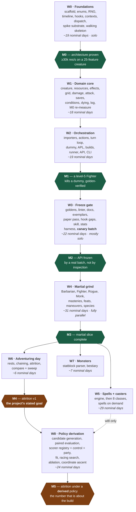

# Roadmap & Delegation Plan

Companion to [DESIGN.md](DESIGN.md). This document sequences the build so that
**decisions with the widest blast radius are made first**, and every interface a
later agent depends on exists — in code, not prose — before that agent starts.

77 tasks across 9 waves, `W0`–`W8`. DESIGN.md § Build order is the one-table
summary; this is the operational detail.

## Sequencing principles

1. **Vocabulary before everything.** `rules/enums.py` and the hook registry are
   imported by all ~630 content implementations. A rename after the grind begins
   is a mass edit; a rename in W0 is free.
2. **Interfaces are code, not documents.** A wave is only "done" when its public
   types exist and are importable, so the next wave's agents can write against a
   real signature instead of a description of one.
3. **Prove the expensive constraint against a hostile case.** The performance
   budget is validated in W0 on a creature with ~25 attached features, an
   8-condition APL and real movement — never on a stub. A stub clears the budget
   trivially and proves only that the harness runs, which spends the one
   milestone whose whole purpose is to make revision cheap. That is why `w0g2`
   pulls a first cut of the creature, the damage pipeline and the grid into W0:
   a spike cannot be hostile against machinery that does not exist yet.
4. **The paper pass gates the grind.** All ~400 combat-relevant features are
   classified to a hook *before* any batch authoring starts. This is what
   prevents hook drift, and it is cheap only if it happens before the API is
   frozen.
5. **Nothing is frozen until an outsider has used it.** M2 is not reached by
   inspecting three hand-built exemplars; it is reached when a canary batch —
   one small, semi-disposable slice authored by an agent that has never seen the
   API — comes back needing no correction. A wrong API found in the sixth
   parallel batch costs six times a wrong API found in the first.
6. **Serialise the risky, parallelise the repetitive.** W0 and W3 are
   single-owner; W1–W2 are delegable but tightly sequenced. W4 onward fans out to
   many agents with near-zero coordination cost, because by then the contract is
   fixed and the work is mechanical.
7. **A stand-in is a budget only if a named task re-measures it.** `w0i` stated
   this of the APL compiler — "a stand-in that a later task has to beat is a
   budget; a stand-in nobody re-measures is a stub" — and W0 then produced sixteen
   more of them, among them a literal `armour_class`, a hand-sequenced attack, a
   hardcoded greatsword, two protocols too narrow for real features, a
   `_refuse_pending()` that raises where `w1c` will apply, and derived stats
   recomputed per attack.
   None of those were wrong to write; all of them are invisible once the file
   around them grows. Every one is now in § The W0 debt register with the task
   that retires it, and a first cut written from here on gets a row there in the
   same commit.
8. **A seam for a later wave is cut in the wave that owns the file.** W8 derives
   the APL by search, and needs three things from W2 — an `Apl` that can be built
   programmatically and serialised back, the reserved `best_scored` action id,
   and an API that takes an explicit seed list and returns per-seed results — all
   near-free in `w2e`/`w2g` and a migration across every file in `builds/` once
   builds exist in git. **One seam lands in W3 instead, and it is the expensive
   one to miss**: the closed `Perturbation` vocabulary the scorer
   reads off a buff or debuff feature (`w3f`, `w3g`, `w3b`, `w3l`). It is authoring surface
   rather than a signature, so declaring it after the grind is a retrofit across
   every buff in `features/` — written by whichever agents happen to be free,
   months after the authors who understood the features moved on. The rule
   generalises: when a later wave's requirement is *known* and costs a signature
   rather than a design, it goes in now — but only the signature. Speculative
   generality is still the enemy; a known consumer is not speculation.
9. **The reviewer is the bottleneck, not the agents.** Roughly 175 nominal
   agent-days funnel through one person, so every deliverable is designed to be
   *reviewable in minutes* — disposition tables, quoted citations, arithmetic
   written out in goldens, a hard file-size cap. Batches are sized for a review
   sitting (15–25 features), not for agent capacity. A batch nobody has the
   attention left to check is worth less than half the batch, checked.

## Delegation modes

| Mode | Meaning |
|---|---|
| 🔒 **Solo** | One owner, serial. High blast radius or cross-cutting; splitting it costs more than it saves. |
| 👥 **Delegable** | One agent, self-contained, clear inputs and outputs. Safe to hand off with a task packet. |
| 🚀 **Batch** | Many agents in parallel on disjoint files, following the authoring skill. Coordination cost ≈ 0. |

---

## Wave dependencies

The per-wave tables below carry the complete edge list in their **Depends**
columns; this is the shape those edges make. There are deliberately no dates:
effort is quoted in **nominal days** — one focused agent-session's worth of work
— and a nominal day is not a calendar day, so a chart with an axis of calendar
dates reads as wrong within a week and gets discounted along with everything
else on it.



**Nothing in W4 or later may start before M2**, and that is the single most
important scheduling constraint in the project. Once M3 lands, three branches run
independently: **W6 depends only on W4, not on W5**, so attrition against target
dummies — the v1 goal — is reachable with martials alone and does not wait for
casters. W7 likewise forks from W4. Given enough agents, W5, W6 and W7 proceed
concurrently. **W8 joins after M4**, because it needs W6's objective function to
search against and W4's features to search over (its one dashed edge from W5 is
`w8l`, AoE placement, which is off the critical path to M5) — it is the one wave whose
position in the order is the inverse of its importance, and the compensation for
that is `w2e`/`w2g`'s seams rather than an earlier start.

### The critical path

`enums → hook registry → contexts → dispatch → spike substrate → walking
skeleton → perf spike → damage → attack → turn loop → APL → exemplars → paper
pass → hook gaps → authoring skill → canary batch → the grind → spell engine`

Everything on it is a decision that is expensive to revisit later; everything off
it can slip without blocking anyone. Three entries were added to the chain
after review. Two are the points at which a milestone stops being
self-certified; the third is what makes the first of them measurable at all:

- **The walking skeleton** (inside `w0h`) puts a featureless creature through the
  real dispatch path and real damage pipeline before resources, effects or
  conditions exist. Without it, 25 tasks complete before anything runs end to
  end, and integration bugs surface at the most expensive possible moment.
- **The canary batch** (`w3j`) is the outsider that turns M2 from an assertion
  into a measurement.
- **The spike substrate** (`w0g2`) is the price of the first: a walking skeleton
  needs a creature and a damage pipeline, and a hostile spike needs a grid. First
  cuts of `creatures/`, `engine/damage.py` and `core/geometry.py` therefore move
  into W0, and `w1a` / `w1d` / `w1e` complete those files rather than creating
  them. The alternative — writing the damage order twice — breaks the one rule
  the design leans on hardest.
- **The movement observer** (`w0g3`) is the same argument one step further on.
  A grid the spike walks but that fires no triggers is a stub of the most
  flattering kind — the distance queries are paid for and the provocation they
  exist to produce costs nothing — so the audience half of `engine/triggers.py`
  moves into W0 alongside the substrate it measures against, and `w2c` completes
  it. What did **not** move is the opportunity attack itself: it is a Command
  and Commands are `w2b`'s, which is the same boundary DESIGN.md § Module layout
  draws between `actions/` and `engine/triggers.py`.

---

## W0 — Foundations 🔒

One owner throughout. This wave decides the shape of every line of code written
afterwards.

| ID | Task | Mode | Depends | Produces (the interface) | Done when |
|---|---|---|---|---|---|
| w0a | Repo scaffold: `pyproject.toml`, ruff, mypy, pytest layout, `.gitignore` (`data/`), GitHub Actions | 🔒 | — | package importable, CI green | `uv sync` + `uv run pytest` pass on an empty suite |
| w0b | **Rules vocabulary**: `Ability`, `DamageType`, `Condition`, `Mastery`, `WeaponProperty`, `Size`, `School`, `Outcome`, PB table, slot table | 🔒 | w0a | `rules/enums.py`, `rules/constants.py` | every 2024 damage type, condition and mastery present; no string literals anywhere downstream |
| w0c | RNG protocol + `MersenneRng` (`PcgRng` as built, replaced by `w0i`) + `ScriptedRng`; dice tokeniser; **per-iteration seeding** `mix(master_seed, iteration_index)` | 🔒 | w0a | `core/rng.py`, `core/dice.py` | same seed ⇒ identical stream; `ScriptedRng` raises on over-draw; **a run reproduces byte-for-byte across different `--jobs` values** |
| w0d | Timeline: `TimeKey`, `TurnPhase`, `InitiativeKey` + the tie-break rule, `Duration` + named constructors, `ResetManager`, `Reset` scopes | 🔒 | w0b | `core/timeline.py` | `TURN` vs `OWN_TURN` semantics covered by tests; `through_phase` proven in both directions; **a creature entering or leaving the order moves nobody else and invalidates no resolved `Expiry`** — initiative is a key, never a seat index |
| w0e | **Hook registry**: `Scope`, `Phase`, `HookSpec`, `define_hook`, and the 39 `define_hook()` calls — including `on_heal`, `on_temp_hp_gained`, `on_death_save`, `on_stabilize`, `on_initiative_roll` | 🔒 | w0b | `hooks/registry.py`, `hooks/definitions.py` | unknown hook name raises; the registry is closed and complete for W1–W3, and the CI **freeze** guard is enabled by `w3f` after the paper pass, not here; the healing and initiative hooks exist **before** W6 and W4 need them |
| w0f | **Contexts**: every `*Context` Parameter Object, attribute-locked, mutator methods only | 🔒 | w0e | `hooks/contexts.py` | direct field assignment raises `AttributeError`; wrong-phase mutation raises `PhaseError` |
| w0g | `@hook` decorator, `HookResult`, `HookSource.__init_subclass__` validation, `Dispatcher` | 🔒 | w0f | `hooks/decorator.py`, `source.py`, `dispatch.py`, `core/errors.py` | bad signature is an `ImportError`; `once_per`/`costs` consumed only on `APPLIED` |
| w0g2 | **Spike substrate**: minimal `Creature` / `StatBlock` and one weapon, first cut of `engine/damage.py` (the full resolution order, no effects yet) and of `core/geometry.py` (5 ft distance, reach, shortest-legal-route) | 🔒 | w0g | `creatures/creature.py`, `stats.py`, `engine/damage.py`, `core/geometry.py` | `w0h` and `w0i` run against real damage and real distance queries rather than stubs. `w1a` / `w1d` / `w1e` **complete** these files; the damage order is never written twice |
| w0h | **Walking skeleton**: a featureless creature attacking another through the *real* dispatch path and *real* damage pipeline, printing a result | 🔒 | w0g2 | `tests/bench/`, `tools/skeleton.py` | one command runs a fight end to end, before resources, effects or conditions exist |
| w0i | **Pessimistic performance spike**: synthetic creature with ~25 attached `HookSource`s (≥15 on `on_hit`), an 8-condition APL with `target:` and `move:` **hand-compiled to callables over the namespace-proxy shape `w2e` will emit**, real grid movement; worker-startup cost measured separately | 🔒 | w0g2, w0h | `tests/bench/` | **≥30k attack resolutions/sec/core on that configuration** — revised down from 50k by the spike itself at M0 (`docs/decisions.md` § w0i), which is what a stop-and-revise gate looks like when it fires. `w2e` re-runs this benchmark when the real compiler lands and must come in at or under the same number |
| w0g3 | **Movement observer**: first cut of `engine/triggers.py` — the audience for a move, the per-five-foot-step `on_leave_reach` offer, initiative ordering, and `Dispatcher.responsive()`; the opportunity-attack trigger without the opportunity attack | 🔒 | w0g2, w0i | `engine/triggers.py`, `hooks/dispatch.py` | a move is walked square by square and the offer is made **from the square being left**, with the mover still standing on it; the audience is filtered only by things that cannot change the answer, so a room of twenty combatants none of whom own a movement reaction costs twenty dict lookups and no dispatches — counted by `tests/contract/test_triggers.py`, never timed. `w2c` **completes** this file with the turn loop, the `opportunity_attack` Command and the effect drain |

> **M0 — Architecture proven.** If w0i misses the budget, stop and revise before
> W1. This is the cheapest moment in the project to change the dispatch design.
>
> **This fired.** The spike came in at 17k against the 50k the design had
> assumed; a revision pass across the hot path took it to ~31.5k, a floor
> calculation showed 50k was unreachable without giving up the authoring
> guarantees, and the budget was revised to 30k with the reasoning recorded in
> `docs/decisions.md` § w0i. Two levers were taken there that later waves
> inherit: `reopen()` is compiled per context class, and the production
> generator is now `MersenneRng` rather than `PcgRng`.
>
> The spike is deliberately hostile. A stub creature clears any budget trivially
> and proves only that the benchmark harness runs — which would spend the one
> milestone whose entire purpose is to make revision cheap. Measure `spawn`
> worker startup too: on Windows every worker re-imports the package and rebuilds
> every character, a cost `compare --sweep dummy.ac=10:22` pays thirteen times
> and an inner-loop benchmark never sees.
>
> It is only hostile if the machinery it stresses is real, which is what `w0g2`
> buys. The one stand-in left is the APL compiler: the eight conditions, the
> `target:` selector and the `move:` clause are hand-written callables over the
> same proxy shape `w2e` will compile to, and `w2e` re-runs `dndsim bench` to
> prove the real compiler is no slower. A stand-in that a later task has to beat
> is a budget; a stand-in nobody re-measures is a stub.

## The W0 debt register

W0 is complete and M0 is met, so this plan has been re-read against what the
wave actually taught rather than against what it assumed. Most of what it taught
is already in `docs/decisions.md`; what follows is the part that changes *the
plan*.

The wave produced twenty-two deliberate stand-ins and deferred obligations —
seventeen from `w0a`-`w0i` and five more from `w0g3`. Every
one of them was the right thing to write — a hostile spike needs real machinery
now, not finished machinery later — and every one of them is invisible six
months from now, when the file around it has grown and the paragraph explaining
it reads as description rather than as a debt. Sequencing principle 7 is the
general rule; this is the ledger it refers to.

**Each row is now also in the retiring task's *Done when* cell**, which is where
an agent will actually look. This table is the index, not the specification.

| # | The stand-in or debt | Where | Retired by | What it costs if nobody does |
|---|---|---|---|---|
| 1 | `StatBlock.armour_class` is a literal | `creatures/stats.py` | `w1a` | AC becomes a number typed into build YAML — the thing DESIGN.md § Reconnaissance is most emphatic about |
| 2 | `Combatant` carries `name` and `initiative` and nothing else | `hooks/contexts.py` | `w1a` | no `on_hit` feature can read the defender's hit points; the spike's own "bloodied" rider had to ask the damage bag instead |
| 3 | `Weapon` carries `name` and nothing else | `hooks/contexts.py` | `w1f` | no feature can ask whether the weapon is Heavy — Great Weapon Master, and every mastery, is unwritable |
| 4 | Derived stats recomputed per attack | `creatures/creature.py` | `w1a` | ~1.5%, out of a 5% headroom |
| 5 | `_refuse_pending()` raises on a queued effect | `engine/damage.py` | `w1c` | every effect a handler applies is refused; the raise is the reminder |
| 6 | `attack_once()` hand-sequences the attack | `tools/skeleton.py`, imported by `tools/spike.py` | `w1f` | a second attack order beside `engine/attack.py` — **and a benchmark that defends the budget on a sequence the project does not ship** |
| 7 | Two inline rulings and one open question, unconfirmed against the 2024 text | `engine/damage.py` | `w1e` | every number a Heavy Armor Master or Uncanny Dodge build reports rests on an argument nobody checked |
| 8 | `on_reduced_to_zero` never fires; hit points clamp at 0 | `engine/damage.py` | `w1j` | nothing is ever dying, and Relentless Endurance has no moment to attach to |
| 9 | `Size` reaches geometry nowhere | `core/geometry.py` | `w1d` | every Large creature is Medium — exact for W1–W3's combatants, silently wrong for the first ogre |
| 10 | The `Economy` protocol has no real implementer or contract test | `hooks/dispatch.py` | `w1a` | the protocol and the class drift, and `costs=` stops being paid |
| 11 | The `Gate` protocol has no contract test | `hooks/dispatch.py` | `w2e` | as above, for every gated handler |
| 12 | `Dispatcher.bind()` is never called | `hooks/dispatch.py` | `w2f` | every gated handler raises `EngineAssemblyError` at the first gate |
| 13 | `GREATSWORD` is hardcoded | `creatures/stats.py` | `w2a` | a second weapon definition beside the imported 38 |
| 14 | The APL is hand-compiled callables | `tools/spike_apl.py` | `w2e` | the budget is defended by a compiler that does not exist yet (already in `w2e`'s row — `w0i` set this precedent) |
| 15 | Effects and resources are fixture stand-ins in the spike | `tools/spike_apl.py` | **`w1k`** | the budget never sees the per-round cost `w0i` says it understates |
| 16 | No multi-round `Duration` anchor | `core/timeline.py` | `w5a` | nothing lasting a minute is expressible — a `core/` change made after the registry freeze, which is why it is named now |
| 17 | No healer-side heal hook | `hooks/definitions.py` | `w3f`, via `w3e` | `on_heal` is `TARGET` by design, so Disciple of Life and every heal-boosting feature has nowhere to attach |
| 18 | `_offer()` raises on a queued effect | `engine/triggers.py` | `w2c` | every effect a reaction applies is refused — 2024 Sentinel's speed-to-zero above all; the raise is the reminder, and it is the same debt as #5 one hook along |
| 19 | Nothing stops a mover whose speed a reaction set to 0 | `engine/triggers.py` | `w2c`, needs `w1a` + `w1c` | Sentinel lets the runner keep running; the walk stops on hit points because those exist, and on nothing else |
| 20 | `provokes=False` has no caller | `engine/triggers.py` | `w2b`, `w2c` | Disengage, forced movement and teleportation all provoke — the valve is there and nothing sets it |
| 21 | No visibility gate on the offer | `engine/triggers.py` | `w2c`, needs `w1h` | the rule is "a creature **you can see** leaves your reach"; a Blinded or Invisible-adjacent creature takes opportunity attacks it cannot legally take. Exact while nothing is blind, wrong the first time something is |
| 22 | No hook for *entering* reach | `hooks/definitions.py` | `w3f`, via `w3e` | 2024 Polearm Master is unwritable — the registry is closed at 39 and this was not the task to open it (same shape as #17) |

### What else the review changed

Four things that are not stand-ins:

- **`w1k` is a new task.** `w0i` measured ~31.5k against a 30k budget and states
  plainly that what it understates is the per-round cost, because effects and
  resources did not exist to be swept. W1 is the wave that adds them, and the
  next task that re-measures anything was `w2e` — twenty tasks later. Five
  percent of headroom does not survive twenty tasks unwatched, and the wave that
  spends it is the wave that should find out.
- **The perf gate needs a work witness** (`w3i`). The cheapest way to make a
  benchmark faster is to stop a rider from firing, and `w0i` ran for a while
  with the one handler that paid for the dispatcher's two expensive escape
  valves never actually running. A gate that watches only the rate cannot tell a
  fix from a fixture that quietly stopped working.
- **A harness with exact-integer assertions must fix its unit of work** (`w3a`).
  `w0i`'s counts were facts about seed 0 rather than about the configuration,
  and the fix was an invariant, not a larger sample. The golden harness inherits
  the same requirement, and it is the harness's job rather than each author's.
- **The turn loop must charge real action costs** (`w2c`), and a starved policy
  must be visible in the output (`w2g`). The spike spent an Action on a Bonus
  Action self-buff whose own condition it could not clear, and stopped attacking
  for the rest of the encounter. It cost 0.07% of the rate — which is exactly
  why nothing about the *rate* would ever have found it. DESIGN.md § APL warns
  about the melee build that stands still; this is the same failure through the
  economy rather than through the grid.

## W1 — Domain core 👥

Interfaces from W0 are fixed, so these run largely in parallel. `w1e`/`w1f` stay
with the architect — they encode the two resolution orders everything else
trusts. `w1a`, `w1d` and `w1e` **complete** files `w0g2` already created; none of
the three is greenfield, and none of them may restate the damage order.

Two changes came out of the W0 review. **`w1k` is new** — the M0 number has 5%
of headroom and W1 is the wave that adds the per-round cost `w0i` says it
understates, so the re-measure happens at the end of this wave rather than
twenty tasks later in `w2e`. And **the participant protocols in
`hooks/contexts.py` are widened here**, by `w1a` (`Combatant`) and `w1f`
(`Weapon`): those two sub-items are the only W1 work that touches a package
content batches may never touch, they are the shape ~400 features will read the
defender and the weapon through, and they are therefore solo within their
otherwise delegable tasks. `w3e` confirms the shape before the grind; `w3f` is
where a structural gap in it gets fixed.

| ID | Task | Mode | Depends | Produces | Done when |
|---|---|---|---|---|---|
| w1a | `Creature` and `StatBlock` completed from `w0g2`, derived stats, **AC derivation** over an `Armour` value object (armour + DEX cap + shield + the Unarmored Defense variants), `ActionEconomy` (action/bonus/reaction/movement, grants) | 👥 | w0g2 | `creatures/creature.py`, `stats.py`, `economy.py` | Action Surge's "grant another action" works via the economy alone; AC is **derived from equipment**, never a literal in the build YAML — `StatBlock.armour_class` is gone, not defaulted. Three W0 debts land here: the derived-stat cache (`proficiency_bonus` and `modifier()` are recomputed three times per resolution today, worth ~1.5%), the contract test `w0g` is owed for the `Economy` protocol, and **widening `Combatant`** — no `on_hit` handler can read the defender's hit points, which is why the spike's own "bloodied" rider had to ask the damage bag instead |
| w1b | `ResourceSpec`, `Recovery`, `ResourcePool`, `SpellSlots` facade, `transaction()` unit of work | 👥 | w0g | `creatures/resources.py` | all 7 resource shapes in DESIGN.md expressible; rollback proven |
| w1c | `Effect`, `EffectStore`, `Stacking`, charge consumption, refresh/expire | 👥 | w0d | `creatures/effects.py` | Rage extend, Vex charge+time, Reckless hard stop all pass; **`engine/damage.py`'s `_refuse_pending()` and its two contract tests are deleted here**, and `ctx.pending_effects` is drained where they raised — the first cut refuses a queued effect loudly precisely so that deleting the refusal is a task rather than a discovery |
| w1d | Grid geometry completed from `w0g2`: LoS, cone/sphere/line templates, and the full **shortest-legal-route resolution** for a movement destination | 👥 | w0g2 | `core/geometry.py` | Fireball's 20 ft sphere selects the correct cells; a `move:` destination resolves to a route that provokes correctly on the way out of reach; **`Size` reaches geometry** — a Large creature occupies 2×2 and that changes its reach and what a template covers. `w0g2` reads `Size` nowhere, which is exact for Small/Medium and silently wrong for the first ogre |
| w1e | **Damage resolution order** completed from `w0g2` — immunity → vulnerability → resistance → flat → halvings → temp HP → HP, with the ruling for each non-quoted step cited inline | 🔒 | w0g2 | `engine/damage.py` | Rage + Uncanny Dodge + vulnerability produces the hand-computed number; the **two rulings `w0g2` wrote inline are confirmed against the 2024 text or changed** — flat reductions applying after resistance, and halvings after the flat reductions — as is the open question beside them, whether two halvings stack where two resistances do not (`_halvings` is a list on the strength of no rule saying otherwise). Each changes every number a Heavy Armor Master or Uncanny Dodge build reports; `mitigate()` stays a pure function over a `MitigationLedger`, which is what lets the order be pinned by a table of cases |
| w1f | **Attack pipeline** — declare → roll → adv/disadv resolution → hit/crit/miss → damage → resolved | 🔒 | w1e | `engine/attack.py` | crit doubles `dice` and never `flat`; advantage is idempotent; `mitigate()` is handed **the generator the attack is using**, because a second stream reproduces a different fight from the same archived seed with no error anywhere; the `Weapon` protocol is widened (no `on_hit` handler can ask whether the weapon is Heavy today); reach comes from the weapon and the creature's square, not from a bare `in_reach()`. **`tools/skeleton.py`'s hand-sequenced `attack_once()` is retired here** — `tools/spike.py` imports it, so leaving it in place is both a second attack order and a benchmark that stops measuring the sequence the project ships |
| w1g | Saving throws, DC calculation, save-for-half | 👥 | w1f | `engine/saves.py` | legendary resistance expressible |
| w1h | The 15 combat-relevant conditions as `Effect` subclasses | 👥 | w1c | `conditions/` | no `if creature.is_prone` anywhere in the engine |
| w1i | Structured event log (tuples; formatting deferred to the reporter) | 👥 | w0d | `core/log.py` | `--log-level=summary` skips per-roll records |
| w1j | **Dying**: 0 HP, death saves, stabilise, healing application and temp HP, firing `on_death_save` / `on_stabilize` / `on_heal` / `on_temp_hp_gained` | 👥 | w1e | `engine/dying.py`, `engine/healing.py` | a downed PC rolls death saves; a heal at 0 HP restores consciousness; Relentless Endurance is expressible with no engine change; **`resolve_damage()` fires `on_reduced_to_zero`** and computes `ReducedToZeroContext.overflow` for the instant-death rule — `w0g2` clamps hit points at 0 and fires nothing, which is the one hook the damage pipeline currently owes |
| w1k | **M0 re-measure**: re-run `w0i`'s spike against the completed W1 substrate — real `EffectStore`, real `ResourcePool`, the real attack sequence — replacing the fixtures' hand-built stand-ins | 🔒 | w1a–w1f, w1j | an updated § w0i measurement | **≥30k on the same hostile configuration, or the shortfall is measured, attributed and either accepted or revised away — as a decision taken here, not a number noticed in W2.** Added by the W0 review: `w0i` measured ~31.5k against a 30k budget — 5% of headroom — and says in as many words that what it understates is the per-round cost, because effects and resources did not exist. W1 is what adds them, `w2e` is the next task that re-measures, and twenty tasks is too long a run for 5% |

## W2 — Orchestration 👥

| ID | Task | Mode | Depends | Produces | Done when |
|---|---|---|---|---|---|
| w2a | **Content ACL**: fetch script **pinning the upstream 5etools commit as the content version**, 5etools loader, `refSubclassFeature`/`refOptionalfeature` resolution, `classTableGroups` → `table_value()`, weapon + **armour** + mastery + **species** import | 👥 | w0b | `content/` | 38 XPHB weapons, every armour and shield entry, `species.json`, and every class table import; `content fetch` records the commit SHA that every `SimResult` cites; no 5etools vocabulary escapes this package; `stats.GREATSWORD` — the one hardcoded weapon the project was ever going to have — goes with the spike that needed it |
| w2b | `Action` Command base (`is_legal`/`execute`), Attack, Dash, Dodge, Disengage | 👥 | w1f | `actions/` | legality query provably cannot spend a resource |
| w2c | Initiative, turn loop, round loop, trigger audience, **reaction regained at the start of each of your turns**, opportunity attacks, movement offers, `on_initiative_roll` | 🔒 | w2b | `engine/turn.py`, `encounter.py`, `triggers.py`, `world.py`, `query.py`, `actions/opportunity_attack.py` | **completes `w0g3`'s `engine/triggers.py`** rather than rewriting it: the movement audience, the per-step offer and the initiative ordering are already there, and what this task owes them is the `opportunity_attack` Command and debts 18-22 of § The W0 debt register. Re-runs `w0i`'s benchmark on a configuration where the offers actually fire, and must come in at or under its number **without** counting an opportunity attack made by a featureless creature as an attack resolution — a cheap resolution added to the numerator of a rate quoted per resolution raises the reported number by making the average resolution less like a real one. turn loop re-polls after every action; a creature may react before its turn and again after it in the same round — the invariant is on the **turn** boundary, never the round. Owns the roster and the `InitiativeKey` for each combatant: `tiebreak` is **one independent uniform draw per creature**, `(rng.roll(2**32) - 1) / 2**32` (never a shuffle of the entrants — it has no honest place for a latecomer), a joiner mid-encounter draws its own without touching anyone else's, and a creature leaving is dropped from the roster with its key left alone. **The loop charges the real XPHB action cost of each offer and filters to what the economy can still pay**: `w0i` charged an Action for a Bonus Action self-buff, and because the buff's own `if:` was a condition the buff did not clear, the creature spent its Action on it and never swung again for the rest of that encounter |
| w2d | `TargetDummy` with every knob from DESIGN.md, including `movement_profile` (`static` / `closes_to_melee` / `kites_at`) | 👥 | w1a | `creatures/dummy.py` | AC sweep 10–22 configurable from YAML; a dummy that closes to melee provokes and is provoked, so the grid is exercised rather than decorative |
| w2e | **APL**: AST whitelist compiler, `NamespaceSchema`, proxies, `Apl.allows()`, default policy, and **all three clauses** — `if:`, `target:` (selector expressions), `move:` (positioning) | 🔒 | w2b, w2c | `apl/` | `self.ragging` fails at load with a suggestion; unmentioned riders and reactions default OFF, **movement being the one exception** — a build with no `move:` clause closes to its nearest enemy; `target: "lowest_hp of enemies.in_reach"` and `move: "toward nearest of enemies until in_reach"` compile through the same whitelist; `Apl` satisfies the `Gate` protocol `hooks/dispatch.py` declares and owes the contract test that says so. **Reactions are entries like any other** — one flat list, not a second one: `{ action: opportunity_attack, if: "..." }` is answered through `Apl.allows()` at the moment `engine/triggers.py` makes the offer, the `trigger.*` root carries the mover and the square being left, and an entry nobody wrote is OFF, so a build that never swings at runners is a build that said so. **All three clauses ship together** — adding a clause after builds exist is a schema migration across every YAML file in git. `dndsim bench` on `w0i`'s configuration comes in at or under `w0i`'s number. **Seam for `w8`:** `best_scored` is **reserved in the action vocabulary** now — the scorer that implements it arrives in W8, but the vocabulary is closed and adding an id after builds exist is the same migration the three clauses were; an `Apl` is constructible programmatically from a list of entry objects without going through YAML text, serialisable back to YAML, and carries a canonical hash — `parse → build → serialise → parse` round-trips to an equal object |
| w2f | Build YAML pydantic schema — class + level, **species, background, ASI/feat choices, fighting style, equipment (weapons, armour, shield)**, `apl:`, and party `retreat_when` — plus the `Character` Builder | 👥 | w2a, w2e | `builds/`, `creatures/character.py` | unknown feature id fails with difflib suggestions; every choice a single-classed level 1–12 character makes is expressible, and AC falls out of the equipment; **the loader calls `Dispatcher.bind()` once per creature** — the gate cannot be a constructor argument because the APL's namespace is built over the creature that owns the dispatcher, and a gated handler with nobody to ask raises rather than running free. **Seam for `w8`:** `apl:` is optional — a build with no `apl:` block loads and plays `[{action: best_scored}]`, never falling through for want of an authored policy |
| w2g | Monte Carlo runner, multiprocessing, stats, CIs; **`SimResult` + its JSON schema**; text/json renderers; the public API | 👥 | w2c, w2d, w2f | `sim/`, `reporting/`, `api.py` | identical seed ⇒ byte-identical event log **at any `--jobs`**, because worker records are merged in **iteration order, never completion order**; text output derived from the JSON, not parallel to it; the pool is started behind a main guard and never from a module a worker re-imports (`spawn` re-runs `__main__` in every worker — `w0i`'s first startup measurement fork-bombed the machine it was measuring, and 0.167 s of that startup is real and paid per worker); **`SimResult` carries actions and attack resolutions per round**, so a policy that starves itself is visible as a count rather than only as a disappointing DPR. **Seam for `w8`:** the API accepts an explicit **seed list** (not only a count) and an **APL override** per creature, and returns the **per-seed objective vector** alongside the aggregate — an aggregate is useless to a paired comparison, and the paired comparison is what makes policy search affordable at all |
| w2h | Typer CLI as a **thin adapter** over `api.py`: `sim`, `day`, `compare`, `inspect`, `validate`, `trace`, `check`, `content fetch`, `bench` | 👥 | w2g, w2a, w2f | `cli.py` | every command in DESIGN.md § Verification runs; no simulation logic lives in `cli.py` |

> **M1 — A level-5 Fighter with a greatsword kills a dummy**, and every number is
> reproduced by a hand-computed golden test.

## W3 — Freeze gate 🔒

The highest-leverage wave in the project. Skipping or rushing it is how the grind
produces 400 subtly wrong features.

One task changed shape after review and two are new. **`w3e` is batched rather
than solo**: 400
prose features classified by hand, alone, is the most tedious task in the plan
sitting directly on the crux, and it degrades quietly because nothing downstream
detects a sloppy classification until features are written against it. Batching
the rows and triaging only the low-confidence and gap buckets costs a fraction of
the attention and spends it where it decides something. **`w3j` and `w3l` are
new**: `w3j` because M2 has to be measured rather than asserted (see M2), and
`w3l` because the statistical harness — the only oracle in the project an author
cannot fake — had no task producing it.

| ID | Task | Mode | Depends | Produces | Done when |
|---|---|---|---|---|---|
| w3a | Golden harness, `scripted_rng` fixture, `parts_by_source` assertions | 👥 | w2c | `tests/golden/conftest.py` | exact-integer assertions, no distributions — and the fixture fixes the *unit of work*, not just the dice: `w0i` wrote exact counts against a benchmark whose encounters resolved 30 attacks on the seed it was written on and something else on 3 seeds in 60. **A harness whose unit of work depends on the dice cannot carry exact-integer assertions**, and the fix is an invariant the fixture guarantees, not a larger sample |
| w3b | Feature linter + no-op detector + golden-coverage collection test, wired to `dndsim check` and to **every batch PR** | 👥 | w3a | `tools/check_features.py`, `noop_report.py` | catches missing `# PHASE:`, private access, stray `import random`, `try`/`except` or `hasattr` in `features/`, a feature file over 60 lines, a `source_ref` without a quoted rules sentence, a `dndsim` import inside an analytic expectation, a `BUFF_PROFILE`/`DEBUFF_PROFILE` using a key outside the closed perturbation vocabulary, a `DEBUFF_PROFILE` with no `save=` where the rules text has one, or a `repeat=` that disagrees with which end of the turn the quoted sentence names, and any write outside a packet's file allowlist |
| w3c | Generate `docs/hooks.md` and `docs/apl.md` from the registries (`docs/score.md` joins them in `w8b2`, same generator) | 👥 | w0e, w2e | `tools/gen_docs.py` | CI fails if generated docs are stale |
| w3d | **Reference exemplars**: Rage, Sneak Attack, Uncanny Dodge, hand-built | 🔒 | w2e | `features/base.py`, `params.py`, `TEMPLATE.py`, the three exemplars | all three pass goldens; they become the skill's examples |
| w3e | **Paper pass**: classify all ~400 combat-relevant features to a hook. **Batched against a fixed row schema**, then human-triaged | 🚀 → 🔒 | w3d | `docs/feature-hook-map.md` | every feature has a row: `feature_id \| hook \| scope \| phase \| resource \| once_per \| confidence \| gap_kind`. Gaps are classified **additive** (a new hook) or **structural** (a missing context field, or a hook firing at the wrong pipeline point). **The pass also confirms the shape of what a hook hands out** — the `Combatant` and `Weapon` protocols `w1a`/`w1f` widened, and the context fields — because a field ~400 features need and cannot reach is a structural gap found at the cheapest moment there is |
| w3f | **Hook gap resolution**: add the hooks the paper pass proved missing; fix the structural ones; **close the `Perturbation` vocabulary** alongside the registry | 🔒 | w3e | `hooks/definitions.py` (final), `features/perturbation.py` | registry frozen; CI guard enabled. The perturbation keys the scorer reads off a buff or debuff — offensive (`to_hit`, `advantage`, `damage_per_hit`, `extra_attacks`, `crit_range`) and defensive (`target_ac`, `target_save`, `advantage_against`, `their_disadvantage`, `damage_taken`, `action_denied`, `speed`), plus the three keys that say how an effect ends — `save=`, its optional `repeat=` (`turn_end` / `turn_start`, which select between the two `E[N]` formulas) and `ends_on_damage` — are closed and CI-diffed on the same terms as the hooks. An effect that does not fit declares nothing and falls back to the scorer's intercept, which is `NEEDS_HOOK`'s logic applied to the value model; positioning control is the standing example of one that does not fit. **Budget against the structural count, not the total** — additive gaps are an append, structural gaps touch `hooks/contexts.py` and `engine/`. Two gaps are known before the pass starts and are its opening rows: the **healer's side of `on_heal`** (Disciple of Life has nowhere to attach — `on_heal` is `TARGET` by design) and the **multi-round `Duration` anchor** (`core/timeline.py` has no additive `turns` field, so nothing lasting a minute is expressible; budgeted to `w5a`, and the pass is where a W4 feature that needs it earlier surfaces) |
| w3g | `.claude/skills/feature-authoring/SKILL.md` (≤3 pages) | 🔒 | w3f | the skill | a fresh agent implements a held-out feature correctly from it alone — **including a `Perturbation` profile on a buff or debuff**, which is the one W8 seam that lands in authoring surface rather than in a signature (DESIGN.md § Buffs and debuffs). Declared after the grind it is a retrofit across every one of the ~30–50 effects in `features/` |
| w3h | Interaction matrix v1 (~50 hand-computed combos) | 🔒 | w3d | `tests/interaction/` | crit+rider, resistance+halving, chained attacks covered |
| w3i | CI benchmark gate: median-of-N with warmup, against a same-run microbenchmark baseline | 👥 | w0i, w2h | CI config | a deliberate slowdown fails CI **and a rerun on unchanged code does not**. Tracked-but-non-blocking until its variance is known. Three constraints `w0i` measured: **1,000 encounters is a floor, not a default to trim** (at 200 the same machine spread 9% across three consecutive runs — wide enough to hide the regression the gate exists to catch; at 1,000 it is 0.2%); the gate **asserts its own fixtures still did their work**, off the no-op detector's counters, because the cheapest way to make a benchmark faster is to stop a rider firing and `w0i` shipped for a while with the one handler that paid for the dispatcher's two expensive escape valves never running; and when the gate does fire, **the reserve lever is the shape of `DamagePart`/`Modifier`** — a `NamedTuple` constructs in ~0.38 µs and a plain slotted class in ~0.28 µs against a frozen dataclass's ~0.9 µs — never the object model `w0i` refused |
| w3j | **The canary batch**: Rogue core + Thief only, authored by one agent from the skill alone, treated as semi-disposable | 🚀 | w3g | `features/classes/rogue/`, an API-friction report | the batch lands needing no correction — or the API is revised and the batch is rewritten |
| w3k | **Reviewer-pass harness**: a read-only review prompt that sees the quoted rules text and the code but not the author's reasoning, and that **re-derives each golden's expected number from the rules text alone** before comparing it with the author's | 👥 | w3d | `.claude/skills/feature-review/` | run against w3j; it finds at least one real discrepancy or is judged useless and cut |
| w3l | **Statistical harness**: the `expectation` declaration on features, **perturbation-profile validation** (measure the real DPR difference **on both sides** — ours and the enemies' — with and without the feature attached; a profile >10% off its own implementation fails the batch, on the same terms as `expectation`), 200k-attack comparison, Wilson intervals for rates and Student-t for means, wired to **every batch PR**; plus the invariant property tests (damage never negative, HP conservation, one reaction per turn, effect count back to baseline after an encounter) | 👥 | w3a, w3b | `tests/statistical/` | a feature whose implementation is 10% off its declared expectation fails the batch; an `expectation` that imports `dndsim` is a linter error, not a review comment |

> **M2 — API frozen.** W4 may not begin before this milestone.
>
> The freeze is **measured by w3j, not asserted by w3d**. Three hand-built
> exemplars prove the exemplars compile; they prove nothing about an author who
> has never seen the API. The canary is one small self-contained slice — the
> smallest in the project — written by an outsider against the frozen contract,
> and its job is to be wrong cheaply. Every friction it reports is a friction six
> parallel batches would otherwise have hit simultaneously, at six times the
> rework.
>
> Arcane Trickster sits inside this slice, which makes w3j the natural place to
> settle the Eldritch Knight / Arcane Trickster spellcasting question below rather
> than discovering it when W4 starts.

## W4 — The martial grind 🚀

Fully parallel, and only now — the canary batch `w3j` has already run one slice
through the frozen API and the frictions it found are fixed. Each batch touches
disjoint files; the only shared surface is the frozen API. Every row is sized for
one review sitting (15–25 features); split further by subclass if you want more
agents, never merge rows to get fewer.

| ID | Task | Mode | Depends | Scope |
|---|---|---|---|---|
| w4a | Weapon masteries | 🚀 | w3j | Cleave, Graze, Nick, Push, Sap, Slow, Topple, Vex |
| w4b | Fighting styles + martial feats | 🚀 | w3j | Archery, Defense, Dueling, GWF, + GWM, Sharpshooter, Crossbow Expert, Dual Wielder, Charger, Grappler… |
| w4b2 | **General combat feats** | 🚀 | w3j | the combat-relevant remainder of the 77 XPHB feats that is not martial-weapon-shaped — Alert, Lucky, Tough, Savage Attacker, Resilient, Sentinel, Polearm Master, Shield Master, Defensive Duelist, Mage Slayer, War Caster, Heavy Armor Master, Inspiring Leader, Healer, Skulker, Elemental Adept, Fey-Touched, Telekinetic… Origin feats need `w2f`'s `background` field, and Alert needs `on_initiative_roll` |
| w4c | Barbarian 1–12 | 🚀 | w3j | core + Berserker, Wild Heart, World Tree, Zealot |
| w4d | Fighter 1–12 | 🚀 | w3j | core + Champion, Eldritch Knight, Psi Warrior. **Battle Master is not in this row at all** — subclass features included, see `w4d2` |
| w4d2 | **Battle Master** | 🚀 | w3j | the whole subclass — Combat Superiority, Student of War, Know Your Enemy, Improved Combat Superiority, Relentless — **and** its 20 maneuvers. Split out of `w4d` because it is a sub-project, not a subclass: one resource, one rider shape, its own save DC — which also makes it an unusually clean batch on its own. Splitting the maneuvers from the features that grant and refresh them is how a subclass ends up owned by nobody |
| w4e | Rogue 1–12 — *remainder after the canary* | 🚀 | w3j | Arcane Trickster, Assassin, Soulknife (core + Thief already landed in `w3j`) |
| w4f | Monk 1–12 | 🚀 | w3j | core + Mercy, Shadow, Elements, Open Hand |
| w4h | **Species traits** | 🚀 | w3j | the ~18 combat-relevant 2024 traits — Relentless Endurance, Breath Weapon, Savage Attacks, Large Form… — landing in `features/species/`, off `w2a`'s `species.json` import |
| w4g | Slice integration, `NEEDS_HOOK` / `APPROXIMATED` triage, no-op sweep, **API freeze review** | 🔒 | w4a–w4f, w4b2, w4d2, w4h | every disposition row is resolved: implemented, hook queued, or approximation accepted in writing |

Eldritch Knight and Arcane Trickster need minimal spellcasting: either stub their
spell list behind `NEEDS_HOOK` or pull `w5a` forward for those two. **This is
settled during `w3j`**, not when W4 starts — Arcane Trickster sits inside the
canary slice, so the canary learns which option is cheaper at the moment that
information is still free.

## W5 — Spell engine + casters 🚀

| ID | Task | Mode | Depends | Scope |
|---|---|---|---|---|
| w5a | **Spell engine**: `Spell(Action)`, concentration + checks, slots/upcasting, AoE templates, save-for-half, **and the multi-round `Duration` anchor** | 🔒 | w4g | the last high-blast-radius design decision. `core/timeline.py` (w0d) deliberately shipped no multi-round anchor — every W1 duration ends one turn ahead — so "1 minute" is not expressible until an additive `turns` field lands here. It is a `core/` change made after the registry freeze, which is why it is named now rather than discovered by the first concentration spell |
| w5b | Paladin + Ranger | 🚀 | w5a | half-casters, martial-adjacent — the cheapest validation of w5a |
| w5c | Cleric + Druid | 🚀 | w5b | |
| w5d | Bard + Sorcerer | 🚀 | w5b | + 10 metamagic |
| w5e | Warlock + Wizard | 🚀 | w5b | + 28 invocations |
| w5f | Spell implementations, on demand | 🚀 | w5a | 212 combat spells, levels 0–6, pulled as the classes above need them |

## W6 — Adventuring day 👥

Depends on W4 only — reachable with martials and target dummies, before any
caster exists.

| ID | Task | Mode | Depends | Scope |
|---|---|---|---|---|
| w6a | Short/long rests, hit dice, encounter chaining, the **stop condition** (TPK or `party.retreat_when`), attrition metrics | 👥 | w4g, w1j | `engine/adventuring_day.py` — the v1 headline output |
| w6b | `compare` harness, `--sweep`, adaptive stopping on CI width | 👥 | w6a | `sim/compare.py`, `sweep.py` — what makes it a sim rather than a calculator |

> **M4 — Attrition v1.** `dndsim day` reports how far a party gets before
> resources run dry, with confidence intervals. This is the project's stated
> goal; W5 and W7 are content expansion beyond it.
>
> Note the dependency on `w1j`. The headline number is decided as much by the
> dying rules and the retreat threshold as by any damage calculation — see
> DESIGN.md § Context for the settled stop condition. `retreat_when` is a party
> YAML knob precisely so that `--sweep` over it is an experiment rather than an
> assumption buried in the engine.
>
> Note also what M4 does *not* yet say. `w6a`'s number is attrition **under the
> APL somebody wrote**, so `compare` at M4 is still partly a comparison of two
> authors. `w6b`'s `--sweep` axes are reused directly as W8's scenario
> distribution, and `w6a`'s attrition metric is W8's default objective — W6 is
> the objective function W8 optimises, which is why W8 depends on it and not the
> other way round.

## W7 — Monsters 👥

| ID | Task | Mode | Depends | Scope |
|---|---|---|---|---|
| w7a | Statblock parser (Visitor) over the closed tag vocabulary + `.claude/skills/statblock-import/` | 👥 | w4g | `{@atkr}`, `{@hit}`, `{@h}`, `{@damage}`, `{@actSave}`, `{@dc}`, `{@recharge}` |
| w7b | Bestiary import, Multiattack handling, unparsed-content report | 🚀 | w7a | 503 XMM stat blocks; unparseable content is flagged, never approximated |

## W8 — Policy derivation 🔒

**Last in sequence, first in importance.** Everything before this wave produces a
simulator that answers "how does this build do *when played this way*". This wave
removes the second clause, and it is the difference between a calculator with
opinions and a sim. Full rationale in DESIGN.md § APL derivation; the tension —
that the most important wave is necessarily the last one — is real and is
addressed by cutting its three seams in `w2e`/`w2g` — and the fourth, authoring
surface, in W3 — rather than by starting it early. There is nothing to search over until features exist.

Mostly 🔒 Solo: the wave is one tightly coupled statistical argument, and a
mistake anywhere in it produces confident wrong answers rather than a failure.
The 👥 rows are the ones with a checkable contract at their boundary.

The policy is **two layers** (DESIGN.md § The scorer): a global fitted scorer
that every build shares, under a per-build searched overlay carrying only that
build's departures from it. `w8a`–`w8b` build the scorer, `w8c`–`w8e` the search
substrate, `w8f` fits the coefficients, and everything after searches the
overlay. The ordering matters — the overlay search takes its warm start from the
fit, which is the largest single cut to the derivation budget in the design.

`w8a2` is the one row whose dependency points backwards into W3 rather than
forwards from W6. It cannot be built without `w3f`'s closed perturbation
vocabulary, and that vocabulary cannot be added after the grind without
rewriting every buff feature — which is why the seam is called out in
principle 8 rather than left to be discovered here.

`search/` may import `api.py` and `apl/` and nothing lower. `dndsim check` grows
one import rule for it (DESIGN.md § Module layout).

| ID | Task | Mode | Depends | Produces | Done when |
|---|---|---|---|---|---|
| w8a | **Expected-damage estimator** — closed-form over attack rolls (`p_hit` from attack bonus vs AC, advantage as `1−(1−p)²`) and saves (`p_fail` from spell save DC vs save bonus), summed over targets, defences applied in the resolver's order. **Two quantities**: `Ê_raw = E[X]`, the damage dealt, and `Ê_eff = E[min(X, pool)]`, the hit points actually removed, where `pool` is remaining HP plus temp HP in the order `engine/damage.py` spends them. The score's damage term uses `Ê_eff`; `Ê_raw` is what the resolver's damage roll produces | 🔒 | w1e, w1f, w2b | `engine/estimate.py` | **the property test binds both to the resolver** over one pass of 10⁵ real resolutions: `Ê_raw` against the empirical mean of damage dealt, `Ê_eff` against the empirical mean of hit points removed, each to within Monte Carlo error, for a matrix covering crit, advantage, disadvantage, resistance, immunity, save-for-half **and a target whose pool is smaller than the roll**. Splitting the quantity strengthens the binding rather than weakening it — capping a single estimate in place would have made the estimator disagree with the damage roll *by construction*, which is the divergence this test exists to catch. Without it the fit absorbs any divergence into a coefficient and hides it. `Ê_eff` costs nothing extra: it is `Σ_{k=1..h} S(k)`, the running sum of the survival function `w8a3` already precomputes for `p_kill`, so both are one lookup |
| w8a2 | **Buff and debuff evaluation** — `ΔÊ_ours` and `ΔÊ_theirs` by *perturbing the estimator and differencing* (never by dispatching the feature, never by a declared scalar), split **offensive/defensive by what changes, not by whom it targets**; reading `w3f`'s closed `Perturbation` vocabulary off the feature; plus `p_land` from the save DC, the geometric `E[rounds]` for repeat-save effects — **`1/(1−p_fail)` for a save at the end of the target's turn, `p_fail/(1−p_fail)` for one at the start**, since an end-of-turn save means the turn was already spent affected and the two differ by a whole round, and the horizon `H = clamp(min(duration_or_E[rounds], Σ enemy hp / Ê_party_dpr), 0, h_max)` narrowed to `H_target = min(H, hp_target / Ê_dpr_at_it)` for an effect that persists through damage — **both `p_land` and `H` computed per target inside the sum**, never factored out, because an area control spell rolls a separate save against a separate creature with its own remaining life | 🔒 | w8a, w3f | `engine/estimate.py` (buff + debuff path) | **the estimator runs over enemies as well as allies** — `Ê_dpr(e)` from the enemy's own attack bonuses against our ACs, which the full `Creature` interface already allows and the offensive-only version would not have needed. Re-applying an active effect scores **exactly zero** with no condition written anywhere, and a second source of advantage against an already-advantaged target scores ~0 without anyone encoding that advantage does not stack; Bless on a three-attack build scores ~3× its value on a one-attack build, and Faerie Fire on one enemy scores ~4× for a party of four, both from the same code; **a stun scores in both terms with no special case**; `H → 0` as the last enemy drops and `H_target → 0` as one enemy does, so **no build buffs on the killing round or stuns the enemy on 3 hp** — the two most recognisable marks of a bad policy, and the reason this task exists. **An effect that `ends_on_damage` is priced on the action that breaks it**: attacking a hypnotised creature restores its output, so `ΔÊ_theirs` for that *attack* is negative by exactly the control destroyed and the scorer targets elsewhere — one step, no plan, and it reaches AoE placement for free, since an origin covering hypnotised enemies pays for each one it wakes. Such an effect does **not** also take the per-target hit-point horizon; applying both double-counts. Positioning control (Push, Thorn Whip, Repelling Blast) declares nothing and falls back to the intercept |
| w8a3 | **Party-aware estimation** — `p_kill(a,e) = P(damage ≥ hp_remaining(e))` off a precomputed survival function, riding the same `w_def` term so a killing blow is priced as the debuff that removes all of an enemy's remaining output; the ally-side re-estimate extended to **target availability**, so `ΔÊ_ours` for a control spell goes negative by the damage it strands; horizons counted in the buffed creature's **remaining turns** off `engine/turn.py`'s roster, not in rounds | 🔒 | w8a2, w2c | `engine/estimate.py` (party path) | **focus fire emerges with no protocol** — the second attacker of a round finishes a softened target because `p_kill` says so, and the first ranks by `Ê_dpr(e)` so the round's ordering is threat per effective hit point; **overkill is priced** — against a 5-hp enemy a 40-damage nova has `Ê_eff ≈ 5` and earns barely more damage credit than a dagger for the same kill credit, so the nova prefers a fresh target and the dagger finishes the wounded one. It is a weighing, not a prohibition: the nova still takes the dying enemy when the damage it forgoes is worth less than the output that kill denies, which is why `w8a`'s `Ê_eff` and not a hardcoded rule is what makes this true; **the same control spell scores well beside a sniper and badly beside four engaged bruisers**, from the availability term alone, with no composition feature anywhere in the coefficient vector; Bless before the martials act beats Bless after by one whole application on a three-round fight. **No shared blackboard** — a party-level focus target was considered and rejected as a second policy mechanism with no ablation rows |
| w8b | **Score term registry** — `ScoreTerm` as a closed, CI-diffed registry shaped like the hook registry (attribute-locked pooled `ScoreContext`, uniform handler, **no phase bands — terms are summed and addition commutes**); the `w[a]`/`w_off[a]`/`w_def[a]`/`b[a]`/`w_ally`/`c[r]` families as loadable data; `best_scored` wired as an APL action id | 🔒 | w8a, w8a2, w8a3, w2e | `apl/score/` (`registry.py`, `context.py`, `horizon.py`, `terms/`) | adding a term is **one file plus one coefficient plus one ablation row**, never an edit to a formula every other term depends on — the acceptance test adds a throwaway term and touches nothing else. The gauge is enforced, not assumed — **and it is two pins, not three**: `score(null) = 0` fixes the offset and `w[attack] = 1` the scale, and a fit that moves either fails, because those two exhaust the affine freedom a ranking is invariant under. `b[attack] = 0` is a *declared assumption* — that a plain attack carries no value the damage term has not counted — never a pin: the model stays identifiable with it floating, so the ablation machinery can be asked whether the freedom earns its coefficient, and relaxing it moves the score-model version like any other term change. Conflating the three is how a modelling claim ends up enforced as bookkeeping. `Horizon` is a **Strategy** with the closed form as its default, because `H` was the most-revised quantity in the design and § The known weakness already names its successor. The `ScoreContext` memoises shared sub-results — one survival-function lookup feeds the damage term, the lethality term and AoE placement, and computing it three times is how the budget is lost. A build with no `apl:` plays `[{action: best_scored}]` and is competent rather than falling through |
| w8b2 | **Score-model versioning** — an eighth provenance field hashing the registered term ids and their coefficient families; `docs/score.md` generated from the registry | 👥 | w8b, w3c | `apl/score/coefficients.py`, `tools/gen_docs.py` | a coefficient set whose score-model version does not match the running registry is **refused at load**, never used with the missing term treated as zero — a stale fit is not a slightly worse fit, because the remaining coefficients absorbed the variance of the term that has since changed; `compare` refuses two derivations from different score-model versions on the same terms it already refuses two scenario sets; CI fails if `docs/score.md` is stale |
| w8c | **Candidate generator** — resolved build + `NamespaceSchema` → the candidate entry pool. Actions from the build's offered ids, riders and reactions; conditions from the schema's boolean / enum / numeric paths (numeric paths gain a declared candidate grid, the schema's only new field); targets and `move:` forms from the selector grammar's cross product; `best_scored` always present with a searched priority | 👥 | w8b, w2f, w4g | `search/candidates.py`, one `NamespaceSchema` field | **adding a class, subclass, feat or spell requires zero lines of change in this file** — the acceptance test parameterises over three unrelated builds and asserts every generated entry loads through the real APL compiler. A pool that needed a per-class table fails review outright: it would launder the author's priors through a search and is the exact failure the wave exists to prevent |
| w8d | **Random-key encoding**, decoder and canonical policy hash — entry `i` is `(enabled, priority ∈ [0,1), θ…)`; decode = filter, sort by priority, emit | 👥 | w8c | `search/encoding.py` | every vector in the box decodes to a legal APL with no repair operator; `decode` is canonical, so two vectors decoding to the same policy produce the same hash, and the hash is stable across processes |
| w8e | **Paired evaluator** — CRN seed sets, disjoint derivation/holdout split, per-seed objective vectors, memoisation on the policy hash, pluggable `objective:` (`attrition` / `dpr` / `survival` / `time_to_kill`) and the scenario **distribution — which carries a party axis alongside enemy AC, count and movement profile**, because a build derived beside an AoE caster is a different policy from the same build derived solo | 🔒 | w2g, w6a, w8d | `search/evaluate.py`, `objectives.py` | same policy + same seed set ⇒ **identical vector at any `--jobs`**; the paired-difference CI on a known near-identical policy pair is demonstrably narrower than the unpaired one on the same samples; the holdout seeds provably never touch the search |
| w8f | **Global coefficient fit** — `builds/corpus.yaml`, tier 1 pooled black-box fit over the ~15 commonest action ids, tier 2 decision-level regression **only if tier 1 stalls on parameter count**, every iterate accepted or rejected against held-out builds | 🔒 | w8e | `search/fit.py`, `builds/corpus.yaml`, `dndsim fit` | the corpus spans class family × level (1 / 5 / 11 minimum) × role **and party composition**, and is hashed into derivation provenance — coefficients fitted only against solo builds and dummies are composition-blind in exactly the terms that matter most, `w_def` and `w_ally`, because nothing in the fitting set ever had an ally worth protecting or a target worth leaving alone; coefficients are reported **in attacks-worth units** with per-build residuals on **builds outside the corpus** — fitting and scoring on the same builds makes "priors help" unfalsifiable. **`w_off[a]` and `w_def[a]` carry wider priors than `w[a]`** and are shrunk toward the global mean far less aggressively, because the horizon is an estimate of an estimate, `p_land` compounds it, and the perturbation vocabulary approximates a rules text — that extra freedom is paid for with its own ablation rows, and the held-out builds are what stop it being spent on noise. A tier-2 iterate that does not improve the holdout is rejected, never compounded |
| w8g | **Derivation spike** — the whole loop with **random search only**, on one real level-5 martial, measuring core-hours per character, the train/holdout optimism gap, **and the scorer's turn overhead**. A stop-and-revise gate in the shape of `w0i` | 🔒 | w8f | `tools/derive_spike.py`, `docs/decisions.md` § w8g | a number exists for cost per character, for the optimism gap at three budgets, and for scorer overhead against a scorer-less turn. **Scorer overhead over 30% is revised here**, before a sampler is built on top of it; if the optimism gap does not close with more seeds the sampling design is revised here too. Random search's holdout score becomes the baseline `w8h` must beat |
| w8h | **Search driver** — optuna study, TPE + successive-halving racing, `BruteForceSampler` rung when the decoded space is small, staged structure-then-thresholds, cheap proxy objective in the early rungs promoted on a rank-correlation check | 🔒 | w8g | `search/driver.py` | deterministic given seed + config, resumable; **beats `w8g`'s random-search baseline on the holdout at equal sample budget, or random search stays and the sampler is cut**. **And the scorer earns its place or is cut**: `best_scored` must carry non-zero marginal value on the holdout for a majority of corpus builds, or the two layers collapse back to one |
| w8i | **Parsimony + ablation** — one-standard-error selection, per-entry marginal value with a CI, drop-inside-noise, the ablation report, **and the same machinery pointed at score terms** | 🔒 | w8h, w8b2 | `search/ablate.py` | every entry in the emitted APL has a marginal-value CI excluding zero or an explicit retained-because annotation; the report names **how many entries this build needs beyond `best_scored`**, which is the number the two-layer design exists to produce. **A score term that cannot show marginal value on held-out builds is cut — not deprecated, not left in with a small coefficient** — because a registry makes terms cheap to add and cheap-to-add is exactly how a value model accumulates plausible corrections nobody can show help; it is readable in one sitting, because an unreadable report is not evidence |
| w8j | **Party coordinate ascent** — cyclic best response **swept in initiative order**, capped sweeps, **multiple restarts with different member orders**, reported trajectory | 🔒 | w8h, w8a3 | `search/party.py` | sweeps are capped and the cap is reported; the result names which member's policy changed last and is labelled a **mutual best response, never an optimum**; a cycle is detected and reported rather than run to the cap in silence. Sweeping in initiative order means each member optimises against the party state it will actually observe on its turn. **A composition whose derived policies depend on the restart order has more than one mutual best response — reported as a result about the party, not smoothed away.** Its known limit is stated rather than mitigated: it cannot find a convention needing two members to move at once, and `w8a3` is what keeps that set small |
| w8k | **`dndsim derive`** + the derived-APL artefact (provenance header over an ordinary `apl:` block), Δ-vs-baseline, and the exploit-triage plausibility band | 🔒 | w8h, w8i, w2h | `cli.py`, `search/emit.py` | a derived APL round-trips through the ordinary build loader unchanged and is indistinguishable from an authored one — **there is no second policy format**; the **eight** provenance fields (seed, build hash, engine version, content version, derivation-config hash, scenario-set hash, coefficient-set hash, **score-model version**) reproduce the APL byte for byte; a derivation whose holdout objective leaves the declared band exits non-zero listing the offending entries |
| w8l | **AoE placement search** — coverage-maximising origins from enemy positions and pairwise radius-circle intersections (**O(n²) candidates, never grid enumeration**), scored by the same `Ê_eff` **summed per target**, allies inside the template subtracted at the fitted `w_ally` | 👥 | w8a, w5a | `engine/estimate.py` (templates) | placement is part of the **estimator**, not the policy — it answers "the best this spell can do from here" and the scorer still decides whether that is worth the slot; the friendly-fire weight is the fitted `w_ally`, never a hardcoded 1.0. **Off the critical path to M5**, which is reached on martials |

> **M5 — Attrition under a derived policy.** `dndsim derive` produces, for a
> build the simulator has never been tuned against **and that is not in the
> scorer's corpus**, a readable APL that beats its hand-written baseline on
> held-out seeds by a margin whose confidence interval excludes zero — and an
> ablation table in which every surviving line has a measured reason to exist.
>
> M4 remains the project's stated goal. M5 is what makes M4's number a property
> of the build rather than of whoever wrote its APL, and it is the only milestone
> whose failure mode is a confident wrong answer rather than a red test. Read
> DESIGN.md § Biggest risks #4 before starting `w8c`; the mitigations listed there
> are the wave's actual specification, and every one of them is a row above.

---

## Task packet template

What a delegated agent receives. Anything missing here is a coordination cost
paid at review time instead.

```markdown
## Task <id>: <title>
**Wave:** W<n>   **Mode:** 🚀 Batch   **Blocked by:** <ids, all merged>

### Read first
- .claude/skills/feature-authoring/SKILL.md
- docs/hooks.md and docs/apl.md (generated — the authoritative surface)
- Exemplars: features/classes/barbarian/rage.py, .../rogue/sneak_attack.py
- Seed feature from THIS batch, already implemented: <path>

NOT DESIGN.md. It is a document for the architect; prose-heavy architecture in a
batch context window produces features consistent with the vibe and wrong about
the rule.

### Scope
Implement exactly: <explicit list of 15-25 feature ids>
Source data: data/class/class-<x>.json, entries with source == "XPHB"
Hook assignment: see docs/feature-hook-map.md rows <n–m>
Files you may write: <explicit allowlist> — CI rejects anything else

### Out of scope
Anything under hooks/, engine/, core/, or outside the allowlist above.
Multiclassing and magic items are out of v1 scope entirely.

### When a feature does not fit
Two markers, both of which are successes:
- NEEDS_HOOK = "on_X: <description>"    cannot be expressed at all
- APPROXIMATED = "<what is lost, why>"  expressible only approximately

In a batch of 20, expect 2-5 of these. **A batch reporting zero will be
spot-audited**, because the failure mode this project is most exposed to is a
feature that is expressible-but-lossy landing silently as "implemented".

### Definition of done
- [ ] every feature registered with a `source_ref` carrying the QUOTED rules
      sentence, not just a page citation
- [ ] scaling numbers read via `table_value()`, never hardcoded
- [ ] one golden test per feature, with the expected number written out as
      arithmetic in a comment, derived from the rules text and not from your
      implementation. You write it; the reviewer pass re-derives the number from
      your quoted `source_ref` alone, so a figure back-read from your own code is
      caught there
- [ ] an `expectation` declared per feature as a literal or a closed-form
      expression of declared inputs (AC, ability modifier, proficiency bonus,
      level) — importing `dndsim` inside one is a linter error
- [ ] every feature file under 60 lines
- [ ] `dndsim check` clean
- [ ] no feature reported by the no-op detector
- [ ] `pytest` green

### Report back
- [ ] **Disposition table**: one row per feature id —
      implemented | needs_hook | approximated — with the reason for the last two
- [ ] `dndsim bench` delta
- [ ] no-op report output
```

The disposition table is the artefact that actually gets reviewed. Everything
else in the checklist is enforced by CI; the table is where a human decides
whether the batch is honest.

## Standing rules for every agent

1. **Never touch `hooks/`, `engine/` or `core/`** in a content batch, or any file
   outside your packet's allowlist. CI enforces it. A needed change there goes
   back to the architect.
2. **Both escape valves are successes.** `NEEDS_HOOK` when a feature cannot be
   expressed; `APPROXIMATED` when it can be expressed only lossily.
   Blocked-and-visible beats improvised-and-wrong, and lossy-and-declared beats
   lossy-and-silent. A batch that flags six features is more useful than one that
   silently approximates them — and a batch that flags none is the one that gets
   audited.
3. **Never hardcode a scaling number.** It comes from `table_value()`.
4. **Never skip a golden test, and write the arithmetic out.** The collection
   test fails the build anyway; the comment is what makes the number reviewable
   without re-deriving it. You write the golden and a separate read-only agent
   re-derives its number from your quoted `source_ref` (`w3k`) — which only works
   if the arithmetic is there to disagree with.
5. **`source_ref` quotes the rules sentence.** A page citation alone is a linter
   error. It is what lets a reviewer check the feature without opening the book.
6. **`dice` doubles on crits, `flat` does not.** `Reset.TURN` is any turn
   boundary; `Reset.OWN_TURN` is yours. These two are the likeliest subtle bugs in
   the entire project.
7. **No `try`/`except`, no `hasattr`/`getattr`, no `isinstance` chain on a domain
   object, no file over 60 lines.** Defensive blocks swallow the fail-loud design,
   attribute probing and type-switching route around the typed contract, and a
   feature needing more than 60 lines is a design smell that goes back to the
   architect rather than getting written. (`isinstance` in a mypy narrowing
   position is fine; branching on what kind of creature or effect something is
   is not.)
8. **Never add a dependency, and never write test harness code.** Test cases
   against the existing fixture only — otherwise there are six competing
   `conftest.py` helpers by the end of W4.
9. **Declare an `expectation`, and never compute it from the engine.** A literal
   or a closed-form expression of AC, ability modifier, proficiency bonus and
   level. An expectation that calls `dndsim` agrees with the implementation by
   construction and tests nothing — it is the one check in the project an author
   cannot fake, and that property only survives if the linter defends it.
