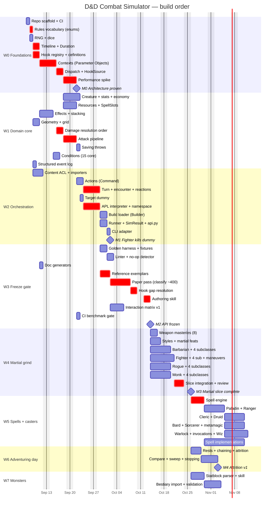

# Roadmap & Delegation Plan

Companion to [DESIGN.md](DESIGN.md). This document sequences the build so that
**decisions with the widest blast radius are made first**, and every interface a
later agent depends on exists — in code, not prose — before that agent starts.

51 tasks across 8 waves, `W0`–`W7`. DESIGN.md § Build order is the one-table
summary; this is the operational detail.

## Sequencing principles

1. **Vocabulary before everything.** `rules/enums.py` and the hook registry are
   imported by all ~610 content implementations. A rename after the grind begins
   is a mass edit; a rename in W0 is free.
2. **Interfaces are code, not documents.** A wave is only "done" when its public
   types exist and are importable, so the next wave's agents can write against a
   real signature instead of a description of one.
3. **Prove the expensive constraint early.** The performance budget is validated
   on a stub in W0, before any content is written against an architecture that
   might not hit it.
4. **The paper pass gates the grind.** All ~400 combat-relevant features are
   classified to a hook *before* any batch authoring starts. This is what
   prevents hook drift — the #1 risk — and it is cheap only if it happens before
   the API is frozen.
5. **Serialise the risky, parallelise the repetitive.** W0 and W3 are
   single-owner; W1–W2 are delegable but tightly sequenced. W4 onward fans out to
   many agents with near-zero coordination cost, because by then the contract is
   fixed and the work is mechanical.

## Delegation modes

| Mode | Meaning |
|---|---|
| 🔒 **Solo** | One owner, serial. High blast radius or cross-cutting; splitting it costs more than it saves. |
| 👥 **Delegable** | One agent, self-contained, clear inputs and outputs. Safe to hand off with a task packet. |
| 🚀 **Batch** | Many agents in parallel on disjoint files, following the authoring skill. Coordination cost ≈ 0. |

---

## Gantt

Calendar dates are **nominal** — a nominal day is one focused agent-session's
worth of work, not an estimate. The ordering and the dependency edges are the
real content; do not read a finish date off this chart.



### The critical path

`enums → hook registry → contexts → dispatch → perf spike → damage → attack →
turn loop → APL → exemplars → paper pass → hook gaps → authoring skill → the
grind → spell engine`

Everything on it is a decision that is expensive to revisit later. Everything off
it can slip without blocking anyone. **Nothing in W4 or later may start before
M2**, and that is the single most important scheduling constraint in the project.

Two branches run independently once M3 lands: **W6 depends only on W4, not on
W5**, so attrition against target dummies — the project's stated v1 goal — is
reachable with martials alone and does not wait for casters. W7 likewise forks
from W4. W5, W6 and W7 can proceed concurrently given enough agents.

---

## W0 — Foundations 🔒

One owner throughout. This wave decides the shape of every line of code written
afterwards.

| ID | Task | Mode | Depends | Produces (the interface) | Done when |
|---|---|---|---|---|---|
| w0a | Repo scaffold: `pyproject.toml`, ruff, mypy, pytest layout, `.gitignore` (`data/`), GitHub Actions | 🔒 | — | package importable, CI green | `pip install -e ".[dev]"` + `pytest` pass on an empty suite |
| w0b | **Rules vocabulary**: `Ability`, `DamageType`, `Condition`, `Mastery`, `WeaponProperty`, `Size`, `School`, `Outcome`, PB table, slot table | 🔒 | w0a | `rules/enums.py`, `rules/constants.py` | every 2024 damage type, condition and mastery present; no string literals anywhere downstream |
| w0c | RNG protocol + `PcgRng` + `ScriptedRng`; dice tokeniser | 🔒 | w0a | `core/rng.py`, `core/dice.py` | same seed ⇒ identical stream; `ScriptedRng` raises on over-draw |
| w0d | Timeline: `TimeKey`, `TurnPhase`, `Duration` + named constructors, `ResetManager`, `Reset` scopes | 🔒 | w0b | `core/timeline.py` | `TURN` vs `OWN_TURN` semantics covered by tests; `through_phase` proven in both directions |
| w0e | **Hook registry**: `Scope`, `Phase`, `HookSpec`, `define_hook`, and the 34 `define_hook()` calls | 🔒 | w0b | `hooks/registry.py`, `hooks/definitions.py` | unknown hook name raises; registry frozen and CI-guarded |
| w0f | **Contexts**: every `*Context` Parameter Object, attribute-locked, mutator methods only | 🔒 | w0e | `hooks/contexts.py` | direct field assignment raises `AttributeError`; wrong-phase mutation raises `PhaseError` |
| w0g | `@hook` decorator, `HookResult`, `HookSource.__init_subclass__` validation, `Dispatcher` | 🔒 | w0f | `hooks/decorator.py`, `source.py`, `dispatch.py` | bad signature is an `ImportError`; `once_per`/`costs` consumed only on `APPLIED` |
| w0h | **Performance spike**: stub creature + attack loop, benchmark harness | 🔒 | w0g | `tests/bench/` | **≥50k attack resolutions/sec/core measured**, or the architecture is revised now |

> **M0 — Architecture proven.** If w0h misses the budget, stop and revise before
> W1. This is the cheapest moment in the project to change the dispatch design.

## W1 — Domain core 👥

Interfaces from W0 are fixed, so these run largely in parallel. `w1e`/`w1f` stay
with the architect — they encode the two resolution orders everything else
trusts.

| ID | Task | Mode | Depends | Produces | Done when |
|---|---|---|---|---|---|
| w1a | `Creature` base, `StatBlock`, derived stats, `ActionEconomy` (action/bonus/reaction/movement, grants) | 👥 | w0g | `creatures/creature.py`, `stats.py`, `economy.py` | Action Surge's "grant another action" works via the economy alone |
| w1b | `ResourceSpec`, `Recovery`, `ResourcePool`, `SpellSlots` facade, `transaction()` unit of work | 👥 | w0g | `creatures/resources.py` | all 7 resource shapes in DESIGN.md expressible; rollback proven |
| w1c | `Effect`, `EffectStore`, `Stacking`, charge consumption, refresh/expire | 👥 | w0d | `creatures/effects.py` | Rage extend, Vex charge+time, Reckless hard stop all pass |
| w1d | Grid geometry: `GridPos`, 5 ft distance, LoS, cone/sphere/line templates | 👥 | w0c | `core/geometry.py` | Fireball's 20 ft sphere selects the correct cells |
| w1e | **Damage resolution order** — immunity → vulnerability → resistance → flat → halvings → temp HP → HP | 🔒 | w0f | `engine/damage.py` | Rage + Uncanny Dodge + vulnerability produces the hand-computed number |
| w1f | **Attack pipeline** — declare → roll → adv/disadv resolution → hit/crit/miss → damage → resolved | 🔒 | w1e | `engine/attack.py` | crit doubles `dice` and never `flat`; advantage is idempotent |
| w1g | Saving throws, DC calculation, save-for-half | 👥 | w1f | `engine/saves.py` | legendary resistance expressible |
| w1h | The 15 combat-relevant conditions as `Effect` subclasses | 👥 | w1c | `conditions/` | no `if creature.is_prone` anywhere in the engine |
| w1i | Structured event log (tuples; formatting deferred to the reporter) | 👥 | w0c | `core/log.py` | `--log-level=summary` skips per-roll records |

## W2 — Orchestration 👥

| ID | Task | Mode | Depends | Produces | Done when |
|---|---|---|---|---|---|
| w2a | **Content ACL**: fetch script, 5etools loader, `refSubclassFeature`/`refOptionalfeature` resolution, `classTableGroups` → `table_value()`, weapon + mastery import | 👥 | w0b | `content/` | 38 XPHB weapons and every class table import; no 5etools vocabulary escapes this package |
| w2b | `Action` Command base (`is_legal`/`execute`), Attack, Dash, Dodge, Disengage | 👥 | w1f | `actions/` | legality query provably cannot spend a resource |
| w2c | Initiative, turn loop, round loop, reaction audience + one-per-round, opportunity attacks | 🔒 | w2b | `engine/turn.py`, `encounter.py`, `reactions.py` | turn loop re-polls after every action |
| w2d | `TargetDummy` with every knob from DESIGN.md | 👥 | w1a | `creatures/dummy.py` | AC sweep 10–22 configurable from YAML |
| w2e | **APL**: AST whitelist compiler, `NamespaceSchema`, proxies, `Apl.allows()`, default policy | 🔒 | w2b | `apl/` | `self.ragging` fails at load with a suggestion; unmentioned riders default OFF |
| w2f | Build YAML pydantic schema + `Character` Builder | 👥 | w2a, w2e | `builds/` | unknown feature id fails with difflib suggestions |
| w2g | Monte Carlo runner, multiprocessing, stats, CIs; **`SimResult` + its JSON schema**; text/json renderers; the public API | 👥 | w2c | `sim/`, `reporting/`, `api.py` | identical seed ⇒ byte-identical event log; text output derived from the JSON, not parallel to it |
| w2h | Typer CLI as a **thin adapter** over `api.py`: `sim`, `day`, `compare`, `inspect`, `validate`, `trace`, `check`, `content fetch`, `bench` | 👥 | w2g | `cli.py` | every command in DESIGN.md § Verification runs; no simulation logic lives in `cli.py` |

> **M1 — A level-5 Fighter with a greatsword kills a dummy**, and every number is
> reproduced by a hand-computed golden test.

## W3 — Freeze gate 🔒

The highest-leverage wave in the project. Skipping or rushing it is how the grind
produces 400 subtly wrong features.

| ID | Task | Mode | Depends | Produces | Done when |
|---|---|---|---|---|---|
| w3a | Golden harness, `scripted_rng` fixture, `parts_by_source` assertions | 👥 | w2c | `tests/golden/conftest.py` | exact-integer assertions, no distributions |
| w3b | Feature linter + no-op detector + golden-coverage collection test, wired to `dndsim check` | 👥 | w3a | `tools/check_features.py`, `noop_report.py` | catches missing `# PHASE:`, private access, stray `import random` |
| w3c | Generate `docs/hooks.md` and `docs/apl.md` from the registries | 👥 | w0e | `tools/gen_docs.py` | CI fails if generated docs are stale |
| w3d | **Reference exemplars**: Rage, Sneak Attack, Uncanny Dodge, hand-built | 🔒 | w2e | `features/.../` + `TEMPLATE.py` | all three pass goldens; they become the skill's examples |
| w3e | **Paper pass**: classify all ~400 combat-relevant features to a hook | 🔒 | w3d | `docs/feature-hook-map.md` | every feature has a hook, a mode, and a batch assignment |
| w3f | **Hook gap resolution**: add the hooks the paper pass proved missing | 🔒 | w3e | `hooks/definitions.py` (final) | registry frozen; CI guard enabled |
| w3g | `.claude/skills/feature-authoring/SKILL.md` (≤3 pages) | 🔒 | w3f | the skill | a fresh agent implements a held-out feature correctly from it alone |
| w3h | Interaction matrix v1 (~50 hand-computed combos) | 🔒 | w3d | `tests/interaction/` | crit+rider, resistance+halving, chained attacks covered |
| w3i | CI benchmark gate (>10% sims/sec regression fails the build) | 👥 | w0h | CI config | a deliberate slowdown fails CI |

> **M2 — API frozen.** W4 may not begin before this milestone. Validate w3g by
> giving one agent a feature *not* in the exemplars and checking the output needs
> no correction.

## W4 — The martial grind 🚀

Fully parallel. Each batch touches disjoint files; the only shared surface is the
frozen API. Split any row further by subclass if you want more agents.

| ID | Task | Mode | Depends | Scope |
|---|---|---|---|---|
| w4a | Weapon masteries | 🚀 | w3g | Cleave, Graze, Nick, Push, Sap, Slow, Topple, Vex |
| w4b | Fighting styles + martial feats | 🚀 | w3g | Archery, Defense, Dueling, GWF, + GWM, Sharpshooter, Crossbow Expert, Dual Wielder, Charger, Grappler… |
| w4c | Barbarian 1–12 | 🚀 | w3g | core + Berserker, Wild Heart, World Tree, Zealot |
| w4d | Fighter 1–12 | 🚀 | w3g | core + Battle Master (20 maneuvers), Champion, Eldritch Knight, Psi Warrior |
| w4e | Rogue 1–12 | 🚀 | w3g | core + Arcane Trickster, Assassin, Soulknife, Thief |
| w4f | Monk 1–12 | 🚀 | w3g | core + Mercy, Shadow, Elements, Open Hand |
| w4g | Slice integration, `NEEDS_HOOK` triage, no-op sweep, **API freeze review** | 🔒 | w4a–w4f | the API is only *actually* frozen once this passes |

Eldritch Knight and Arcane Trickster need minimal spellcasting; either stub their
spell list behind `NEEDS_HOOK` or pull `w5a` forward for those two. This is the
one unresolved sequencing question in the plan, and it only becomes live when W4
starts.

## W5 — Spell engine + casters 🚀

| ID | Task | Mode | Depends | Scope |
|---|---|---|---|---|
| w5a | **Spell engine**: `Spell(Action)`, concentration + checks, slots/upcasting, AoE templates, save-for-half | 🔒 | w4g | the last high-blast-radius design decision |
| w5b | Paladin + Ranger | 🚀 | w5a | half-casters, martial-adjacent — the cheapest validation of w5a |
| w5c | Cleric + Druid | 🚀 | w5b | |
| w5d | Bard + Sorcerer | 🚀 | w5b | + 10 metamagic |
| w5e | Warlock + Wizard | 🚀 | w5b | + 28 invocations |
| w5f | Spell implementations, on demand | 🚀 | w5a | 212 combat spells, levels 0–6, pulled as the classes above need them |

## W6 — Adventuring day 👥

Depends on W4 only — reachable with martials and target dummies, before any
caster exists.

| ID | Task | Mode | Depends | Scope |
|---|---|---|---|---|
| w6a | Short/long rests, encounter chaining, attrition metrics | 👥 | w4g | `engine/adventuring_day.py` — the v1 headline output |
| w6b | `compare` harness, `--sweep`, adaptive stopping on CI width | 👥 | w6a | `sim/compare.py`, `sweep.py` — what makes it a sim rather than a calculator |

> **M4 — Attrition v1.** `dndsim day` reports how far a party gets before
> resources run dry, with confidence intervals. This is the project's stated
> goal; W5 and W7 are content expansion beyond it.

## W7 — Monsters 👥

| ID | Task | Mode | Depends | Scope |
|---|---|---|---|---|
| w7a | Statblock parser (Visitor) over the closed tag vocabulary + `.claude/skills/statblock-import/` | 👥 | w4g | `{@atkr}`, `{@hit}`, `{@h}`, `{@damage}`, `{@actSave}`, `{@dc}`, `{@recharge}` |
| w7b | Bestiary import, Multiattack handling, unparsed-content report | 🚀 | w7a | 503 XMM stat blocks; unparseable content is flagged, never approximated |

---

## Task packet template

What a delegated agent receives. Anything missing here is a coordination cost
paid at review time instead.

```markdown
## Task <id>: <title>
**Wave:** W<n>   **Mode:** 🚀 Batch   **Blocked by:** <ids, all merged>

### Read first
- DESIGN.md § <sections>
- .claude/skills/feature-authoring/SKILL.md
- Exemplars: features/classes/barbarian/rage.py, .../rogue/sneak_attack.py

### Scope
Implement exactly: <explicit list of feature ids>
Source data: data/class/class-<x>.json, entries with source == "XPHB"
Hook assignment: see docs/feature-hook-map.md rows <n–m>

### Out of scope
Anything under hooks/, engine/, core/ — CI rejects it. If a feature cannot be
expressed, declare NEEDS_HOOK and move on. Do not approximate.

### Definition of done
- [ ] every feature registered with a `source_ref` citation
- [ ] scaling numbers read via `table_value()`, never hardcoded
- [ ] one golden test per feature, exact integers
- [ ] `dndsim check` clean
- [ ] no feature reported by the no-op detector
- [ ] `pytest` green
```

## Standing rules for every agent

1. **Never touch `hooks/`, `engine/` or `core/`** in a content batch. CI enforces
   it. A needed change there goes back to the architect.
2. **`NEEDS_HOOK` is a success, not a failure.** Blocked-and-visible beats
   improvised-and-wrong. A batch that flags six features is more useful than one
   that silently approximates them.
3. **Never hardcode a scaling number.** It comes from `table_value()`.
4. **Never skip a golden test.** The collection test fails the build anyway.
5. **`dice` doubles on crits, `flat` does not.** `Reset.TURN` is any turn
   boundary; `Reset.OWN_TURN` is yours. These two are the likeliest subtle bugs in
   the entire project.
