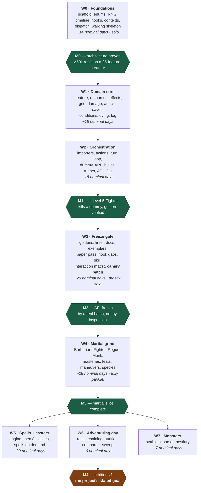

# Roadmap & Delegation Plan

Companion to [DESIGN.md](DESIGN.md). This document sequences the build so that
**decisions with the widest blast radius are made first**, and every interface a
later agent depends on exists — in code, not prose — before that agent starts.

57 tasks across 8 waves, `W0`–`W7`. DESIGN.md § Build order is the one-table
summary; this is the operational detail.

## Sequencing principles

1. **Vocabulary before everything.** `rules/enums.py` and the hook registry are
   imported by all ~630 content implementations. A rename after the grind begins
   is a mass edit; a rename in W0 is free.
2. **Interfaces are code, not documents.** A wave is only "done" when its public
   types exist and are importable, so the next wave's agents can write against a
   real signature instead of a description of one.
3. **Prove the expensive constraint against a hostile case.** The performance
   budget is validated in W0 on a creature with ~25 attached features, an
   8-condition APL and real movement — never on a stub. A stub clears the budget
   trivially and proves only that the harness runs, which spends the one
   milestone whose whole purpose is to make revision cheap.
4. **The paper pass gates the grind.** All ~400 combat-relevant features are
   classified to a hook *before* any batch authoring starts. This is what
   prevents hook drift, and it is cheap only if it happens before the API is
   frozen.
5. **Nothing is frozen until an outsider has used it.** M2 is not reached by
   inspecting three hand-built exemplars; it is reached when a canary batch —
   one small, semi-disposable slice authored by an agent that has never seen the
   API — comes back needing no correction. A wrong API found in the sixth
   parallel batch costs six times a wrong API found in the first.
6. **Serialise the risky, parallelise the repetitive.** W0 and W3 are
   single-owner; W1–W2 are delegable but tightly sequenced. W4 onward fans out to
   many agents with near-zero coordination cost, because by then the contract is
   fixed and the work is mechanical.
7. **The reviewer is the bottleneck, not the agents.** Roughly 130 nominal
   agent-days funnel through one person, so every deliverable is designed to be
   *reviewable in minutes* — disposition tables, quoted citations, arithmetic
   written out in goldens, a hard file-size cap. Batches are sized for a review
   sitting (15–25 features), not for agent capacity. A batch nobody has the
   attention left to check is worth less than half the batch, checked.

## Delegation modes

| Mode | Meaning |
|---|---|
| 🔒 **Solo** | One owner, serial. High blast radius or cross-cutting; splitting it costs more than it saves. |
| 👥 **Delegable** | One agent, self-contained, clear inputs and outputs. Safe to hand off with a task packet. |
| 🚀 **Batch** | Many agents in parallel on disjoint files, following the authoring skill. Coordination cost ≈ 0. |

---

## Wave dependencies

The per-wave tables below carry the complete edge list in their **Depends**
columns; this is the shape those edges make. There are deliberately no dates:
effort is quoted in **nominal days** — one focused agent-session's worth of work
— and a nominal day is not a calendar day, so a chart with an axis of calendar
dates reads as wrong within a week and gets discounted along with everything
else on it.



**Nothing in W4 or later may start before M2**, and that is the single most
important scheduling constraint in the project. Once M3 lands, three branches run
independently: **W6 depends only on W4, not on W5**, so attrition against target
dummies — the v1 goal — is reachable with martials alone and does not wait for
casters. W7 likewise forks from W4. Given enough agents, W5, W6 and W7 proceed
concurrently.

### The critical path

`enums → hook registry → contexts → dispatch → walking skeleton → perf spike →
damage → attack → turn loop → APL → exemplars → paper pass → hook gaps →
authoring skill → canary batch → the grind → spell engine`

Everything on it is a decision that is expensive to revisit later; everything off
it can slip without blocking anyone. Two entries were added to the chain after
review, and both for the same reason — they are the points at which a milestone
stops being self-certified:

- **The walking skeleton** (inside `w0h`) puts a featureless creature through the
  real dispatch path and real damage pipeline before resources, effects or grid
  exist. Without it, 25 tasks complete before anything runs end to end, and
  integration bugs surface at the most expensive possible moment.
- **The canary batch** (`w3j`) is the outsider that turns M2 from an assertion
  into a measurement.

---

## W0 — Foundations 🔒

One owner throughout. This wave decides the shape of every line of code written
afterwards.

| ID | Task | Mode | Depends | Produces (the interface) | Done when |
|---|---|---|---|---|---|
| w0a | Repo scaffold: `pyproject.toml`, ruff, mypy, pytest layout, `.gitignore` (`data/`), GitHub Actions | 🔒 | — | package importable, CI green | `pip install -e ".[dev]"` + `pytest` pass on an empty suite |
| w0b | **Rules vocabulary**: `Ability`, `DamageType`, `Condition`, `Mastery`, `WeaponProperty`, `Size`, `School`, `Outcome`, PB table, slot table | 🔒 | w0a | `rules/enums.py`, `rules/constants.py` | every 2024 damage type, condition and mastery present; no string literals anywhere downstream |
| w0c | RNG protocol + `PcgRng` + `ScriptedRng`; dice tokeniser; **per-iteration seeding** `mix(master_seed, iteration_index)` | 🔒 | w0a | `core/rng.py`, `core/dice.py` | same seed ⇒ identical stream; `ScriptedRng` raises on over-draw; **a run reproduces byte-for-byte across different `--jobs` values** |
| w0d | Timeline: `TimeKey`, `TurnPhase`, `Duration` + named constructors, `ResetManager`, `Reset` scopes | 🔒 | w0b | `core/timeline.py` | `TURN` vs `OWN_TURN` semantics covered by tests; `through_phase` proven in both directions |
| w0e | **Hook registry**: `Scope`, `Phase`, `HookSpec`, `define_hook`, and the 38 `define_hook()` calls — including `on_heal`, `on_temp_hp_gained`, `on_death_save`, `on_stabilize` | 🔒 | w0b | `hooks/registry.py`, `hooks/definitions.py` | unknown hook name raises; registry frozen and CI-guarded; the healing group exists **before** W6 needs it |
| w0f | **Contexts**: every `*Context` Parameter Object, attribute-locked, mutator methods only | 🔒 | w0e | `hooks/contexts.py` | direct field assignment raises `AttributeError`; wrong-phase mutation raises `PhaseError` |
| w0g | `@hook` decorator, `HookResult`, `HookSource.__init_subclass__` validation, `Dispatcher` | 🔒 | w0f | `hooks/decorator.py`, `source.py`, `dispatch.py` | bad signature is an `ImportError`; `once_per`/`costs` consumed only on `APPLIED` |
| w0h | **Walking skeleton**: a featureless creature attacking another through the *real* dispatch path and *real* damage pipeline, printing a result | 🔒 | w0g | `tests/bench/`, `tools/skeleton.py` | one command runs a fight end to end, before resources, effects or grid exist |
| w0i | **Pessimistic performance spike**: synthetic creature with ~25 attached `HookSource`s (≥15 on `on_hit`), an 8-condition APL with `target:` and `move:`, real grid movement; worker-startup cost measured separately | 🔒 | w0h | `tests/bench/` | **≥50k attack resolutions/sec/core on that configuration**, or the architecture is revised now |

> **M0 — Architecture proven.** If w0i misses the budget, stop and revise before
> W1. This is the cheapest moment in the project to change the dispatch design.
>
> The spike is deliberately hostile. A stub creature clears 50k/s trivially and
> proves only that the benchmark harness runs — which would spend the one
> milestone whose entire purpose is to make revision cheap. Measure `spawn`
> worker startup too: on Windows every worker re-imports the package and rebuilds
> every character, a cost `compare --sweep dummy.ac=10:22` pays thirteen times
> and an inner-loop benchmark never sees.

## W1 — Domain core 👥

Interfaces from W0 are fixed, so these run largely in parallel. `w1e`/`w1f` stay
with the architect — they encode the two resolution orders everything else
trusts.

| ID | Task | Mode | Depends | Produces | Done when |
|---|---|---|---|---|---|
| w1a | `Creature` base, `StatBlock`, derived stats, `ActionEconomy` (action/bonus/reaction/movement, grants) | 👥 | w0g | `creatures/creature.py`, `stats.py`, `economy.py` | Action Surge's "grant another action" works via the economy alone |
| w1b | `ResourceSpec`, `Recovery`, `ResourcePool`, `SpellSlots` facade, `transaction()` unit of work | 👥 | w0g | `creatures/resources.py` | all 7 resource shapes in DESIGN.md expressible; rollback proven |
| w1c | `Effect`, `EffectStore`, `Stacking`, charge consumption, refresh/expire | 👥 | w0d | `creatures/effects.py` | Rage extend, Vex charge+time, Reckless hard stop all pass |
| w1d | Grid geometry: `GridPos`, 5 ft distance, LoS, cone/sphere/line templates, **shortest-legal-route resolution** for a movement destination | 👥 | w0c | `core/geometry.py` | Fireball's 20 ft sphere selects the correct cells; a `move:` destination resolves to a route that provokes correctly on the way out of reach |
| w1e | **Damage resolution order** — immunity → vulnerability → resistance → flat → halvings → temp HP → HP | 🔒 | w0f | `engine/damage.py` | Rage + Uncanny Dodge + vulnerability produces the hand-computed number |
| w1f | **Attack pipeline** — declare → roll → adv/disadv resolution → hit/crit/miss → damage → resolved | 🔒 | w1e | `engine/attack.py` | crit doubles `dice` and never `flat`; advantage is idempotent |
| w1g | Saving throws, DC calculation, save-for-half | 👥 | w1f | `engine/saves.py` | legendary resistance expressible |
| w1h | The 15 combat-relevant conditions as `Effect` subclasses | 👥 | w1c | `conditions/` | no `if creature.is_prone` anywhere in the engine |
| w1i | Structured event log (tuples; formatting deferred to the reporter) | 👥 | w0c | `core/log.py` | `--log-level=summary` skips per-roll records |
| w1j | **Dying**: 0 HP, death saves, stabilise, healing application and temp HP, firing `on_death_save` / `on_stabilize` / `on_heal` / `on_temp_hp_gained` | 👥 | w1e | `engine/dying.py`, `engine/healing.py` | a downed PC rolls death saves; a heal at 0 HP restores consciousness; Relentless Endurance is expressible with no engine change |

## W2 — Orchestration 👥

| ID | Task | Mode | Depends | Produces | Done when |
|---|---|---|---|---|---|
| w2a | **Content ACL**: fetch script, 5etools loader, `refSubclassFeature`/`refOptionalfeature` resolution, `classTableGroups` → `table_value()`, weapon + mastery import | 👥 | w0b | `content/` | 38 XPHB weapons and every class table import; no 5etools vocabulary escapes this package |
| w2b | `Action` Command base (`is_legal`/`execute`), Attack, Dash, Dodge, Disengage | 👥 | w1f | `actions/` | legality query provably cannot spend a resource |
| w2c | Initiative, turn loop, round loop, reaction audience, **reaction regained at the start of each of your turns**, opportunity attacks, movement offers | 🔒 | w2b | `engine/turn.py`, `encounter.py`, `reactions.py` | turn loop re-polls after every action; a creature may react before its turn and again after it in the same round — the invariant is on the **turn** boundary, never the round |
| w2d | `TargetDummy` with every knob from DESIGN.md, including `movement_profile` (`static` / `closes_to_melee` / `kites_at`) | 👥 | w1a | `creatures/dummy.py` | AC sweep 10–22 configurable from YAML; a dummy that closes to melee provokes and is provoked, so the grid is exercised rather than decorative |
| w2e | **APL**: AST whitelist compiler, `NamespaceSchema`, proxies, `Apl.allows()`, default policy, and **all three clauses** — `if:`, `target:` (selector expressions), `move:` (positioning) | 🔒 | w2b | `apl/` | `self.ragging` fails at load with a suggestion; unmentioned riders default OFF; `target: "lowest_hp of enemies.in_reach"` and `move: "toward nearest of enemies until in_reach"` compile through the same whitelist. **All three clauses ship together** — adding a clause after builds exist is a schema migration across every YAML file in git |
| w2f | Build YAML pydantic schema + `Character` Builder | 👥 | w2a, w2e | `builds/` | unknown feature id fails with difflib suggestions |
| w2g | Monte Carlo runner, multiprocessing, stats, CIs; **`SimResult` + its JSON schema**; text/json renderers; the public API | 👥 | w2c | `sim/`, `reporting/`, `api.py` | identical seed ⇒ byte-identical event log **at any `--jobs`**; text output derived from the JSON, not parallel to it |
| w2h | Typer CLI as a **thin adapter** over `api.py`: `sim`, `day`, `compare`, `inspect`, `validate`, `trace`, `check`, `content fetch`, `bench` | 👥 | w2g | `cli.py` | every command in DESIGN.md § Verification runs; no simulation logic lives in `cli.py` |

> **M1 — A level-5 Fighter with a greatsword kills a dummy**, and every number is
> reproduced by a hand-computed golden test.

## W3 — Freeze gate 🔒

The highest-leverage wave in the project. Skipping or rushing it is how the grind
produces 400 subtly wrong features.

Two tasks changed shape after review. **`w3e` is batched rather than solo**: 400
prose features classified by hand, alone, is the most tedious task in the plan
sitting directly on the crux, and it degrades quietly because nothing downstream
detects a sloppy classification until features are written against it. Batching
the rows and triaging only the low-confidence and gap buckets costs a fraction of
the attention and spends it where it decides something. **`w3j` is new** — see
M2.

| ID | Task | Mode | Depends | Produces | Done when |
|---|---|---|---|---|---|
| w3a | Golden harness, `scripted_rng` fixture, `parts_by_source` assertions | 👥 | w2c | `tests/golden/conftest.py` | exact-integer assertions, no distributions |
| w3b | Feature linter + no-op detector + golden-coverage collection test, wired to `dndsim check` and to **every batch PR** | 👥 | w3a | `tools/check_features.py`, `noop_report.py` | catches missing `# PHASE:`, private access, stray `import random`, `try`/`except` or `hasattr` in `features/`, a feature file over 60 lines, a `source_ref` without a quoted rules sentence, a `dndsim` import inside an analytic expectation, and any write outside a packet's file allowlist |
| w3c | Generate `docs/hooks.md` and `docs/apl.md` from the registries | 👥 | w0e | `tools/gen_docs.py` | CI fails if generated docs are stale |
| w3d | **Reference exemplars**: Rage, Sneak Attack, Uncanny Dodge, hand-built | 🔒 | w2e | `features/.../` + `TEMPLATE.py` | all three pass goldens; they become the skill's examples |
| w3e | **Paper pass**: classify all ~400 combat-relevant features to a hook. **Batched against a fixed row schema**, then human-triaged | 🚀 → 🔒 | w3d | `docs/feature-hook-map.md` | every feature has a row: `feature_id \| hook \| scope \| phase \| resource \| once_per \| confidence \| gap_kind`. Gaps are classified **additive** (a new hook) or **structural** (a missing context field, or a hook firing at the wrong pipeline point) |
| w3f | **Hook gap resolution**: add the hooks the paper pass proved missing; fix the structural ones | 🔒 | w3e | `hooks/definitions.py` (final) | registry frozen; CI guard enabled. **Budget against the structural count, not the total** — additive gaps are an append, structural gaps touch `hooks/contexts.py` and `engine/` |
| w3g | `.claude/skills/feature-authoring/SKILL.md` (≤3 pages) | 🔒 | w3f | the skill | a fresh agent implements a held-out feature correctly from it alone |
| w3h | Interaction matrix v1 (~50 hand-computed combos) | 🔒 | w3d | `tests/interaction/` | crit+rider, resistance+halving, chained attacks covered |
| w3i | CI benchmark gate: median-of-N with warmup, against a same-run microbenchmark baseline | 👥 | w0i | CI config | a deliberate slowdown fails CI **and a rerun on unchanged code does not**. Tracked-but-non-blocking until its variance is known |
| w3j | **The canary batch**: Rogue core + Thief only, authored by one agent from the skill alone, treated as semi-disposable | 🚀 | w3g | `features/classes/rogue/`, an API-friction report | the batch lands needing no correction — or the API is revised and the batch is rewritten |
| w3k | **Reviewer-pass harness**: a read-only review prompt that sees the quoted rules text and the code but not the author's reasoning | 👥 | w3d | `.claude/skills/feature-review/` | run against w3j; it finds at least one real discrepancy or is judged useless and cut |

> **M2 — API frozen.** W4 may not begin before this milestone.
>
> The freeze is **measured by w3j, not asserted by w3d**. Three hand-built
> exemplars prove the exemplars compile; they prove nothing about an author who
> has never seen the API. The canary is one small self-contained slice — the
> smallest in the project — written by an outsider against the frozen contract,
> and its job is to be wrong cheaply. Every friction it reports is a friction six
> parallel batches would otherwise have hit simultaneously, at six times the
> rework.
>
> Arcane Trickster sits inside this slice, which makes w3j the natural place to
> settle the Eldritch Knight / Arcane Trickster spellcasting question below rather
> than discovering it when W4 starts.

## W4 — The martial grind 🚀

Fully parallel, and only now — the canary batch `w3j` has already run one slice
through the frozen API and the frictions it found are fixed. Each batch touches
disjoint files; the only shared surface is the frozen API. Every row is sized for
one review sitting (15–25 features); split further by subclass if you want more
agents, never merge rows to get fewer.

| ID | Task | Mode | Depends | Scope |
|---|---|---|---|---|
| w4a | Weapon masteries | 🚀 | w3j | Cleave, Graze, Nick, Push, Sap, Slow, Topple, Vex |
| w4b | Fighting styles + martial feats | 🚀 | w3j | Archery, Defense, Dueling, GWF, + GWM, Sharpshooter, Crossbow Expert, Dual Wielder, Charger, Grappler… |
| w4c | Barbarian 1–12 | 🚀 | w3j | core + Berserker, Wild Heart, World Tree, Zealot |
| w4d | Fighter 1–12 | 🚀 | w3j | core + Champion, Eldritch Knight, Psi Warrior. **Maneuvers are not in this row** |
| w4d2 | **Battle Master maneuvers** | 🚀 | w3j | the 20 maneuvers + superiority dice. Split out because it is a sub-project, not a subclass: one resource, one rider shape, its own save DC — which also makes it an unusually clean batch on its own |
| w4e | Rogue 1–12 — *remainder after the canary* | 🚀 | w3j | Arcane Trickster, Assassin, Soulknife (core + Thief already landed in `w3j`) |
| w4f | Monk 1–12 | 🚀 | w3j | core + Mercy, Shadow, Elements, Open Hand |
| w4h | **Species traits** | 🚀 | w3j | the ~18 combat-relevant 2024 traits — Relentless Endurance, Breath Weapon, Savage Attacks, Large Form… |
| w4g | Slice integration, `NEEDS_HOOK` / `APPROXIMATED` triage, no-op sweep, **API freeze review** | 🔒 | w4a–w4f, w4d2, w4h | every disposition row is resolved: implemented, hook queued, or approximation accepted in writing |

Eldritch Knight and Arcane Trickster need minimal spellcasting: either stub their
spell list behind `NEEDS_HOOK` or pull `w5a` forward for those two. **This is
settled during `w3j`**, not when W4 starts — Arcane Trickster sits inside the
canary slice, so the canary learns which option is cheaper at the moment that
information is still free.

## W5 — Spell engine + casters 🚀

| ID | Task | Mode | Depends | Scope |
|---|---|---|---|---|
| w5a | **Spell engine**: `Spell(Action)`, concentration + checks, slots/upcasting, AoE templates, save-for-half | 🔒 | w4g | the last high-blast-radius design decision |
| w5b | Paladin + Ranger | 🚀 | w5a | half-casters, martial-adjacent — the cheapest validation of w5a |
| w5c | Cleric + Druid | 🚀 | w5b | |
| w5d | Bard + Sorcerer | 🚀 | w5b | + 10 metamagic |
| w5e | Warlock + Wizard | 🚀 | w5b | + 28 invocations |
| w5f | Spell implementations, on demand | 🚀 | w5a | 212 combat spells, levels 0–6, pulled as the classes above need them |

## W6 — Adventuring day 👥

Depends on W4 only — reachable with martials and target dummies, before any
caster exists.

| ID | Task | Mode | Depends | Scope |
|---|---|---|---|---|
| w6a | Short/long rests, hit dice, encounter chaining, the **stop condition** (TPK or `party.retreat_when`), attrition metrics | 👥 | w4g, w1j | `engine/adventuring_day.py` — the v1 headline output |
| w6b | `compare` harness, `--sweep`, adaptive stopping on CI width | 👥 | w6a | `sim/compare.py`, `sweep.py` — what makes it a sim rather than a calculator |

> **M4 — Attrition v1.** `dndsim day` reports how far a party gets before
> resources run dry, with confidence intervals. This is the project's stated
> goal; W5 and W7 are content expansion beyond it.
>
> Note the dependency on `w1j`. The headline number is decided as much by the
> dying rules and the retreat threshold as by any damage calculation — see
> DESIGN.md § Context for the settled stop condition. `retreat_when` is a party
> YAML knob precisely so that `--sweep` over it is an experiment rather than an
> assumption buried in the engine.

## W7 — Monsters 👥

| ID | Task | Mode | Depends | Scope |
|---|---|---|---|---|
| w7a | Statblock parser (Visitor) over the closed tag vocabulary + `.claude/skills/statblock-import/` | 👥 | w4g | `{@atkr}`, `{@hit}`, `{@h}`, `{@damage}`, `{@actSave}`, `{@dc}`, `{@recharge}` |
| w7b | Bestiary import, Multiattack handling, unparsed-content report | 🚀 | w7a | 503 XMM stat blocks; unparseable content is flagged, never approximated |

---

## Task packet template

What a delegated agent receives. Anything missing here is a coordination cost
paid at review time instead.

```markdown
## Task <id>: <title>
**Wave:** W<n>   **Mode:** 🚀 Batch   **Blocked by:** <ids, all merged>

### Read first
- .claude/skills/feature-authoring/SKILL.md
- docs/hooks.md and docs/apl.md (generated — the authoritative surface)
- Exemplars: features/classes/barbarian/rage.py, .../rogue/sneak_attack.py
- Seed feature from THIS batch, already implemented: <path>

NOT DESIGN.md. It is a document for the architect; prose-heavy architecture in a
batch context window produces features consistent with the vibe and wrong about
the rule.

### Scope
Implement exactly: <explicit list of 15-25 feature ids>
Source data: data/class/class-<x>.json, entries with source == "XPHB"
Hook assignment: see docs/feature-hook-map.md rows <n–m>
Files you may write: <explicit allowlist> — CI rejects anything else

### Out of scope
Anything under hooks/, engine/, core/, or outside the allowlist above.
Multiclassing and magic items are out of v1 scope entirely.

### When a feature does not fit
Two markers, both of which are successes:
- NEEDS_HOOK = "on_X: <description>"    cannot be expressed at all
- APPROXIMATED = "<what is lost, why>"  expressible only approximately

In a batch of 20, expect 2-5 of these. **A batch reporting zero will be
spot-audited**, because the failure mode this project is most exposed to is a
feature that is expressible-but-lossy landing silently as "implemented".

### Definition of done
- [ ] every feature registered with a `source_ref` carrying the QUOTED rules
      sentence, not just a page citation
- [ ] scaling numbers read via `table_value()`, never hardcoded
- [ ] one golden test per feature, with the expected number written out as
      arithmetic in a comment, derived from the rules text and not from your
      implementation
- [ ] every feature file under 60 lines
- [ ] `dndsim check` clean
- [ ] no feature reported by the no-op detector
- [ ] `pytest` green

### Report back
- [ ] **Disposition table**: one row per feature id —
      implemented | needs_hook | approximated — with the reason for the last two
- [ ] `dndsim bench` delta
- [ ] no-op report output
```

The disposition table is the artefact that actually gets reviewed. Everything
else in the checklist is enforced by CI; the table is where a human decides
whether the batch is honest.

## Standing rules for every agent

1. **Never touch `hooks/`, `engine/` or `core/`** in a content batch, or any file
   outside your packet's allowlist. CI enforces it. A needed change there goes
   back to the architect.
2. **Both escape valves are successes.** `NEEDS_HOOK` when a feature cannot be
   expressed; `APPROXIMATED` when it can be expressed only lossily.
   Blocked-and-visible beats improvised-and-wrong, and lossy-and-declared beats
   lossy-and-silent. A batch that flags six features is more useful than one that
   silently approximates them — and a batch that flags none is the one that gets
   audited.
3. **Never hardcode a scaling number.** It comes from `table_value()`.
4. **Never skip a golden test, and write the arithmetic out.** The collection
   test fails the build anyway; the comment is what makes the number reviewable
   without re-deriving it.
5. **`source_ref` quotes the rules sentence.** A page citation alone is a linter
   error. It is what lets a reviewer check the feature without opening the book.
6. **`dice` doubles on crits, `flat` does not.** `Reset.TURN` is any turn
   boundary; `Reset.OWN_TURN` is yours. These two are the likeliest subtle bugs in
   the entire project.
7. **No `try`/`except`, no `hasattr`/`getattr`, no file over 60 lines.** Defensive
   blocks swallow the fail-loud design, attribute probing routes around the typed
   contract, and a feature needing more than 60 lines is a design smell that goes
   back to the architect rather than getting written.
8. **Never add a dependency, and never write test harness code.** Test cases
   against the existing fixture only — otherwise there are six competing
   `conftest.py` helpers by the end of W4.
